# FocusFlow

**An intent-first video recommender that acts as a gatekeeper, not a feed.**

Live: **https://focus-flow.uk** · [中文版 README](README.zh.md) · [Architecture](docs/architecture.md) · [Design decisions](docs/decisions.md) · [Source](src/) · [Roadmap](docs/roadmap.md)

> This repository open-sources the **AI agent core** of FocusFlow: the LLM agent layer (planner, judges, profiler, assistant, channel discovery), all prompts, the orchestrator and the code-only pipeline stages, the retrieval tools the agent executes, and the hybrid vector + full-text retrieval layer, plus the architecture docs and the reasoning behind key decisions. The web frontend, the HTTP API, authentication, quota ledgers and the rest of the storage layer stay private. See [What is open and what is not](#what-is-open-and-what-is-not).

---

## The problem

Mainstream video platforms optimise for watch time. You open the app with a purpose and leave an hour later having been fed. FocusFlow inverts the contract: **the user declares intent first, then the system filters the world down to what fits that intent.** Nothing outside the declared intent appears, and every single thing that was filtered out is written to a ledger the user can inspect and appeal.

It is built on top of YouTube's public Data API, so it can never be as data-rich as YouTube's own ranker. The design bet is that a system with *less* data but *explicit* intent can produce a better session than a system with all the data and none of the intent.

## What it does

| Product principle | How it shows up |
|---|---|
| **Intent before content** | Four modes (focus, entertainment, explore, wind-down), each with its own content whitelist, duration window and quality bar. You pick a mode before you see a single card. You can also type a one-off intent sentence that overrides the plan for that session. |
| **A protective viewing room** | Embedded player with no sidebar recommendations and no autoplay. "Open on YouTube" exists, but it is a deliberate, visible exit. |
| **Finite by design** | One refresh produces one batch of cards plus a folded section. There is no infinite scroll. When you finish the batch, you are done. |
| **Nothing is a black box** | Every rejected video is recorded with the stage and rule that rejected it. A side panel shows the ledger. The user can appeal a rejection, and an accepted appeal becomes a standing exemption. |
| **No visible profiling** | The system keeps a preference state internally, but the user never sees a "here is what we think you are" panel. Personalisation is driven by entries the user writes in their own words and can edit or delete. |
| **Transparent progress** | Results stream in wave by wave over Server-Sent Events, and the UI shows which stage is working. The previous session's result is painted first (measured at 21 ms) so there is never a blank screen. |

## How it works

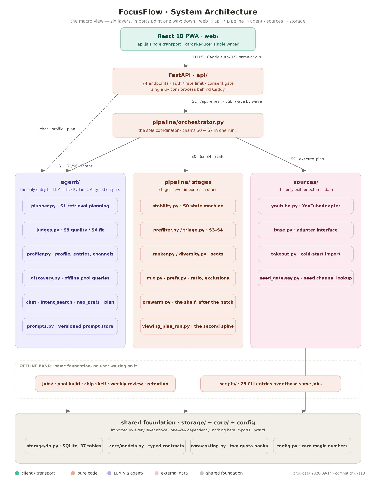

One refresh runs through a fixed pipeline. Stages never import each other; a single orchestrator chains them and streams results as they become available.

| Stage | Name | Cost | Role |
|---|---|---|---|
| S0 | State | code | Per-user, per-mode state machine decides whether to re-plan or reuse the last plan. |
| S1 | Planning | LLM, with coded fallback | Picks 2–6 retrieval strategies and how much API quota each may spend. |
| S2 | Retrieval | YouTube API | Executes the plan across subscriptions, a curated channel pool, search and a local candidate library. |
| S3 | Prefilter | code | Blocklists, duration window, category rules. Zero cost. |
| S4 | Triage | code | Splits candidates into *direct pass*, *cached verdict* and *needs review*. This is the LLM cost gate. |
| S5 | Quality judge | LLM | Reviews only the *needs review* bucket, in batches, concurrently. |
| S6 | Mode-fit judge | LLM | Rules on whether each candidate fits the declared mode and the user's own profile entries. Backed by a 7-day cache. |
| S7 | Exclusions | code | Applies the user's per-mode excluded content types. |
| rank | Ranking | code | Weighted score, then seat rules for diversity, followed channels and user-named seed channels. |

A conservation check closes every run: `videos in == cards shown + cards folded + ledger rows`. If the equation breaks, it is logged as an error. It is the first thing read whenever card counts look wrong, and it has settled more than one wrong hypothesis.

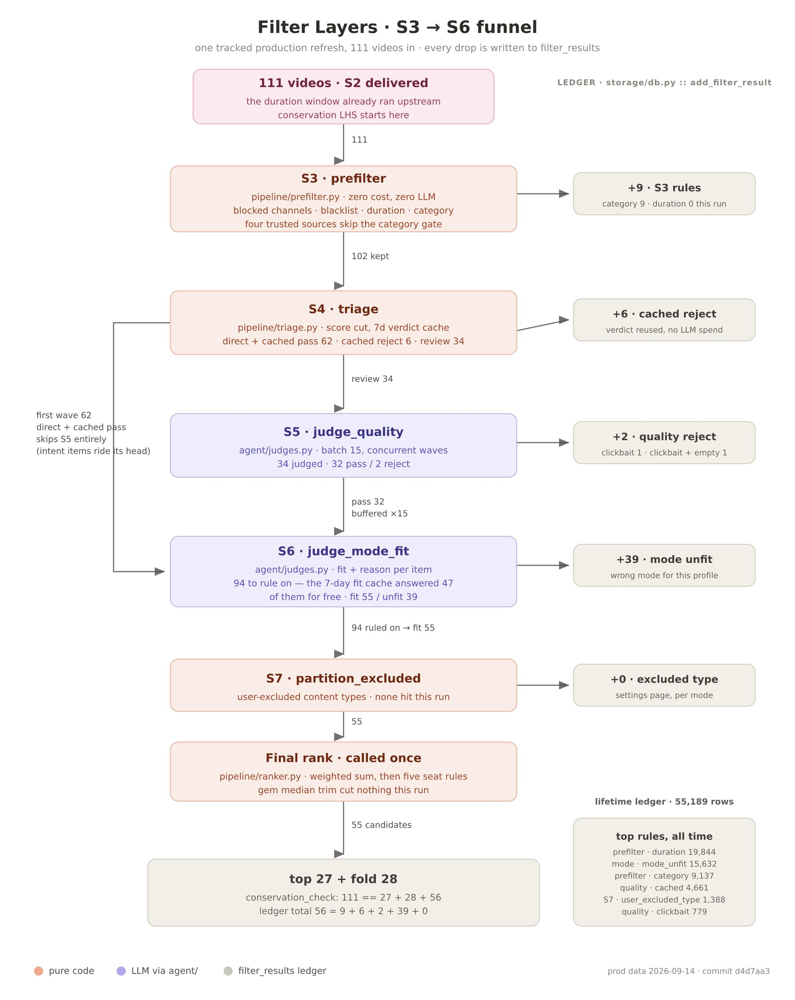

More depth, including the orchestrator flow, the agent layer and the state machine, is in [docs/architecture.md](docs/architecture.md).

## Numbers

All figures are from the production deployment or the repository as of late September 2026.

| | |
|---|---|
| Backend (Python, excluding tests and scripts) | ~23,800 lines |
| Frontend (React) | ~9,100 lines |
| Automated tests | 1,347 backend (pytest) + 497 frontend (vitest), all green |
| Commits | 664 between 2026-06-10 and 2026-09-27, still active |
| HTTP/SSE endpoints | 74 |
| Database tables | 37, all behind one access module |
| Versioned prompts | 15, full text in `src/agent/prompts.py` |
| Full refresh wall time | 164.9 s → **58.3 s** (−65 %) after a measurement-driven concurrency pass on the two LLM stages |
| First paint on return visit | 21 ms (previous result painted from a local pool before the pipeline starts) |

## Stack

- **Backend:** Python 3, FastAPI, SQLite (single file, WAL), `sqlite-vec` + FTS5 with `jieba` for hybrid Chinese/English retrieval, Pydantic AI for typed LLM outputs.
- **LLM:** Claude models through the Anthropic API. Cost-tiered: a small model by default, a larger one only where it was shown to matter. Every LLM call lives in one layer and has a pure-code fallback, so the product never 500s because a model is down.
- **Data source:** YouTube Data API v3 behind a single adapter, with per-call quota accounting across two separate daily budgets.
- **Frontend:** React 18, Vite, Tailwind CSS v4, PWA, no router and no global state library by choice. Full Chinese/English i18n with a hand-rolled provider.
- **Ops:** One small VPS, one process, Caddy for TLS. Rate limiting, CSP, consent gate, account deletion and data export, 30-day retention sweeps.

## Screenshots

Production, English UI. The interface is fully bilingual (the 中 toggle at the top).

| Focus mode, batch complete. Mode picker, one-off intent box, quota bar. | Cards streaming in. The previous batch is painted while the new one arrives. |
|---|---|
| 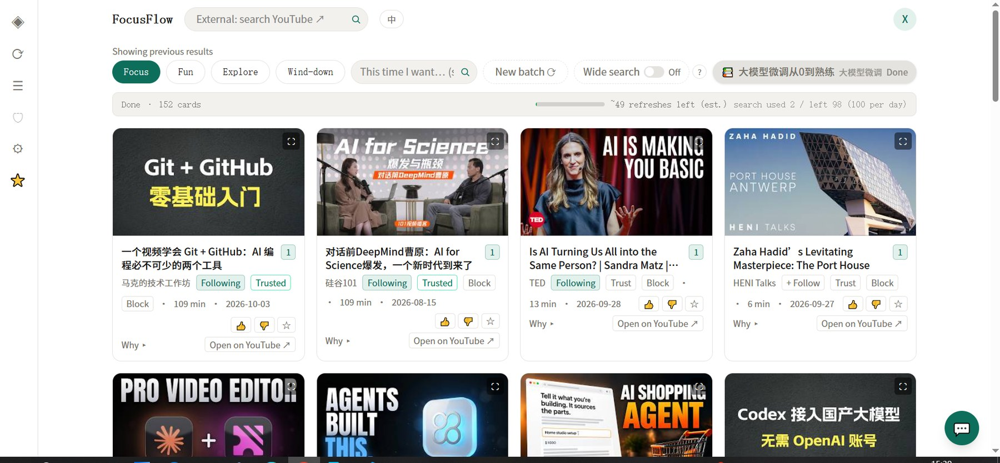 | 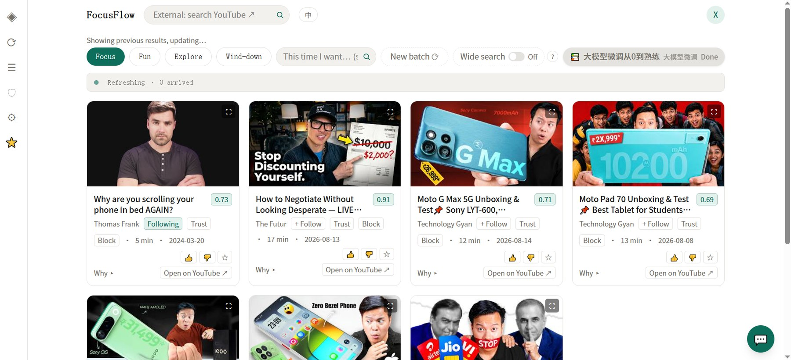 |

| A multi-day viewing plan, stage view. | Drafting a plan with the assistant. |
|---|---|
| 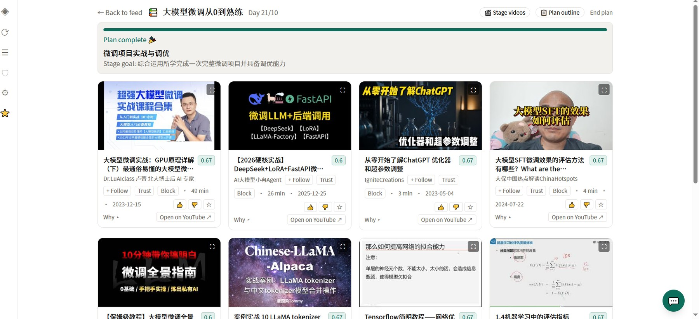 | 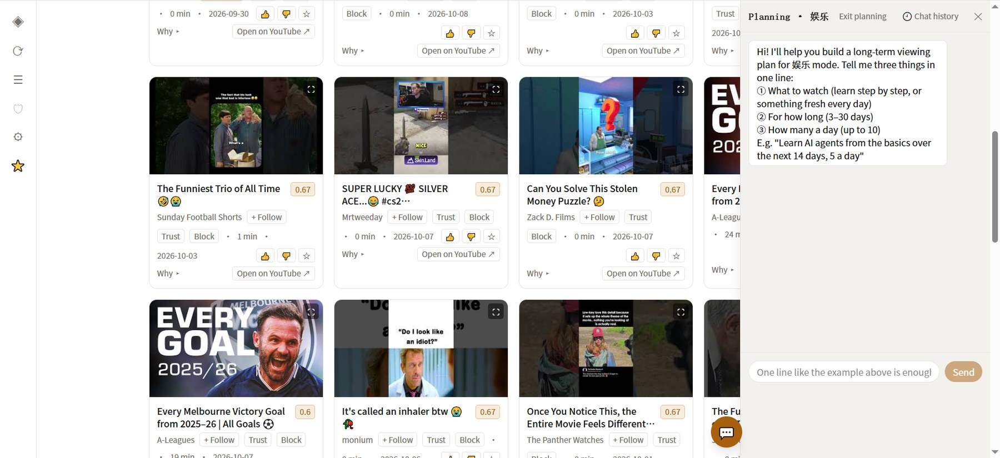 |

| Settings: excluded types per mode, source ratio, subscription import. | Profile entries, written by the user, reorderable, with per-entry share. |
|---|---|
| 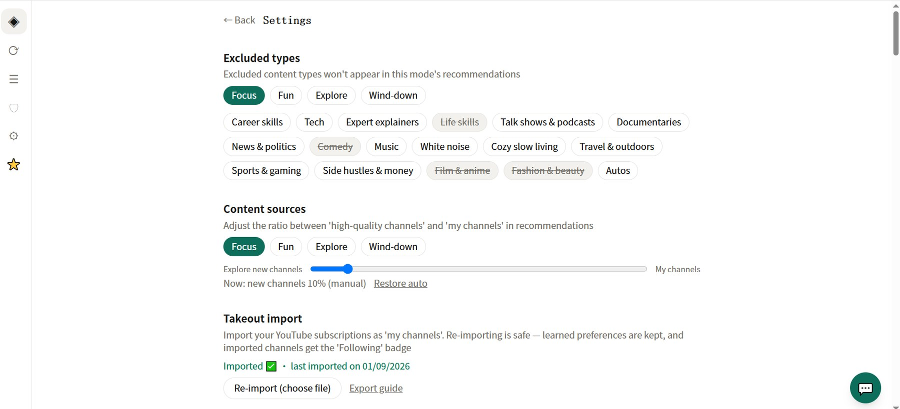 | 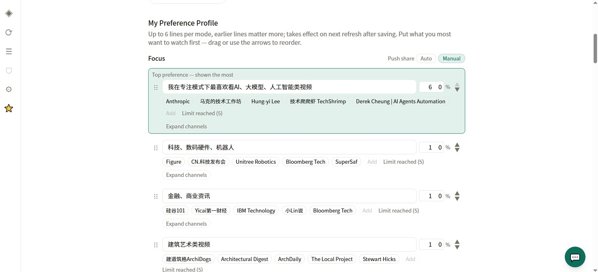 |

| Favourites with folders. | Dislike manager, over-exposure ledger, data export and account deletion. |
|---|---|
| 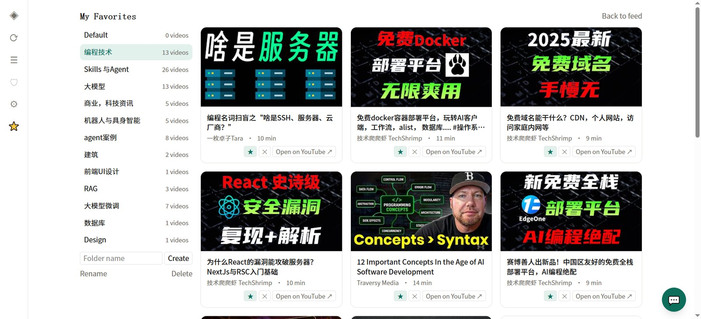 | 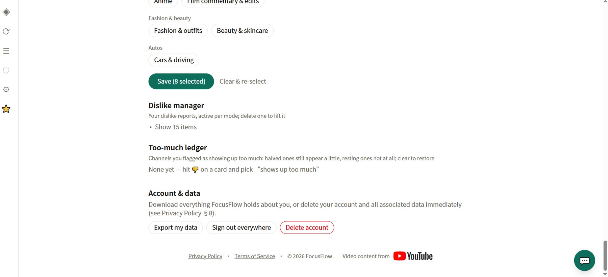 |

| Filter transparency, Chinese UI. Every dropped card is listed with the rule that dropped it, and can be appealed. | Mobile layout: single-column cards, per-card follow/trust/block, six-tab bottom bar. |
|---|---|
| 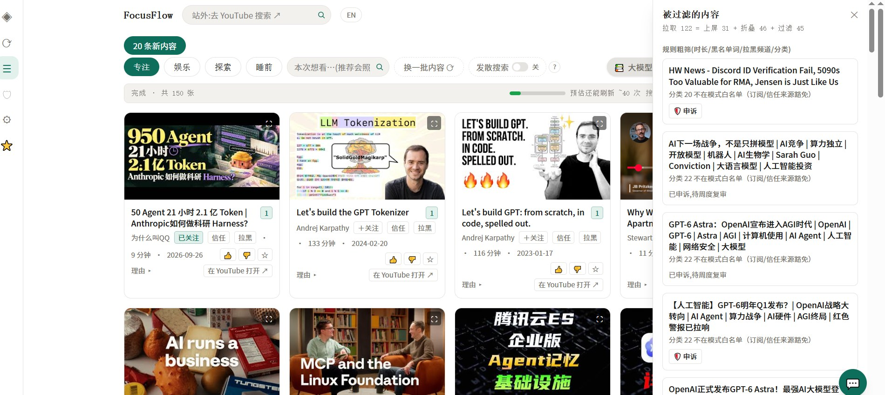 |  |

## My role

Solo project: product definition, architecture, implementation, evaluation and operations. Built as my master's dissertation project in 2026 (*FocusFlow: A Proactive, Context-Aware Video Recommendation AI Agent Built on Explicit User Intent*), then kept in production and iterated on after submission.

The codebase was written with AI pair-programming tools under a spec → plan → test → review workflow. Every batch starts as a written spec with numbered decisions, lands with tests, and is checked against production logs after deployment. I consider that workflow part of the deliverable.

## What is open and what is not

**Open (MIT, under `src/` and `tests/`):**

| Path | What it is |
|---|---|
| `src/agent/` | Every LLM call in the system: S1 planner, S5 quality judge, S6 mode-fit judge, profile extractor, chat assistant, intent-search expansion, negative-preference parser, viewing-plan drafter, channel discovery (query generation and candidate judging). |
| `src/agent/prompts.py` | All prompts, full text, in one versioned registry. |
| `src/pipeline/` | The orchestrator (S0–S7, wave scheduling, conservation check) and the code-only stages: prefilter, triage, ranker, diversity seats, source mix, preferences, plan stability, prewarm. |
| `src/core/` | Typed models shared by all layers, the mode-fit cache key, LLM usage metering, log redaction, cost estimation. |
| `src/sources/` | The tool layer: `base.py` defines the source-adapter contract (one method per planner tool); `youtube.py` implements it on the YouTube Data API and contains `execute_plan`, which runs the planner's strategies with quota accounting; `embeddings.py` is the embedding-model entry point; `takeout.py` imports Google Takeout subscriptions. |
| `src/storage/retrieval.py` | Hybrid retrieval: sqlite-vec KNN + SQLite FTS5 (jieba-segmented Chinese), profile-entry reranking, the S6 mode-fit cache and the local candidate library. |
| `src/api/sse.py` | The bridge that turns the orchestrator's async batches into a Server-Sent Events stream. |
| `src/config.py` | The real constants used by the code above: thresholds, seat counts, batch sizes, model tiers. |
| `tests/` | A selection of offline tests for the agent layer and orchestrator (no database, no network, no API keys). |

**Not open:**

- `src/storage/db.py` is a **facade**: it re-exports the real retrieval functions and lists signature-only stubs (raising `NotImplementedError`) for the rest of the storage layer — users, auth, quota ledgers, preferences, filter records — which is private.
- The React frontend, the FastAPI routes, authentication, rate limiting and trial-account code.
- The offline channel-pool job that drives discovery (budgets, rotation, scheduling) and the pool itself.
- Deployment and operations material.

The code is therefore **readable but not runnable end-to-end**. The tests run on their own:

```bash
pip install -r requirements.txt
pytest            # 103 passed, 1 skipped
```

## License

Source code under `src/` and `tests/` is licensed under the [MIT License](LICENSE). Text, diagrams and screenshots (README files, `docs/`, `assets/`) are licensed under [CC BY-NC-ND 4.0](LICENSE-docs).
