# FocusFlow Architecture

[中文](architecture.zh.md)

This document goes from "why build this" down to "what each piece of code does", one level of depth at a time: background research first, then the core paradigm and the overall architecture, then each module, and finally the rules and numbers of every stage and mechanism. It describes **what the current code actually does**. Every number comes from [`src/config.py`](../src/config.py), with the constant name in backticks so you can find it in the source.

---

## 0. Document map

### 0.1 How to read this

| If you want to know | Read | Depth |
|---|---|---|
| What problem this solves and why YouTube | §1 Background research | Context |
| How it differs from "a smarter feed" | §2 Core paradigm | Concept |
| What happens in one refresh, end to end | §3 Overall architecture | System |
| What each layer owns and where its boundaries are | §4 Modules | Module |
| The exact rules and numbers of a stage or mechanism | §5 Finer level | Code |
| What happens when something fails | §6 Reliability and degradation matrix | Operations |
| Which source files implement a section | §7 Code map | Index |

### 0.2 Conventions

- **Constants** are written like `TOP_N`; their values are whatever `src/config.py` says. A few values live in the private API or storage layer (cooldown durations, for example). Those are marked "private config": the mechanism is described, but no constant name is given.
- **"Private"** covers the frontend, HTTP routes, authentication, rate limiting, trial accounts, quota-ledger operations, the offline channel-pool job's budgets and scheduling, and deployment. None of it is in this repository, and this document only mentions it at overview level.
- **Diagrams** in `assets/diagrams/` were all rendered from one tracked production refresh (2026-09-14), so the numbers on them are real. Where a diagram and the text disagree, the text (that is, the current code) wins.

### 0.3 Source tree at a glance

| Directory | Contents |
|---|---|
| [`src/agent/`](../src/agent/) | Every LLM call: the planner, both judges, profile helpers, the chat assistant, intent expansion, the negative-preference adjudicator, the viewing-plan drafter, channel discovery. [`prompts.py`](../src/agent/prompts.py) is the versioned prompt registry |
| [`src/pipeline/`](../src/pipeline/) | The orchestrator [`orchestrator.py`](../src/pipeline/orchestrator.py) (S0–S7, wave scheduling, conservation check) and the code-only stages |
| [`src/sources/`](../src/sources/) | The tool layer: the adapter contract `base.py`, the YouTube implementation and plan executor `youtube.py`, the embedding-model entry point, the Takeout importer |
| [`src/storage/`](../src/storage/) | `retrieval.py` (hybrid retrieval, verdict cache, candidate library; real code); `db.py` (a facade: retrieval functions re-exported, everything else signature stubs) |
| [`src/core/`](../src/core/) | Shared models, cost estimation, the cache fingerprint, LLM metering, log redaction, profile sections, viewing-plan models |
| [`src/api/sse.py`](../src/api/sse.py) | Turns the orchestrator's async batches into Server-Sent Events |
| [`src/config.py`](../src/config.py) | Every threshold, weight, seat count, batch size and model tier, the four modes, the fallback plans |

---

## 1. Background research

### 1.1 The problem and its algorithmic roots

Mainstream video platforms rank for **engagement**: watch time, interaction rate, return visits. That objective comes from the business model and does not line up with what the user is trying to do right now. The visible symptom is content that is wrong for the moment: fast, loud comedy while you are working, high-arousal content at bedtime, lectures when you only wanted to unwind.

Take YouTube. Its recommender traces back to Covington et al., *Deep Neural Networks for YouTube Recommendations* (RecSys 2016): a two-stage architecture of candidate generation plus ranking, with the ranking stage trained on **expected watch time**. The system has since grown into multi-objective ranking that also weighs satisfaction, diversity and freshness, but three structural traits have not changed:

| Trait | Consequence |
|---|---|
| **Behaviour over declaration** | The system infers what you want from what you did. It never asks what you want to watch now |
| **Learning from vast, noisy implicit signals** | It learns "what keeps you watching", not "what is good for you" |
| **Modelling a stable long-term identity, not the current situation** | Your whole history becomes one profile, but nobody watches videos in their "average" state |

FocusFlow does not try to out-rank that system. It changes the **contract**: the user declares intent first, and the system searches inside that intent.

### 1.2 Data-source compliance: why the YouTube Data API v3

Which data a third-party system can get, and how, has to be answered before the first line of code. The early-2026 review of five candidate platforms:

| Platform | Official API | Known enforcement (at time of review) | Decision |
|---|---|---|---|
| **YouTube** | Data API v3, public, free daily quota, standard developer terms | None; development is encouraged | **Adopted** |
| Bilibili | Open platform for companies only; individuals cannot join | Legal letters to a third-party API documentation project and a third-party client | Rejected |
| TikTok | Research API requires an academic institution | Very low approval rate for individuals | Rejected |
| Xiaohongshu | Merchant APIs only, no content discovery API | Criminal conviction for scraping via reverse-engineered request signing, plus a large civil award | Rejected |
| Instagram | Basic Display API shut down; Graph API is business-only and cannot read other people's content | The platform has sued scrapers | Rejected |

Three reasons for YouTube: an official public API with a clear legal footing; a free quota that is ample for a small product; and enough good Chinese-language science, documentary and slow-living content on YouTube to test "filter by intent" properly. The cold-start subscription import follows the same logic: the user exports their own file with Google's official Takeout tool and uploads it. The system parses the file it is given. It never touches a login session and does not use OAuth.

### 1.3 What the API can and cannot give you

This table drives many later design choices.

| Data | Available? | Effect on the design |
|---|---|---|
| Video metadata (title, description, tags, duration, category, publish time) | ✅ `videos.list`, 50 per call | The judges only ever see metadata, never the video. The prompts say explicitly: do not imagine the content |
| View, like and comment counts | ✅ but some channels hide likes | The statistical quality score is built from these three numbers only; hidden likes are treated as "unknown", not "zero" |
| Channel info and uploads list | ✅ `channels.list` + `playlistItems.list`, 1 unit each | Channel videos come from the uploads list, not from search, which is far cheaper |
| Keyword search | ✅ `search.list`, but with its own daily counter of 100 calls | Search is the scarcest resource in the system, with its own ledger and its own gates |
| Category trending charts | ✅ `videos.list?chart=mostPopular`, per region | Categories 15 and 27 have no chart; 30 and above are legacy, non-assignable categories and cannot be queried |
| Watch time, retention, click-through, impressions | ❌ first-party only | There is no completion-rate signal of any kind, and none is wanted |
| Watch history | ❌ endpoint retired long ago | Cold start relies on declarations, ticked interests and an imported subscription list |
| Personalised home feed | ❌ no endpoint | "Filter the platform's feed" is not even an option; the system has to retrieve for itself |
| Dislike counts | ❌ removed from the public API | — |

Quota resets at midnight Pacific time. The code keeps two ledgers, matching the two counters in the Google console:

| Ledger | Daily allowance | Charged calls |
|---|---|---|
| General pool | `DAILY_QUOTA` = 10,000 units | Channel info, uploads lists, trending charts, batched stat enrichment; each is 1 in `QUOTA_COST` |
| Search bucket | `DAILY_SEARCH_CALLS` = 100 calls | Video search, channel search, video search aggregated by channel |

A practical finding: the real bottleneck is the search bucket, not the 10,000-unit headline quota. A whole family of mechanisms exists to save one search: the local candidate library, local full-text recall for intents, search-yield rules and per-user daily search caps.

### 1.4 Related work and positioning

| Work | Paradigm | Data source | Context-aware | Proactive retrieval | Explainable |
|---|---|---|---|---|---|
| YouTube "focus" browser extensions | Reactive filtering | Platform feed | ✗ | ✗ | ✗ |
| *Content Filtering on YouTube: An LLM Approach* (ACM WWW 2025) | Reactive filtering | Platform feed | ✗ | ✗ | ✓ scoring rationale |
| Natural-language-controlled recommendation (CTRL-Rec, Alexandria, TKGPT, …) | Steering the platform pipeline | Candidates the platform already retrieved | Partly | ✗ the platform still owns retrieval | Partly |
| Mozilla RegretsReporter | After-the-fact audit | Behaviour logs | ✗ | ✗ | ✓ after the fact |
| Classic recommenders (collaborative filtering, two-tower, Monolith) | Implicit recommendation | Behavioural signals | Weak | ✓ black box | ✗ |
| Screen-time tools | Time limits | — | ✗ | ✗ | — |
| **FocusFlow** | **Proactive retrieval** | **Intent-driven retrieval** | **✓ modes** | **✓ agent calls tools** | **✓ a reason per card, appealable** |

The closest neighbours are the natural-language-control systems. The key difference is that they re-rank or re-weight candidates the platform has already retrieved, so retrieval stays with the platform. FocusFlow plans and executes retrieval itself, outside the platform's pipeline; what it controls is retrieval. Conceptually it borrows Horvitz's principles of mixed-initiative interfaces, and ContextAgent's distinction between reactive and proactive agents.

### 1.5 Design goals and explicit non-goals

**Goals**

| Goal | Meaning |
|---|---|
| Context awareness | Four modes, each with its own filtering and recommendation criteria |
| User control | The user, not the platform, decides what gets through |
| Quality first | In every mode, clickbait, divisive and empty videos are filtered first |
| Active discovery | Surface small creators the engagement algorithm buries |
| Transparency | Every filtering and recommendation decision is explainable and appealable |
| No collateral damage | Serious debate is not the same as inciting division |
| Creator-friendly | No absolute view-count threshold; protect creators in their cold-start phase |
| Compliance first | Official public APIs only |

**Explicit non-goals**

- No understanding of video content (no speech-to-text, no frame analysis). Metadata only.
- No passive signals: dwell time, scroll speed and completion rate are never collected (see §2.2).
- No platform that requires reverse engineering.
- No ongoing pull of the user's platform data. Takeout import is a one-off cold-start seed.
- No native app. It is a PWA.
- No infinite scroll.
- No "here is who we think you are" panel showing an inferred profile.

---

## 2. Core paradigm

### 2.1 From reactive filtering to proactive retrieval

Existing tools **subtract** from the platform's feed:

```
platform ranker → feed → user → [filter tool: hide / block] → what the user finally sees
```

FocusFlow **goes and fetches**:

```
user declares intent (a mode + an optional sentence)
        + profile entries the user wrote, explicit feedback, visible deliberate actions
                        ↓
        agent plans retrieval → calls several sources → filters and ranks → a reason for each card
```

A mode is a **direction valve**, not "forget everything and search from scratch". The user's history is always passed to the agent; the mode decides which direction to search in, and preferences decide who comes first inside that direction. Switching modes does not erase what you like.

### 2.2 Three signal layers

| Layer | Definition | Examples | Collected? |
|---|---|---|---|
| **T0 explicit declaration** | Things the user states | Choosing a mode, like/dislike, favourite, appeal, writing profile entries, typing an intent, changing settings | ✅ |
| **T1 deliberate action** | Visible actions the user takes and knows they took | Opening a video, expanding the fold, opening a channel, accepting a mode suggestion | ✅ (`ENABLE_ACTION_SIGNALS` switches it off entirely) |
| **T2 passive signal** | Covert observation of viewing behaviour | Dwell time, scroll speed, completion rate, rewinds | ❌ never |

The rule in one line: **collect only what the user knows they did.** The frontend has no code path that could collect T2 at all.

This does not mean throwing away engagement data. Like rate and comment rate are still used as explainable ranking signals (§5.5, §5.9). What is rejected is two specific things: engagement maximisation as the objective, and training a black-box preference model on signals the user does not know about.

### 2.3 Why it has to be an agent, not a classifier

A classifier can only say yes or no to what it is given. This product needs to:

- **plan**: which sources to use this time, how much from each, how much quota to spend;
- **call tools**: channel uploads, search, trending charts, small-channel mining, the local library;
- **trade off several objectives**: mode fit, quality, preference, diversity, quota;
- **explain**: every card needs a reason a person can read.

Those are exactly an agent's capabilities: autonomous planning, tool use, reasoning. Before LLMs, a high-level intent such as "high-quality content for focus mode" could not be handed to keyword search and was very hard to write as rules.

### 2.4 Autonomy gradient and division of labour

| Kind | Agent autonomy | User involvement | Example |
|---|---|---|---|
| Reactive filtering | Low | High | Focus extensions |
| **Mixed-initiative proactive retrieval** | **Medium** | **Medium** | **FocusFlow** |
| Implicit recommendation | High | Low | Platform rankers |

| Decision | Owner |
|---|---|
| Which videos exist, what is in them | The platform (supplies raw material) |
| Which direction I want right now; whether to accept a recommendation | **The user** |
| How to search in that direction, what qualifies, how to rank, how to explain | **The agent** |

### 2.5 Plan, then execute

The LLM appears only at fixed points: **one retrieval plan** and **two rounds of batched judging** (quality, then mode fit). Executing the retrieval, rule filtering, triage and ranking are all deterministic code. There is no free-running ReAct loop, for three reasons:

1. **Predictable cost and latency.** A free loop could make anywhere from ten to dozens of unpredictable calls per refresh; plan-then-execute is a fixed handful of batched calls.
2. **Reproducibility.** Comparable inputs must give comparable outputs, both for evaluation and for debugging.
3. **No loss of proactivity.** The initiative lives in the plan itself: the agent decides which tools to call, in what proportion, with what parameters.

The split is enforced in code too: `agent/` never imports `sources/`. The planner only produces a `RetrievalPlan`; `execute_plan` in `sources/youtube.py` carries it out.

---

## 3. Overall architecture

### 3.1 System context

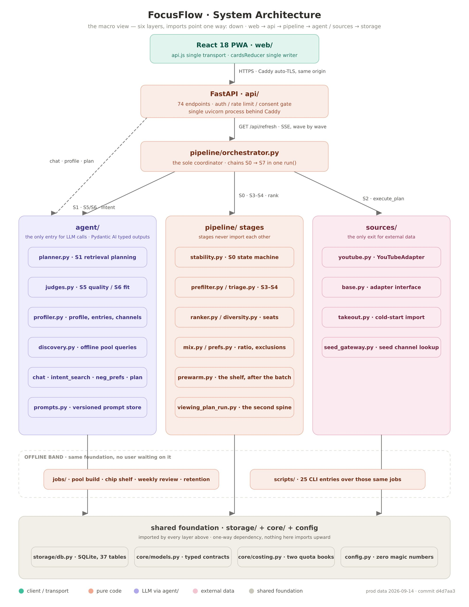

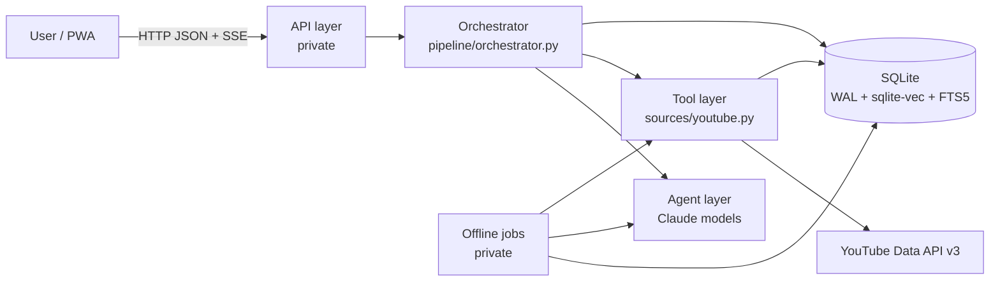

The whole system is one process and one SQLite file. No message queue, no cache server, no second database. Vector search and full-text search both happen inside the same SQLite file.

### 3.2 Layers and dependency direction

Dependencies only point down: `frontend → API → orchestrator → agent / tool layer → storage → core / config`.

| Layer | Directory | Responsibility and discipline |
|---|---|---|
| Client | `web/` (private) | React PWA. Talks to the backend only over HTTP JSON and SSE; no import relationship with the Python code |
| Service | `api/` (only `sse.py` is public) | HTTP and SSE endpoints, auth, rate limiting, consent gate. A **consumer** of orchestration, never a second orchestrator |
| Decision | `pipeline/` | S0–S7 and ranking. Stages never import each other and are composed only by the orchestrator; they make no LLM or external API calls themselves |
| Agent | `agent/` | The **only** place in the project that calls an LLM. Every agent has a pure-code fallback |
| Tools | `sources/` | The **only** place that calls the YouTube API. Every call is charged to a quota ledger |
| Storage | `storage/` | The **only** place that contains SQL |
| Foundation | `core/`, `config.py` | Shared models, cost estimation, redaction. `config.py` is the single home for thresholds, weights and budgets; business code has no magic numbers |

**Import rules**

- Pipeline stage modules never import each other; only the orchestrator calls them. Any stage can therefore be removed on its own for a comparison run.
- `agent/` never imports `sources/`: the LLM produces plans and never calls the API itself.
- SQL appears only in `storage/`; YouTube calls only in `sources/youtube.py`; LLM calls only in `agent/`.
- The API layer may import the orchestrator, the prewarm module, the preference readers, storage, core, config and the Takeout importer, plus two narrow exceptions for profile and chat. It may not import the judges, the planner, individual stages or the YouTube adapter.
- Offline jobs may import agent, sources, storage and core, but are never imported by the pipeline or the API.
- Documented exceptions: the planner builds its context through **read-only** storage calls and reuses two read-only helpers from `pipeline/prefs.py`; the viewing-plan card run reuses a few pure functions from the orchestrator; the prewarm module lazily imports the refresh-id generator from the SSE module.

### 3.3 One refresh, end to end

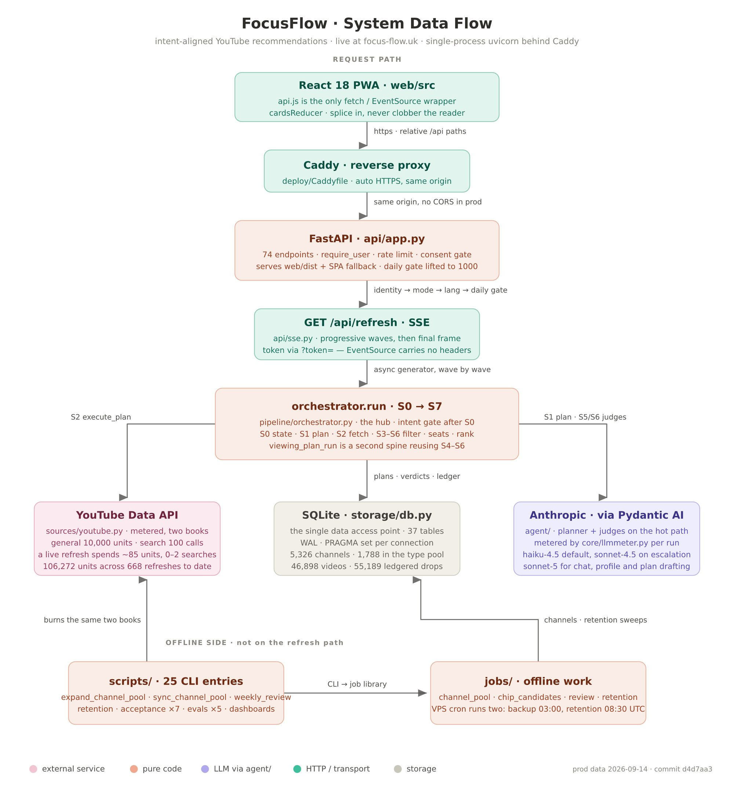

1. **Instant first paint.** When the client enters a mode, the API serves the previous final cards straight from a card pool keyed by user × mode × language (measured at 21 ms), with no quota and no LLM. Before serving, it re-applies the latest blocks, excluded types, impression penalties, dislikes and watched lists.
2. The user taps refresh, the client opens an SSE stream, and the orchestrator's `run()` starts.
3. **S0** reads the state machine for this user × mode. It also reads the profile entries and negative preferences once, computes the fit-cache fingerprint and draws this refresh's profile seat plan (§5.1, §5.11).
4. **S1** plans. In the steady state with no intent, the previous plan may be reused and the LLM skipped; otherwise the planner proposes 2–6 strategies, code validates them, a failed plan is re-planned once with the reason attached, and a second failure falls back to a hand-written default plan (§5.2). If there is a one-off intent, the whole refresh switches to the lightweight intent fast lane (§5.10).
5. **Post-planning injection in code**: source-ratio rebalancing, profile search rotation, seed channels, expanded channels, search yield rules, the local candidate library. All deterministic; no LLM.
6. **Suppression sets** are computed once, before retrieval: accepted appeals (exempt), impression penalty, explicit dislikes, already watched. Quota is never spent on cards that would be thrown away.
7. **S2** executes the plan: strategies run concurrently, then dedup, duration pre-check, stat enrichment, persistence, duration-window filter and ratio truncation (§5.3).
8. Videos with an accepted appeal skip S3–S7 and go straight to the top.
9. **S3** rule prefilter. Every dropped video gets a ledger row (§5.4).
10. **S4** triage into three buckets: cached, direct pass, needs review. This is the LLM cost gate (§5.5).
11. **S5** quality judge reviews the needs-review bucket. **At the same time**, direct-pass and cached-pass candidates go straight to S6 as the **first wave**.
12. **S6** mode-fit judge rules wave by wave, reading a 7-day cache first. Every passing batch goes to the client as an `incoming` frame (§5.7).
13. **S7** removes the content types the user excluded (§5.8).
14. **rank** scores once, splits on-screen and folded sections, applies seat rules (§5.9), then the source cap, the source soft floor and the impression tail seats.
15. **Bookkeeping**: save the plan, run the conservation check, record quota and token usage. All of this happens **before** the final frame leaves, so a client that disconnects early cannot lose the accounting.
16. The final snapshot frame is emitted and written to the card pool; the API marks those cards as served and may start preparing the next batch (§5.14).

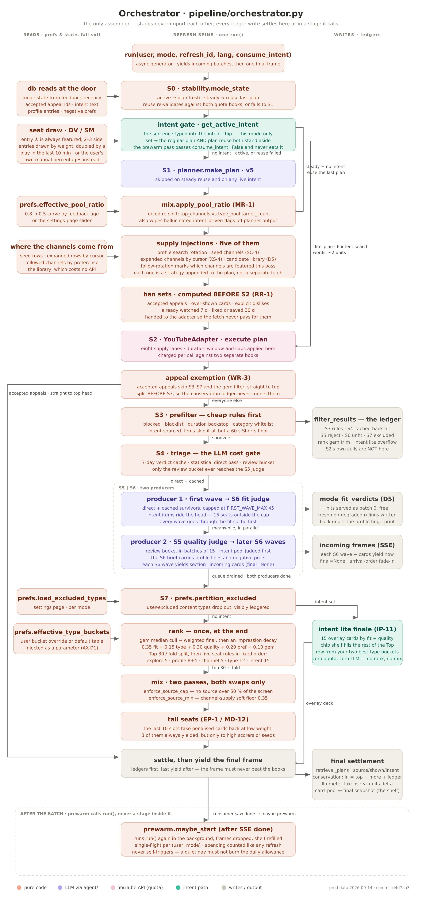

### 3.4 Progressive waves and the streaming contract

A full refresh takes tens of seconds; a spinner for that long loses the user. So S6 is split into waves, and whatever finishes first appears first:

```
time →
producer 1:  [first wave: direct + cached passes, top FIRST_WAVE_MAX by stat score] → S6 → card frames
producer 2:  [S5 batch 1] → [S5 batch 2] → ... each LLM_BATCH_SIZE of passes → an S6 wave → card frames
consumer:    pull frames off a queue and yield them to SSE in arrival order
```

- The first wave runs **in parallel** with S5. They work on disjoint sets with no dependency between them; run serially they blew the latency budget.
- The first wave takes the top `FIRST_WAVE_MAX` = 45 candidates by statistical score (about 1.5 × `TOP_N`); the rest are **deferred** to later waves, not dropped and not recorded. When profile vectors exist, the order before truncation is an RRF fusion of the statistical rank and the similarity rank to the user's profile entries, so the closest matches reach the screen first.
- The first wave may not escalate to the stronger model: first-screen latency matters more than that batch's verdict quality.
- Later waves only send **whole batches** so the judge's inter-batch concurrency actually kicks in. Apart from the tail batch flushed when S5 ends, only two exceptions allow a partial batch: the first wave, and the earliest batch of intent candidates on an intent refresh.
- The orchestrator is an async generator. Intermediate frames carry `section="incoming"` and `final=None`; **the last frame is always the complete final snapshot**. The client treats it as authoritative and rebuilds everything it has shown from it. That lets the server reorder, demote or even remove a card it showed early.
- Cancellation: when the generator is closed, its `finally` explicitly cancels unfinished producer tasks, otherwise orphan tasks would keep burning tokens. When the user switches mode or closes the page, the cancellation reaches all the way into the judge layer.

A measurement-driven concurrency pass on the two LLM stages cut full-refresh wall time from 164.9 s to **58.3 s** (−65 %): the first wave runs in parallel with S5, judge batches run concurrently (global gate `LLM_MAX_CONCURRENCY` = 4), and the first wave is truncated by statistical score.

### 3.5 The conservation equation

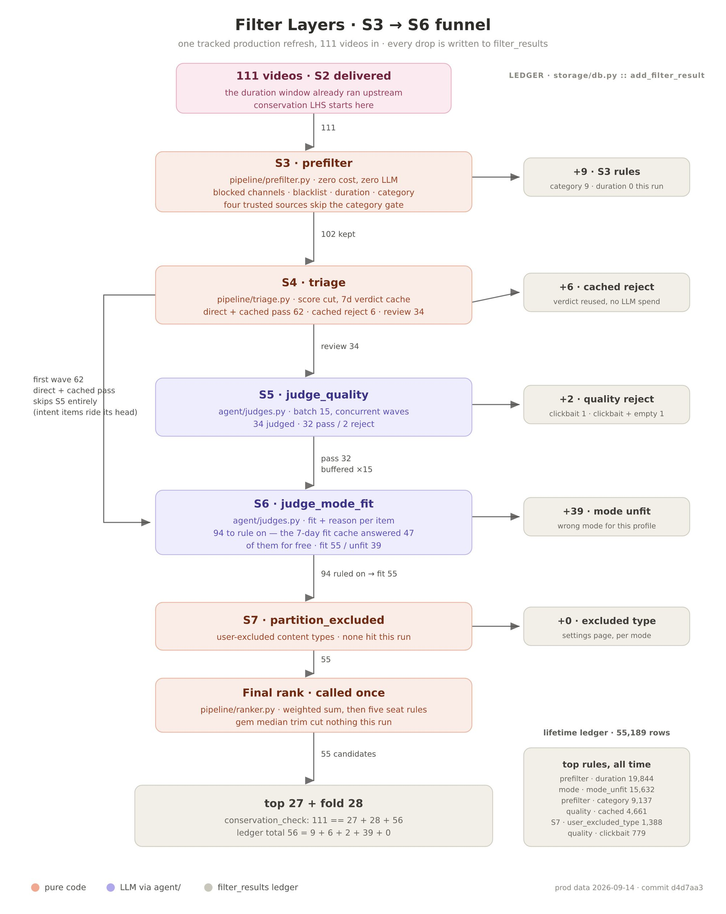

Every refresh ends with this check:

```
rows entering S3 == on-screen cards + folded cards + this refresh's filter-ledger rows
```

Every video that enters the prefilter either appears on screen (top or fold) or has a ledger row with stage, rule and reason. The ledger is fed by the S3 prefilter, stale rejections from the S4 cache, S5 rejections, S6 rejections, S7 exclusions and the ranker's hidden-gem median filter. A broken equation is logged at ERROR but does not fail the refresh; assertions live in the tests.

A few deliberate accounting choices:

- Cards with an accepted appeal are split off before S3, so they are not on the left-hand side.
- Impression tail cards and intent fill cards come from the card pool or the shelf and never entered S3, so they are outside the equation.
- When the ranker moves a card from the top section to the fold, that is a **swap**, not a filter, and is not recorded.

The real refresh in the diagram above was `111 == 27 + 28 + 56`. In the same refresh, 62 of the 102 prefilter survivors never reached the quality judge, and the 7-day cache answered 47 of 94 mode-fit rulings. Whenever card counts look wrong, this equation is the first thing read; it has disproved more than one wrong hypothesis.

### 3.6 Model tiers and the cost/latency budget

| Tier | Constant | Current model | Used for |
|---|---|---|---|
| Default | `LLM_MODEL` | `claude-haiku-4-5` | Planner, both judges, intent expansion, sub-topic derivation, channel-fit judge, followed-channel ranking, channel discovery |
| Escalation | `LLM_MODEL_FALLBACK` | `claude-sonnet-4-5` | Re-judging a judge batch once when it still fails validation after a retry |
| Profile | `PROFILE_MODEL` | `claude-sonnet-5` | Profile structuring, long-term signal consolidation, profile-entry translation, negative-preference adjudication |
| Chat | `CHAT_MODEL` | `claude-sonnet-5` | The in-app chat assistant |
| Plans | `VIEWING_PLAN_MODEL` | `claude-sonnet-5` | Drafting long-term viewing plans in conversation |

The policy is cost first: a small model by default, escalation only where measurement showed it mattered, and a larger model for multi-turn conversational surfaces, where multi-turn context is the point. `MODE_LLM_OVERRIDES` can move a whole mode to a stronger model; it is currently empty. A model name starting with `deepseek-` is routed to a different provider automatically. That capability is still there, but a same-day trial was rolled back.

**Budget for one ordinary refresh (orders of magnitude)**

| Item | Amount |
|---|---|
| Planner calls | 0–2 (0 on steady-state reuse or an intent refresh, 2 on a re-plan); an intent refresh adds 1 expansion call |
| Quality judge | ⌈needs-review count / 15⌉ batches, run concurrently |
| Mode-fit judge | ⌈cache-miss count / 15⌉ batches, run concurrently |
| YouTube general pool | About 100 units (plans are priced at the deep-paging worst case; the default plans come to about 64–72) |
| YouTube search bucket | 0–2 profile-rotation searches plus free planner searches (one shared gate) |
| First paint | 21 ms (card pool); fresh cards start arriving once the first wave is judged |
| Full refresh | 58.3 s (measured) |

The cost savers are part of the architecture: S4 direct pass, the 7-day quality cache (shared across users), the 7-day fit cache (per user), batching, and skipping the planner in the steady state.

### 3.7 Fail-soft principles

1. **Every LLM call has a pure-code fallback**, and the product must still be usable on that path.
2. **Fallbacks are visible**: fallback results carry `degraded=True`, the plan source is recorded as `default`, and the degradation rate is a metric rather than an incident.
3. **Fallback results are never cached**: every cache row means "an LLM actually judged this".
4. **The direction matters**: quality and fit **fail open** in most modes (better to give a card a chance than show an empty screen); wind-down is the only mode that **fails closed**. The state machine falls back to "active" whenever data is missing, because a few extra tokens are safer than wrongly reusing a stale plan.
5. **Bookkeeping failures never sink results**: if the ledger or the card-pool write fails, it is logged and the final frame still goes out.
6. **Errors do not leak**: every exception log goes through the redaction layer (API keys, session tokens, Bearer tokens); the SSE error event carries only fixed text and the refresh id.

---

## 4. Modules

### 4.1 The agent layer

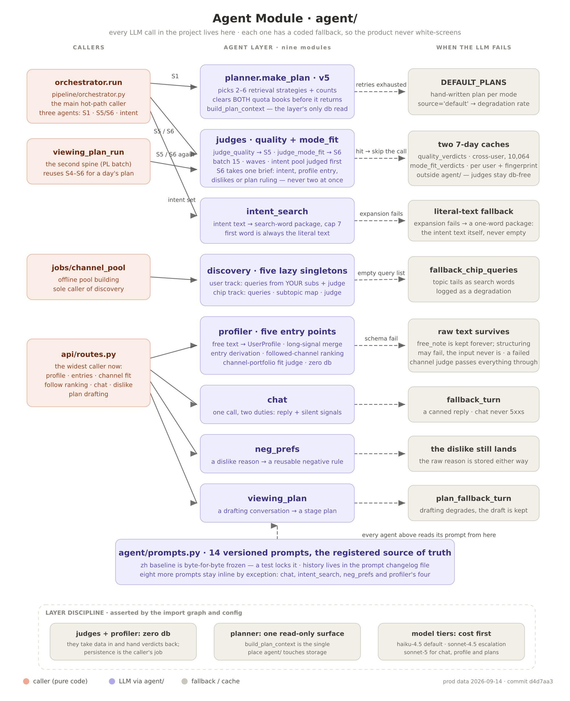

Every agent is built with Pydantic AI and returns a typed Pydantic model; the framework handles schema validation and retries (`LLM_MAX_SCHEMA_RETRIES` = 1, per-call timeout `LLM_TIMEOUT_SEC` = 60 s). Agent objects are built lazily on first use, so the code imports and the offline tests run without an API key.

| Agent | File | Role | Input → output | Tier | On failure |
|---|---|---|---|---|---|
| Retrieval planner (S1) | `planner.py` | Choose 2–6 retrieval strategies for the current mode | `PlanContext` → `RetrievalPlan` | Default | Re-plan once if code validation fails; a second failure or any exception → `DEFAULT_PLANS[mode]`, source `default` |
| Quality judge (S5) | `judges.py` | Four-level quality grade, three low-quality categories | 15 compressed videos → `list[QualityVerdict]` | Default, may escalate | Retry → escalate → degrade: pass if the statistical score ≥ `DEGRADE_PASS_THRESHOLD`; wind-down rejects all |
| Mode-fit judge (S6) | `judges.py` | Fit, fit score, content type, profile attribution and recommendation reason in one call | 15 videos + optional prefix → `list[ModeFitVerdict]` | Default, may escalate | Same; degrades to `fit=True`, `fit_score=0.5`, reason "not mode-judged"; wind-down rejects all |
| Intent expansion | `intent_search.py` | Expand one intent sentence into multi-angle search queries | Intent text → `IntentQuerySet` | Default | Search the verbatim text only; intent retrieval never drops to zero |
| Profile structurer | `profiler.py` | Split free text into six fields | Raw text → `UserProfile` | Profile | Raises; the caller stores the raw text first with a null structured profile, and the planner reads a truncated raw note |
| Profile-entry translator | `profiler.py` | Derive types, search queries, interest chips and an English translation per entry | Entry list → `list[EntryDerivation]` | Profile | Raises; the caller stores empty derivations |
| Sub-topic derivation | `profiler.py` | Derive 8–12 sub-topics per entry | Entry → sub-topic list | Default | Raises; only the entry's main query is used |
| Long-term signal consolidation | `profiler.py` | Decide which existing entries a new signal duplicates | New signal + list → `LongConsolidation` | Profile | Raises; the caller appends the signal as a new entry |
| Followed-channel ranking | `profiler.py` | Rank followed channels by relevance to one profile entry | Entry + channels → index list | Default | Raises; the caller uses a heuristic. When vectors exist this step uses them instead of the LLM |
| Channel-fit judge | `profiler.py` | Estimate from recent upload titles how much of a channel matches the entry (0/1/2) | Entry + candidate channels (chunks of `EXPAND_JUDGE_BATCH` = 20, concurrent) | Default | A missing or out-of-range index voids the chunk; the caller treats all as 1 and marks them unjudged |
| Negative-preference adjudicator | `neg_prefs.py` | Turn one "dislike" into a topic-level negative preference, or merge it into an existing one | Video + ticked reasons + profile + existing negatives → `NegAdjudication` | Profile | Raises; the API layer handles it fail-soft and stores the raw reason |
| Chat assistant | `chat.py` | Chat, while silently extracting an intent candidate and profile signals | History + new message → `ChatTurn` | Chat | Raises; the API layer returns a canned reply, chat never 5xxs |
| Viewing-plan drafter | `viewing_plan.py` | Draft a multi-day viewing plan over several turns | History + background + new message → `PlanDraftTurn` | Plans | Raises; the API layer returns a canned reply |
| Channel discovery (offline) | `discovery.py` | Generate queries and judge candidate channels for the offline pools | Pool profile / interest chip → queries / selected ids | Default | Each has a coded fallback: topic categories as queries, rank by hard metrics |

**Three layers of protection in the judges** (both judges share one implementation, `_judge_batch`):

1. **Schema validation**: Pydantic AI's `output_type`; a schema failure is retried automatically.
2. **Batch validation**: the output video ids must match the input one to one (none missing, none extra, no duplicates), and the quality judge also requires a `quality_grade` on every item. On failure the whole batch is retried once with a failure-specific prompt; if that fails it is escalated once to `LLM_MODEL_FALLBACK`; if that fails too it degrades. Exceptions (timeout, missing key, network) degrade directly and never escalate. A mean-confidence escalation trigger exists, but its threshold `ESCALATE_CONF_MEAN_MIN` = 0.0 keeps it inactive.
3. **Differentiated degradation**: see the table. Only code sets `degraded=True`; the LLM cannot claim a degraded verdict.

**Other shared practices**

- **Deterministic shuffling**: before building the prompt, the batch is sorted by video id to erase retrieval order and then shuffled with a seed derived from the batch contents. This removes position bias (retrieval order systematically favours subscribed content) while keeping the prompt order reproducible for the same batch. Results are mapped back to input order.
- **Compression**: each video sends only its title, the first `COMPRESS_DESC_CHARS` = 200 characters of the description, the first `COMPRESS_TAGS_MAX` = 8 tags, the channel name, duration, the three counters, whether likes are hidden, and the official category name.
- **Judges never touch the database**: cache reads and writes and ledger writes all belong to the caller. A judge is then a pure LLM function that can be tested offline at zero cost. Each batch is yielded as soon as it finishes so the caller persists it immediately; batches already judged are never lost to a later failure.
- **English UI**: with `lang="en"`, "write every reason in English" is appended to the user prompt; the system prompt is unchanged.

**The prompt registry**: [`prompts.py`](../src/agent/prompts.py) holds 15 versioned prompts (planner, profile structuring, quality judge, four per-mode fit judges, two user-track discovery prompts, three interest-chip-track prompts, chip reasons, profile sub-topics, viewing plans). The four fit prompts share one "content type" section so they cannot drift apart; changing it bumps all four versions. Version changes are recorded in a separate changelog, and a test checks that every current version has an entry. A few small prompts (chat, intent expansion, the negative-preference adjudicator) live in their own files. Numbers inside prompts (strategy counts, search limits) are behavioural guidance for the LLM; the real gate is code validation, and code wins if the two disagree.

### 4.2 Pipeline stages

| Stage | File | Cost | Reads | Writes |
|---|---|---|---|---|
| S0 state | `pipeline/stability.py` | Pure SQL aggregates, zero tokens | Actions, feedback, plan history | — |
| S1 planning | `agent/planner.py` | 0–1 LLM calls | Preferred channels, type pool, feedback, quota, last plan, profile, intent | — |
| Post-planning injection | `pipeline/orchestrator.py`, `mix.py`, `diversity.py`, `subtopics.py` | Code | Profile entries, seed/expanded channels, ratio settings | Search cursor, sub-topic cursors, expansion cursors, per-user search counters |
| S2 retrieval | `sources/youtube.py` | YouTube API | Channels, cached video durations, paging cursors | Channels, videos, quota, paging cursors |
| S3 prefilter | `pipeline/prefilter.py` | Code | Blocked, cooling-down and trusted channels | Filter ledger |
| S4 triage | `pipeline/triage.py` | Code | Quality verdict cache | — (read only; routes, never rules) |
| S5 quality | `agent/judges.py` | Batched LLM | — | Quality verdict cache, filter ledger (written by the orchestrator) |
| S6 fit | `agent/judges.py` | Batched LLM, cache first | Fit verdict cache | Fit verdict cache, filter ledger (written by the orchestrator) |
| S7 exclusions | `pipeline/prefs.py` | Code | Excluded types | Filter ledger |
| rank | `pipeline/ranker.py`, `diversity.py`, `mix.py` | Code | Channel preference scores, impression counts, subscriber counts | Filter ledger (hidden-gem median filter only) |
| Bookkeeping | `pipeline/orchestrator.py` | — | — | Plan log, usage, card pool |

### 4.3 The tool layer (data sources)

**The adapter contract**: [`sources/base.py`](../src/sources/base.py) defines the `SourceAdapter` abstract class with five abstract methods. The first four are the four tools the planner can choose from, named exactly like the four `StrategyCall.tool` values; the fifth is enrichment:

| Method | Source tag produced | YouTube endpoint |
|---|---|---|
| `fetch_channel_videos(channel_id, n)` | `subscribed` | `playlistItems.list` |
| `search_by_keyword(query, n)` | `search` | `search.list` (search bucket) |
| `fetch_trending_by_category(category_id, n)` | `trending` | `videos.list?chart=mostPopular` |
| `mine_hidden_gems(k)` | `hidden_gem` | sample the small-channel pool, then `playlistItems.list` |
| `enrich_stats(videos)` | — (enrichment, not retrieval) | `videos.list`, 50 per call |

Retrieval tools return only "bare" videos (id, channel, source tag); titles, durations and counters are filled in batches by `enrich_stats`. Supporting a new platform means writing a new adapter; the pipeline skeleton does not change.

**One tool, several identities**: `fetch_channel_videos` is multiplexed by parameter into several supply lanes. The planner can use two of them directly (preferred channels, type pool); the orchestrator injects the rest after S1:

| Parameter | Lane | Source tag | Calls the API? |
|---|---|---|---|
| `use_top_channels` | My channels (weighted rotation) | `subscribed` | Yes |
| `use_type_pool` | Shared type channel pool | `channel_pool` | Yes |
| `use_seed_channels` | Seed channels the user hand-picked on profile entries | `seed_channel` | Yes |
| `use_expanded_channels` | Expanded channels vetted by the judge | `expanded_channel` | Yes |
| `use_library` | Local high-quality candidate library | `seed_channel` / `subscribed` | **No** (enrichment only) |
| `use_local_intent` | Local full-text recall for an intent | `search` (intent-flagged) | **No** |
| `channel_id` | One named channel | `subscribed` | Yes |

**The plan executor `execute_plan`** runs in a fixed order:

1. **Budget guard**: recompute the plan's two-ledger cost with `core/costing.py` (the LLM's self-reported `est_quota` is ignored), subtract what other in-flight plans have reserved, and refuse to run if it does not fit. This is the last line of defence beyond the planner's validation, because some callers (calibration scripts, comparison runs) bypass the planner.
2. Inject the mode's region and language bias (`relevanceLanguage` is added only to queries containing Chinese characters; it is a soft bias, not a filter).
3. Run all strategies concurrently. One strategy failing does not stop the others; one channel failing does not stop the rest of its strategy.
4. Dedup by source priority (`SOURCE_PRIORITY`: seed > my channels > expanded > hidden gem > type pool > search > trending). The intent flag is OR-ed on collision, so it survives even when the source tag is overridden. Dedup runs before enrichment, so no id is billed twice.
5. Zero-cost pre-enrichment filtering: drop suppressed videos and videos whose known duration is outside the mode window (known from the trending chart or from the video table). Intent results are exempt.
6. Enrich and persist. Out-of-window videos are persisted too, so the video table doubles as a free duration cache for the next pre-check.
7. After enrichment: filter by the mode's duration window; keep at most `S2_PER_CHANNEL_MAX` items per channel; trim each source back to the sum of its strategies' `target_count`, with non-search sources capped at `S2_DELIVER_MAX` in total. (`S2_PER_CHANNEL_MAX` = 8, `S2_DELIVER_MAX` = 90; setting either to 0 turns it off.)

S2-side removals are logged but not written to the ledger: the conservation equation starts at S3's input.

**Quota**: every real call is charged right **after it succeeds**, routed by `quota_bucket(tool)` to the general pool or the search bucket. Plan cost estimates assume the deep-paging worst case (`CHANNEL_DEEP_PAGES_MAX` = 3 pages) and the enrichment batches implied by over-fetching, so they err high.

### 4.4 Storage and retrieval

**Tables at concept level** (all SQL lives in `storage/`; only the retrieval part is public here)

| Shared (objective, not per user) | Per user |
|---|---|
| Channels (subscribers, uploads playlist id, small-channel flag, interest chips) | Channel preference scores, follow flag, block, trust |
| Videos (metadata and statistics) | Actions and feedback, appeals |
| Quality verdict cache (a property of the content, shared across users) | Filter ledger (per refresh id) |
| Cold-start shelf (cards prepared per interest chip) | Retrieval plan log |
| Video and text vector maps, full-text index | Card pool, mode-fit verdict cache |
| Quota ledgers (site-wide) | Profile entries, sub-topics, seed channels, expanded channels, negative preferences, session intents, mode settings, viewing plans, daily usage |

**Hybrid retrieval** ([`storage/retrieval.py`](../src/storage/retrieval.py))

- **Vectors**: `sqlite-vec` vec0 virtual tables, 512 dimensions (`EMBED_DIM`), cosine distance; embedding model `EMBED_MODEL` = `BAAI/bge-small-zh-v1.5`. A vec0 table stores only the vector; "which video/channel/entry this belongs to, which model, what text hash" lives in ordinary map tables that share the rowid. Videos have one vector table; channels, profile entries, interest chips, negative preferences and sub-topics share another, distinguished by `(kind, key)`.
- **Full text**: FTS5 with text pre-segmented by jieba before the `unicode61` tokenizer sees it, because the default tokenizer treats a whole run of Chinese characters as a single token. The index is an own-content table rather than an external-content table over videos (the video table has a TEXT primary key with no stable rowid, and the indexed columns hold derived, segmented text).
- **Fusion**: each path takes its top 3k and the ranks are fused with RRF (`RRF_K` = 60). The two score scales are incompatible (unbounded bm25 vs. cosine in [0, 1]); using ranks only means no weights to tune. For pure-English queries the full-text path uses K/2, boosting literal matches because this embedding model is weaker on English.
- **Scoped queries**: vec0 can only be restricted by rowid, so "search only these videos" is first translated into a rowid set. For non-empty scopes the code computes cosine distance directly instead of `MATCH ... k = ?` (with a rowid filter, `k = 1` returns nothing, and scopes are only tens to hundreds of rows, so direct computation is both correct and cheap).
- **Graceful degradation**: if sqlite-vec is missing or the switch is off, `vector_available()` is false, vector writes are silent no-ops, vector reads return nothing, and hybrid search falls back to full text alone. Callers check that one function instead of guessing whether tables exist. Embedding runs as a separate offline job (the model takes about 900 MB resident and cannot live in the web process); a newly saved profile entry gets its vector the next day, and every reader tolerates missing vectors.

**Where vectors are used**

| Place | Effect | Switch |
|---|---|---|
| Candidate-library rerank | Over-sample `E1_LIBRARY_OVERSAMPLE` = 4×, then let profile entries claim candidates greedily in segments: entry 1 → this refresh's drawn secondary entries → remaining entries → misses in original order | `E1_VECTOR`, `E1_ENTRY_ISOLATION` |
| Local intent recall | Search the intent text in the local full-text index; enough hits means fewer live searches | `INTENT_LOCAL_RECALL` |
| S6 first-wave order | RRF of statistical rank and profile-similarity rank | `E7_VECTOR` |
| Sub-topics | An entry's similarity = max(entry similarity, `VEC_SUBTOPIC_WEIGHT` × sub-topic similarity) | `ES_VECTOR` |
| Followed-channel ranking, expansion candidate pre-sort, type-pool backfill (private API layer) | Entry vector × channel vector | — |

Vectors only answer "which first", never "whether at all". The quality judge, the fit judge, the prefilter rules and the ranking formula are untouched by them. The hit threshold is `VECTOR_SIM_MIN` = 0.55.

**Caches**

| Cache | Key | Lifetime | Notes |
|---|---|---|---|
| Quality verdicts | video_id | `QUALITY_CACHE_TTL_DAYS` = 7 days | Shared across users (quality is a property of the content); written only by S5, read only by S4: a single writer |
| Mode-fit verdicts | user × mode × video_id × fingerprint | `FIT_CACHE_TTL_DAYS` = 7 days | Fingerprint = sha1(prompt version, model, language, full text of this mode's profile entries, full text of negative preferences); change any of them and every old verdict stops matching |
| Card pool | user × mode × language | Older than `POOL_STALE_HOURS` = 6 h only changes the UI label | Carrier for instant first paint and prewarmed batches |
| Cold-start shelf | interest chip × language | `CHIP_CANDIDATE_TTL_DAYS` = 90 days | Zero-quota, zero-LLM fallback supply |

**The local candidate library** (`library_candidates`): from "all seed channels of this mode ∪ the top `LIBRARY_TOP_K` = 10 preferred channels", take local videos that have not been shown, have not been judged unfit, and are not suppressed; at most `LIBRARY_PER_REFRESH` = 30 per refresh, zero API calls. Previously shown cards may flow back once their latest showing is more than 72 hours old. Order: never-pooled first, recycled after; within each, not-yet-judged before judged; then newest first.

### 4.5 The API/SSE bridge

[`api/sse.py`](../src/api/sse.py) is the orchestrator's only consumer. It translates one to one and never re-orchestrates: no dedup, no reordering, no regrouping.

- **Events**: `card` × N → `done` or `error`. Each card is projected through `CardOut.from_item`; the `final` field distinguishes preview frames from final frames.
- **One stream per user**: starting a new stream cancels the user's previous one. Cancellation is used instead of a lock because when a generator suspended at `yield` is cancelled, its `finally` runs at a GC-dependent time, and a lock might never be released.
- **Disconnects**: the cancellation from a client disconnect is **not swallowed**; it propagates into the orchestrator and stops a pipeline that would otherwise keep spending quota.
- **Mid-stream errors**: headers are already sent, so the status cannot become a 500. Instead an `error` event (fixed text `PIPELINE_ERROR_TEXT` plus the refresh id) is emitted and the stream ends cleanly, without `done`. On this path the orchestrator never reaches the card-pool write, so a partial result cannot replace the previous good one.
- **Heartbeat**: after 15 s of silence an SSE comment line is sent so reverse proxies do not drop the connection as idle. The heartbeat wrapper drives every `__anext__` with one copied context, so the token meter installed at the top of the orchestrator stays visible to producer tasks created later.
- **After `done`**: mark the final cards as served, then try to start preparing the next batch (§5.14).

### 4.6 The frontend (overview, private)

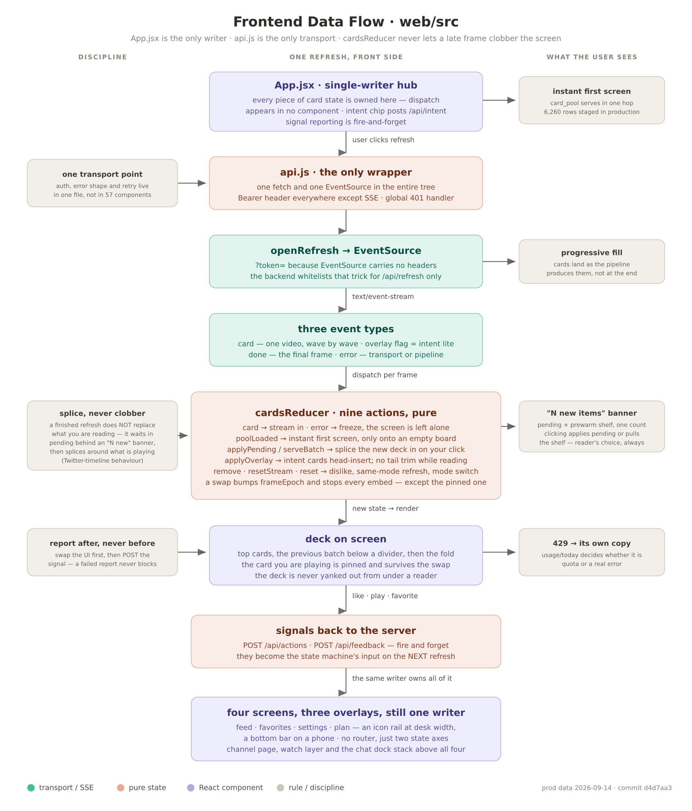

- React 18 + Vite + Tailwind CSS v4, a PWA that installs to a phone's home screen.
- No router and no global state library; every "page" is a state switch in the root component.
- One transport module wraps every fetch and EventSource; one reducer is the only writer of card state.
- **Frame model**: preview frames fade in translucent, and the list is rebuilt from the final frame when it arrives. A progress ribbon shows which stage is working.
- Signals are fire-and-forget: the UI updates first, and a failed report never blocks or rolls back the UI.
- The embedded player has no sidebar recommendations and no autoplay; "Open on YouTube" is a deliberate, visible exit.
- Fully bilingual (Chinese/English); each mode owns an accent colour.

### 4.7 Offline jobs (overview, private)

| Job | Purpose |
|---|---|
| Weekly review | A read-only weekly summary of the appeal queue, filter-rule distribution, deliberate actions, channel-pool health, blacklist-word hits and negative preferences. A person rules on appeals from the command line (accepted = a standing exemption) or retires a negative preference the judge has been over-applying |
| Embedding job | Nightly incremental vectors for videos, channels, profile entries, sub-topics, interest chips and negative preferences, plus the full-text index; rows whose text hash has not changed are skipped |
| Channel pools | Uses the LLM query generation and judging in `agent/discovery.py` to build a shared, curated type channel pool across 44 interest chips (hard subscriber floor `TYPE_POOL_SUBS_MIN` = 200,000) and a small-channel pool; a user track also grows from a user's existing preferred channels |

None of these is on the refresh path; no user ever waits on them.

---

## 5. Finer level

### 5.1 S0 · The state machine

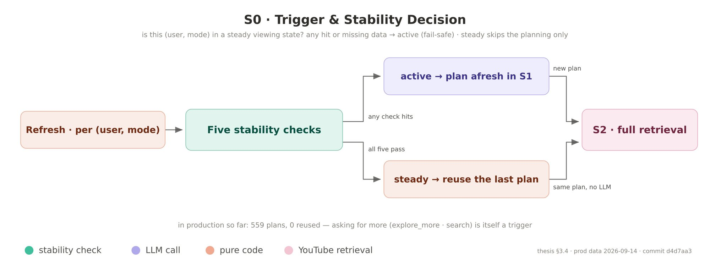

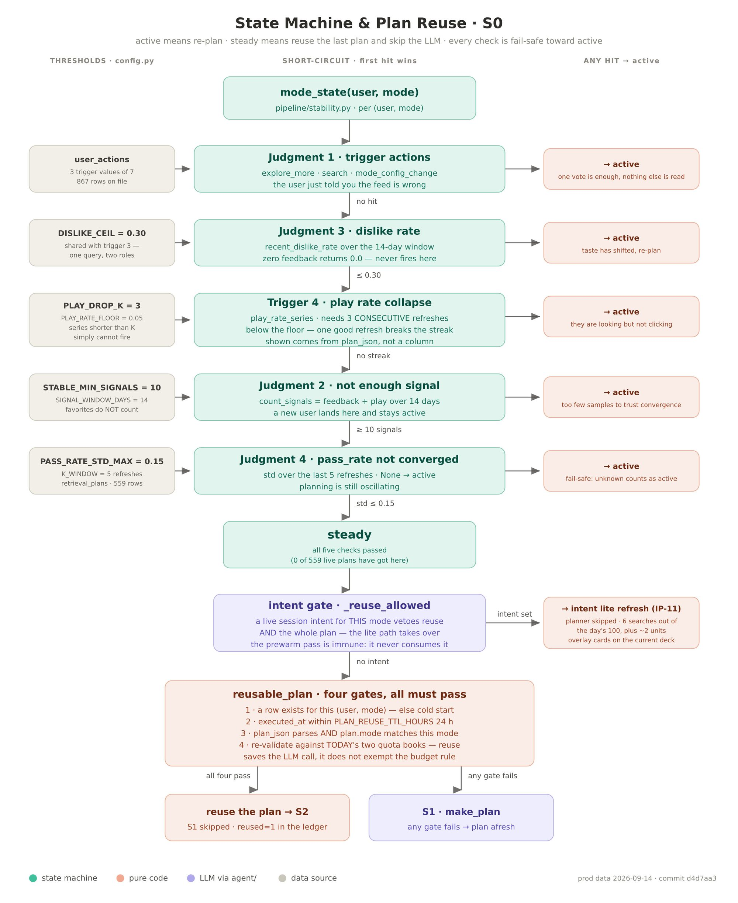

Every user × mode pair has two states: **active** and **steady**. `stability.mode_state` runs its checks in order; any hit means active:

| Check | Rule |
|---|---|
| 0 master switch | `ENABLE_ACTION_SIGNALS` off → always active |
| 1a trigger actions | Any of "more like this / a search / a mode-settings change" in the last `SIGNAL_WINDOW_DAYS` = 14 days |
| 1b dislike rate | Dislike rate over 14 days > `DISLIKE_CEIL` = 0.30 |
| 1c play-rate drop | The last `PLAY_DROP_K` = 3 refreshes **all** had a play rate (plays / shown) below `PLAY_RATE_FLOOR` = 0.05 |
| 2 too few signals | Fewer than `STABLE_MIN_SIGNALS` = 10 feedback + play signals in 14 days |
| 4 not converged | Std of the quality pass rate over the last `K_WINDOW` = 5 refreshes > `PASS_RATE_STD_MAX` = 0.15, or not enough data |

The direction is **missing data means active**: spending a few more tokens is always safer than wrongly declaring convergence and serving stale content. It is all SQL aggregates, zero tokens.

**Steady only skips planning.** Reusing a plan needs four more checks (`stability.reusable_plan`): a previous plan exists; it is younger than `PLAN_REUSE_TTL_HOURS` = 24 h; it deserialises into a valid plan for this mode; and it re-validates against **today's** two quota ledgers (the validator is injected by the orchestrator, so `stability` has no dependency on the agent layer). Any failure means S1 runs as usual. Reuse is not replay: S2 still runs in full, channel uploads come newest first, and new videos keep arriving. The other two safeguards against staleness are the explore floor (§5.9) and the play-rate-drop trigger.

An intent is never served from a reused plan: an intent is one-off input and always needs fresh retrieval.

### 5.2 S1 · Planning

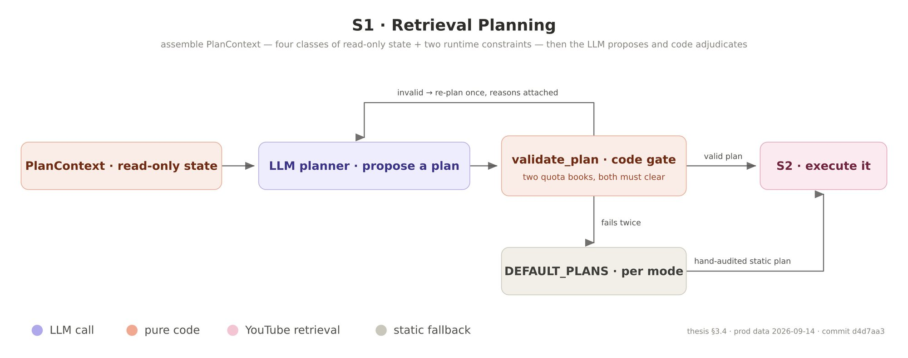

**Context** `PlanContext` (assembled read-only by `build_plan_context`; every database row is converted to plain types so the whole thing serialises into the prompt):

| Field | Contents |
|---|---|
| `mode_config` | Mode summary: keyword pool, category whitelist, duration window, whether small-channel mining is allowed, whether the mode is strict (blacklist words are deliberately omitted; they belong to S3) |
| `channels` | 15 channels: the user's highest-scored channels and type-pool channels, split by the source ratio, with either side's shortfall going to the other. Type-pool channels come only from the mode's top two content-type tiers, exclude any channel the user already has a learned score for, and get a neutral 0.5 in memory that is **never written back** to the user's preferences |
| `feedback` | Recent explicit feedback per channel, `[likes, dislikes]` |
| `quota_left` / `search_left` | Today's remaining general units and searches |
| `last_plan` | The previous plan, how many items each strategy actually returned, the pass rate, whether it was reused; lets the planner self-correct |
| `time_stats` | Time-of-day activity distribution |
| `user_profile` | The six-field persistent profile; a truncated raw `free_note` if structuring failed |
| `session_intent` | The current intent text |

**Guidance in the prompt** (soft constraints): aim for 240–300 items in total to offset losses to the duration rules (the subscription ecosystem is full of Shorts; measured loss is 56–92 %); budget beats volume when they conflict; modes that allow small-channel mining should include it and the others must not; the priority chain is "mode hard constraints > intent > current goals > interests > behavioural preferences"; with an intent, produce an `ack` of at most 60 characters.

**Code validation** `validate_plan` (hard constraints; the LLM is never trusted to police itself):

1. At most `MAX_SEARCH_PER_REFRESH` = 2 free search strategies, and none when the search bucket is below `SEARCH_FLOOR_PROFILE` = 20.
2. General cost ≤ today's remaining × `PLAN_QUOTA_BUDGET_RATIO` = 0.5; searches ≤ remaining search bucket. Cost is recomputed in code.
3. Between `PLAN_MIN_STRATEGIES` = 2 and `PLAN_MAX_STRATEGIES` = 6 strategies; the maximum counts only LLM-authored strategies, not the seed, expanded, library or local-intent strategies the orchestrator injects.
4. Every tool has its required parameters (otherwise the strategy would die on a missing key at execution time).
5. The plan's mode is the requested mode.

On failure, the reason goes at the top of the next user prompt and the planner re-plans `PLANNER_REPLAN_MAX` = 1 time. If that also fails, or on any LLM error (missing key, timeout, schema retries exhausted), a deep copy of `DEFAULT_PLANS[mode]` is returned. The source is recorded as `agent`, `agent_replan` or `default`, so the degradation rate is measurable.

**Default plans** (`DEFAULT_PLANS`, hand-written and hand-audited):

| Mode | Strategies |
|---|---|
| Focus | my channels 120 · type pool 40 · search "白噪音 纯音乐" 40 · search "AI tools productivity" 40 · Music category trending 30 |
| Entertainment | my channels 150 · type pool 40 · Comedy category trending 40 · hidden gems 40 |
| Explore | my channels 150 · type pool 40 · search "科普 原理" 50 · hidden gems 40 |
| Wind-down | my channels 100 · type pool 40 · Howto & Style category trending 40 · search "治愈 慢生活" 40 |

**Code injection after planning** (non-intent refreshes; applied equally to planner output, reused plans and default plans):

1. **Clear hallucinated flags**: any `intent_driven=True` in the planner's output is reset. Only the orchestrator may issue that "intent pass".
2. **Source ratio** (`apply_pool_ratio`): the target counts of the "my channels" and "type pool" strategies are summed and re-split by the type-pool share. The share comes from the user's slider if set; otherwise it slides linearly from `POOL_RATIO_NEW` = 0.8 to `POOL_RATIO_MATURE` = 0.5 with signal maturity (signals in 14 days / 10, capped at 1). A user with no preferred channels yet gets everything from the pool, so a new user's share does not come back empty.
3. **Profile search rotation** (§5.11).
4. **Seed channel** and **expanded channel** fetches (§5.11).
5. **Search yield**: whatever the plan's origin, the remaining non-intent searches pass one more gate: if the search bucket is below 20 or the user's profile searches today would exceed `PROFILE_SEARCH_DAILY_MAX` = 40, they are all removed; otherwise they are charged to the user's daily count.
6. **The local candidate library** (§4.4), appended last so that under ratio truncation it only fills what subscribed and seed targets leave.

### 5.3 S2 · Retrieval

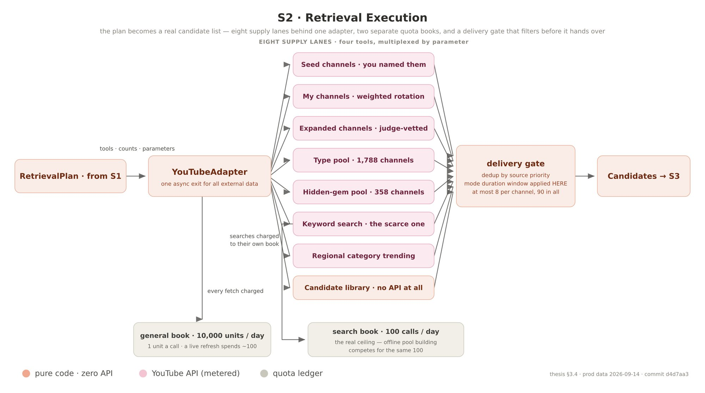

The execution order is in §4.3. Details of the lanes:

- **My-channels rotation**: the candidate set is the user's channels that are not blocked, have preference ≥ `FOLLOW_POOL_MIN_PREF` = 0.5, and are either followed or have preference ≥ `FOLLOW_POOL_LOVED_PREF` = 0.75. They are sampled without replacement with weight `exp(FOLLOW_PREF_BETA × (pref − 0.5)) × FOLLOW_PICK_DECAY ^ picks today × (FOLLOW_ENTRY_AFFINITY if the channel was recently attributed to a profile entry featured this refresh)`, with 8.0, 0.85 and 2.0 respectively. A channel at 0.6 weighs about 2.2, one at 0.9 about 25. Over a day the whole followed list gets a turn, instead of every refresh returning the newest uploads of the same few channels.
- **Deep paging**: each channel's first page (newest uploads, `CHANNEL_PAGE_SIZE` = 50 per page) is fetched first. If it yields too few valid items (not suppressed, not already collected, known duration not out of window), paging continues from a per user × channel cursor, up to `CHANNEL_DEEP_PAGES_MAX` = 3 pages per channel per refresh. Reaching the end marks the channel exhausted; it restarts from the top after `CHANNEL_DEEP_RESET_DAYS` = 30 days. Cursor read/write failures fall back to first-page-only.
- **Over-fetch**: non-intent strategies fetch ⌈target × `S2_OVERFETCH_FACTOR`⌉ = 2× to leave room for the post-enrichment duration filter; within one 50-item page this costs no extra retrieval quota. Intent strategies are not over-fetched: each query returns exactly its share.
- **Hidden gems**: `SMALL_POOL_SAMPLE_K` = 6 random channels from the small-channel pool (fewer than `SMALL_CHANNEL_SUBS_MAX` = 200,000 subscribers), with a 24-hour cooldown. A channel without a cached uploads id is resolved on the spot and cached; dead channels enter the cooldown too, capping the waste at 1 unit per channel per day.
- **Type pool**: 8 channels from the shared pool matching the user's ticked interest chips, with the user's blocked channels excluded up front (otherwise that slot and that unit are wasted). This path **never writes** the user's preference table.
- **Trending**: the only path that knows real durations before truncation, so out-of-window items can be dropped for free before enrichment.

### 5.4 S3 · Rule prefilter

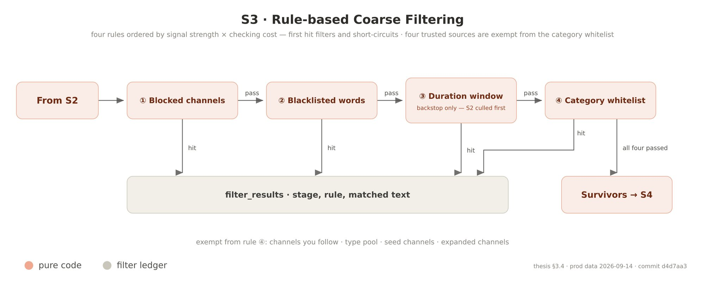

Rules are ordered by signal strength × checking cost. The first hit filters and short-circuits, so each video records exactly one reason:

| Order | Rule | Ledger rule name | Notes |
|---|---|---|---|
| 1 | Blocked channel | `channel_blacklisted` | Search and trending do not go through channel-level exclusion, so they must be caught here |
| 1 | Channel in cooldown | `channel_cooldown` | The user said "this channel is too frequent"; see §5.13 |
| — | **Intent-sourced** | `intent_shorts_floor` | Only the block check and an anti-Shorts floor of `INTENT_MIN_DURATION_SEC` = 60 s apply; every other rule is waived |
| 2 | Blacklisted word | `blacklist:<word>` | Matched against title + first 200 characters of description + tags; ASCII terms match whole words (no letter or digit on either side), Chinese terms match as substrings; with several hits the longest is reported |
| 3 | Duration window | `duration` | Shares `Mode.fits_duration` with S2, so this is only a backstop; duration 0 (enrichment failed) is naturally filtered |
| 4 | Category whitelist | `category` | My channels, the type pool, seed channels, expanded channels and user-trusted channels are **exempt**: the user or the pool curation already vouches for the topic, and YouTube's categories do not line up with modes |

An exemption waives only that rule; the later quality and fit checks still apply.

### 5.5 S4 · Triage (the LLM cost gate)

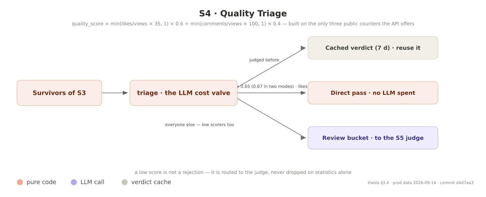

The statistical quality score can only use the three numbers the API provides:

```
like_term    = min(likes / max(views, 1) × QUALITY_LIKE_RATE_SCALE, 1)        # 35
comment_term = min(comments / max(views, 1) × QUALITY_COMMENT_RATE_SCALE, 1)  # 100
quality      = like_term × QUALITY_W_LIKE + comment_term × QUALITY_W_COMMENT  # 0.6 / 0.4
likes hidden: quality = comment_term
```

Three buckets, in a fixed order:

| Bucket | Condition | Goes to |
|---|---|---|
| Cached | A quality verdict from the last 7 days, pass or fail | Passes join the first wave; the orchestrator records failures (rule `cached`) |
| Direct | Score ≥ threshold (`QUALITY_PASS_THRESHOLD` = 0.65; entertainment and explore use 0.67 from `MODE_DIRECT_THRESHOLDS`) and like term ≥ `DIRECT_LIKE_TERM_FLOOR` = 0.4; hidden likes never pass directly (`ALLOW_LIKE_HIDDEN_DIRECT` = False) | The first wave, with a constant quality norm `DIRECT_PASS_QUALITY_NORM` = 0.6 |
| Review | Everything else, **including very low scores** | S5 |

A low score is not a rejection: statistics lie for new videos and small channels, so there is no statistical veto and no absolute view-count threshold. S4 writes nothing and takes no user id: the statistical score is free to recompute every time, and caching it would only freeze a free signal for days.

### 5.6 S5 · Quality judge

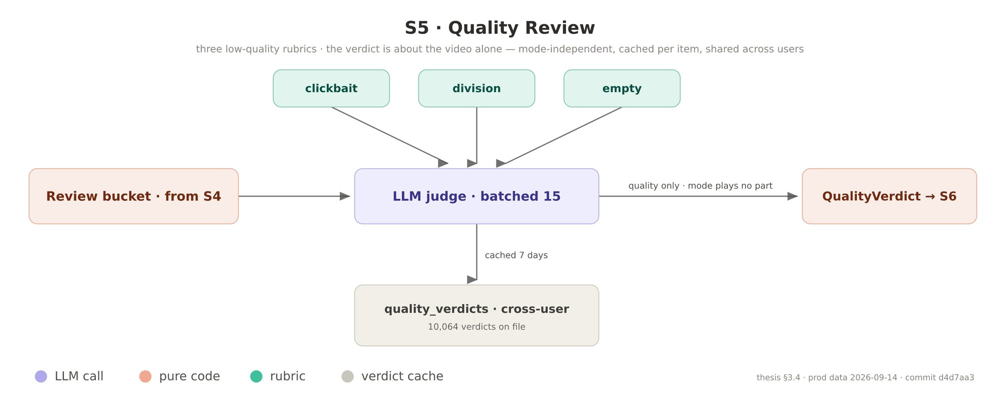

- It judges **the content itself**, independent of mode and language, so verdicts are cached and shared across users.
- Four levels of `quality_grade`: 3 good, 2 acceptable (the default when signals are unclear), 1 weak, 0 low quality. `passed` is derived in code as `grade ≥ QUALITY_GRADE_PASS_MIN` = 2; the LLM's grade is the single source of truth.
- Three low-quality categories: **clickbait** (shock headlines, title/content mismatch), **division** (conflict as the core narrative, stigmatising a group by one example), **empty** (title bait, AI filler, compilations with no original information).
- Principles: you see only metadata, do not imagine the content; lean towards passing when unsure; "division" needs high confidence for a 0, and serious discussion of a contested topic is not division; hidden likes are "unknown", not evidence.
- Batches of `LLM_BATCH_SIZE` = 15; all batches are scheduled up front and yielded in input order, and the caller persists each one as it arrives.
- On an intent refresh, intent candidates go to the front of the review queue so they finish first and reach S6 sooner.
- The ledger rule for a rejection is the LLM's low-quality categories (for example `clickbait,empty`); a degraded rejection is `degraded_reject`.
- Quality norm: `grade / 3` for an LLM verdict; the statistical score for a degraded pass. This keeps the order 0 < 1/3 < 0.6 (direct pass) < 2/3 < 1.

### 5.7 S6 · Mode-fit judge

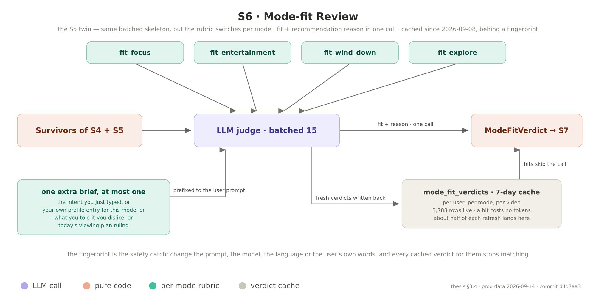

One call produces five things: whether it fits, a fit score (0–1, feeds ranking), a content type (one of 17, or `other`), a profile attribution (which of this mode's profile entries it belongs to, or null), and a reason (for `fit=True`, the sentence shown on the card).

**Each mode has its own rubric** (`fit_focus`, `fit_entertainment`, `fit_explore`, `fit_wind_down`), each with boundary examples. The system prompt never changes; the batch's special context is expressed as a **user-prompt prefix**, at most one by priority:

| Prefix | When | Effect |
|---|---|---|
| Intent ruling | Intent pool | Judge relevance to the stated intent instead; the mode's exclusion clauses do not apply to this batch; the quality floor still does; reasons use an "as you asked" voice |
| Plan ruling | Viewing-plan card run | Judge fit to the plan's current stage; progressive plans also check difficulty against the user's level |
| Profile entries | Regular pool with user-written entries | List this mode's entries; matches get a higher score and the reason names the entry; also output the profile attribution, judged strictly by topic |
| Negative preferences | Regular pool only; can coexist with the profile prefix | Clear matches get `fit=false` with a reason starting "Matched your dislike:" (`NEG_PREF_HIT_PREFIX`); possible matches with other clear value get a much lower score; no broad interpretation |

Intent and plan prefixes are mutually exclusive; passing both raises an error.

**The fit cache** (`_fit_with_cache`): the regular pool reads the cache first, and hits are yielded at once as one batch (no LLM; ledger notes get a "[cached]" prefix). Misses go to the judge and non-degraded verdicts are written back. The intent pool bypasses the cache. A cache read failure counts as all misses; a write failure only logs a warning.

**The single consumer of verdicts** `fit_effective`: `fit=False` → `mode_unfit` (real verdict) or `mode_degraded_reject` (fallback); a degraded `fit=True` bypasses the score threshold (to keep fail-open); the optional score threshold `FIT_SCORE_THRESHOLD` is None, i.e. disabled.

**Profile attribution** drives seat allocation (§5.9). LLM output is untrusted, so the orchestrator clamps it to 1..number of entries; out-of-range values or booleans become null. Attribution is judged by content topic, not broad base type, so a loosely related card cannot pose as a specific entry.

**Content type** is a global property of the content, independent of mode. The 17-type vocabulary is `CONTENT_TYPES`; the prompt has an 11-step tie-break ladder for boundary cases (current news first, pure ambient sound, film commentary goes to film, beauty tutorials go to fashion and beauty, and so on; first match wins). Out-of-vocabulary values cannot break ranking (unknown types weigh 0.6) but are aggregated into one warning per refresh.

### 5.8 S7 · Excluded types

Per mode, the user can permanently exclude content types. The meaning is "never appear", not "sink to the bottom", so they are removed **before** ranking and recorded with stage `S7`, rule `user_excluded_type`. The user can see and appeal them in the side panel.

The exception is **exempt entries**. Profile entries are written deliberately, while excluded types are often ticked casually; on conflict the profile wins, but only for the most important entries. In automatic mode that is entries 1..`EXCLUDE_EXEMPT_TOP_N` (currently 2); in manual-share mode, the two entries with the highest share. Cards attributed to an exempt entry pass, with an `exempt_top_entry` row recording why. If the user explicitly chose "keep excluded" in the conflict dialog, the exemption is off. The seat side (draw, manual seats, query order) and S7 consume the same effective exclusion set, so they stay in sync; otherwise a seat could be reserved for a card S7 then blocks. A card with a null type (degraded judge) is never excluded: unknown means not guilty.

### 5.9 rank · Ranking and seats

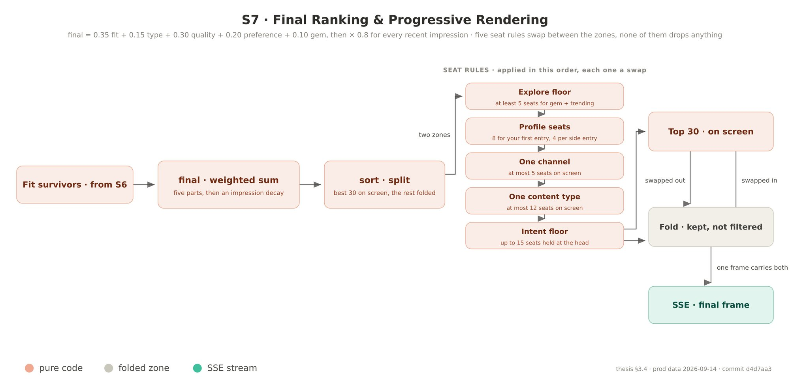

**Scoring**

```
final = W_FIT × fit + W_TYPE × type_weight + W_QUALITY × quality_norm + W_PREF × channel_pref + GEM_BONUS × is_gem
      = 0.35 × fit + 0.15 × type + 0.30 × quality + 0.20 × pref + 0.10 × gem
final ×= IMPRESSION_RANK_DECAY ^ (showings within the 72 h window)       # 0.8; intent cards exempt
```

- **Type weight**: each mode places the 17 types into four tiers (`MODE_TYPE_BUCKETS`, user-overridable), weighted `TYPE_BUCKET_WEIGHTS` = [1.0, 0.7333, 0.4667, 0.2]; unknown types get 0.6 and an explicit `other` gets 0.2.
- **Channel preference**: read from the database, not recomputed here; a neutral 0.5 when absent. It already includes any active cooldown discount.
- Mode match (fit + type) is the largest axis, quality second, preference capped (to avoid overfitting old taste), and the gem bonus is a small constant nudge.

**Passes around the split**, in execution order; later passes can override earlier ones:

| # | Pass | Rule | Drops? |
|---|---|---|---|
| 1 | Hidden-gem median filter | With at least `GEM_MEDIAN_MIN_N` = 4 hidden-gem candidates, those whose gem score is strictly below the median are dropped and recorded (`gem_below_median`). Gem score = engagement rate × view factor (1.0 for 2,000–30,000 views, 0.7 below, 0.5 above) × subscriber factor (× 1.2 under 200,000) | **Yes** (the only dropping pass) |
| 2 | Same-channel recency | Two cards from one channel within `RANK_RECENCY_TIE_DELTA` = 0.02 of each other count as tied, and the newer upload goes first; the order is encoded in `final` as 1e-6 steps so later re-sorts keep it | No |
| 3 | Split | Sort by `(-final, video_id)`; the top `TOP_N` = 30 go on screen, the rest to the fold | No |
| 4 | Explore floor | At least ⌈30 × `EXPLORE_SLOT_FLOOR`⌉ = 5 hidden-gem + trending cards on screen; if short, promote the best from the fold and demote the weakest non-exploration cards; never forced when the fold has none | No, swap |
| 5 | Profile seats | See below | No, swap |
| 6 | Per-channel cap | At most `RANK_CHANNEL_CAP` = 5 cards per channel; pinned seed seats kept first; intent cards not counted | No, swap |
| 7 | Per-type cap | At most `RANK_TYPE_CAP` = 12 cards per type; refills also respect the per-channel cap | No, swap |
| 8 | Intent floor | Intent-sourced cards, by `W_FIT×fit + W_QUALITY×quality`, take up to `INTENT_RESERVED_SLOTS` = 15 seats at the head (the current intent refresh uses a lightweight snapshot and skips ranking, so for regular refreshes this is a no-op) | No, swap |
| 9 | Per-source cap | No source exceeds ⌈`SOURCE_MAX_SHARE` × on-screen count⌉ (0.5 → 15 cards); intent cards not counted; seated cards never swapped out | No, swap |
| 10 | Two-sided soft floor | If "my channels" or "type pool" falls below `SOURCE_MIX_FLOOR` = 0.35 of the channel-based cards on screen and the fold has candidates, swap; nothing happens when the denominator is too small | No, swap |
| 11 | Impression tail seats | See §5.13 | From the card pool, outside the conservation equation |

Every swap is a pure swap: the union of top and fold is unchanged and nothing is recorded. Before any pass swaps a card in, it checks whether that channel already has 5 cards on screen; the per-channel cap is a hard constraint.

**Profile seats** (`_apply_profile_diversity`)

In automatic mode, the seat plan is drawn in S0 by `diversity.draw_featured_subs`:

- Entry 1 always gets `DIVERSITY_TIER1_SEATS` = 8 seats.
- From entry 2 on, each entry gets an independent draw with probability decreasing by position, `DIVERSITY_SUB_BASE_WEIGHTS` = [0.6, 0.45, 0.3, 0.2] (later positions reuse the last value); each winner gets `DIVERSITY_SUB_SEATS` = 4 seats, at most `DIVERSITY_MAX_SUBS` = 3 winners.
- An entry played within the last `DIVERSITY_PLAY_WINDOW_SEC` = 600 s has its draw weight doubled (capped at `DIVERSITY_WEIGHT_CAP` = 0.9, so it is never certain) and its seats doubled.
- An entry that lost `DIVERSITY_MISS_FORCE` = 3 draws in a row is forced in; if nothing wins, the entry with the longest losing streak is added.
- The RNG is seeded from the refresh id, so a refresh is reproducible.
- Each entry holds at most `DIVERSITY_ENTRY_CAP` = 12 cards on screen.

In manual-share mode (the user gave each entry a percentage in settings, summing to 100), an entry's seats = round(share × `SEAT_PROFILE_SHARE_PCT` % × 30): the profile as a whole only gets 85 %, and the remaining 15 % is silently left for exploration. No draw, no boost, no forcing, and no per-entry cap.

At execution, each entry claims its seats in position order, and inside an entry the order is:

1. **Pinned seats**: cards from that entry's seed channels, up to `SEED_TIER1_SEATS` = 3 for entry 1 and `SEED_ENTRY_SEATS` = 2 for the others. They are claimed by channel id, not by source tag, so the same channel arriving through the my-channels lane also counts. Claiming rewrites the card's attribution to this entry.
2. **Followed seats**: cards attributed to this entry from followed channels with preference > `FOLLOW_SEAT_MIN_PREF` = 0.6 (`FOLLOW_ENTRY_SEATS_ON`). The threshold keeps "followed but never liked" channels competing on score instead of jumping the queue.
3. Other cards attributed to this entry, by `final` descending.

Seats are never filled with placeholders. If the judge gave no attribution to any card at all (degraded), the pass falls back to matching the card's content type against the entry's base types. Claimed cards are marked `seated`, and the later source cap and soft floor never swap them out.

### 5.10 The intent fast lane

A user types one sentence in a mode (say, "explain how neural networks work from the ground up"). For a while (private config, about half an hour) it is that mode's **session intent**. An intent applies only in the mode where it was declared; it does not leak into other modes.

With an intent, a **lightweight intent refresh** replaces the regular flow:

1. **Skip** the planner, the source ratio, regular retrieval, the profile seat draw and ranking.
2. **Expand**: the verbatim text is always the first query; the LLM adds at most `INTENT_SEARCH_MAX` − 1 variants (Chinese and English forms, sub-angles, synonyms, all still pointing at the exact topic named, never generalised into a parent category). If expansion fails, only the verbatim text is searched.
3. **Local first**: query the local full-text index with the jieba-segmented intent, apply the mode's duration window, exclude explicit dislikes and already-watched videos; up to `INTENT_LOCAL_K` = 45 rows, zero API calls.
4. **Number of searches**: `INTENT_LITE_QUERIES` = 6 queries by default, reduced to `INTENT_LITE_QUERIES_MIN` = 1 when local recall already has ≥ `INTENT_LITE_TOP` = 15 hits (the verbatim query still goes out, to catch new content not yet in the library). Also bounded by the search bucket and the user's remaining daily intent searches (`INTENT_SEARCH_DAILY_MAX` = 40). Each query keeps its top `INTENT_PER_QUERY_KEEP` = 10 results by relevance.
5. **The intent pass**: videos from local recall and the search package are flagged `intent_sourced`. Only the orchestrator issues that flag; the same field in planner output is reset.
6. S3 checks only blocks and the 60-second floor; the S5 queue is intent-first; up to `INTENT_FIRST_WAVE_MAX` = 15 intent candidates sit at the head of the first wave without competing for truncation slots; intent candidates that pass the first S5 batch are sent to S6 immediately instead of waiting for a full batch.
7. S6 uses the intent ruling prefix and no cache. S7 still applies excluded types (an explicit user choice; intents get no exemption).
8. **Lightweight snapshot**: the top 15 by `W_FIT×fit + W_QUALITY×quality`, with `overlay=True`; the frontend inserts them at the head of the current screen and pushes existing cards down instead of replacing the page. Candidates not picked get an `intent_lite_overflow` row so conservation holds. Channel preference is left out because intent recall mostly surfaces channels the user has never seen.
9. **Fill**: the remaining top seats are filled from the cold-start shelf, limited to the user's top `INTENT_FILL_BUCKET_TIERS` = 2 type tiers, round-robin across types, zero quota and zero LLM, outside the conservation equation.

**One-time pass for watched videos**: watched videos are normally suppressed for a while, but a watched video hit by an intent search may appear **once**; once shown, the pass is used up.

Background prewarm runs never consume an intent (`consume_intent=False`); otherwise the intent cards would be produced in the background, lose their head position, and spend intent searches for nothing.

### 5.11 Profile entries and sub-topic rotation

In each mode the user can write a few profile entries (private config: at most 6 per mode) in their own words, and reorder, edit or delete them. **The first entry is tier 1**, the most important interest in that mode. The product red line: what the user wrote is visible and editable; inferred state is never shown as "this is you".

On save, the entry translator derives for each entry: base types (up to 2), a representative search query (in the entry's language), an English query, fine-grained interest chips (up to `ENTRY_CHIPS_MAX` = 3) and an English translation. The sub-topic deriver then adds `ENTRY_SUBTOPICS_MIN`–`ENTRY_SUBTOPICS_MAX` = 8–12 sub-topics per entry, each with a Chinese and an English query.

One profile has five uses:

| Use | Mechanism |
|---|---|
| Search | Up to `MAX_SEARCH_PER_REFRESH` = 2 profile queries per refresh (below) |
| Seed channels | Channels the user pinned on featured entries, at most `SEED_FETCH_CHANNELS_MAX` = 10 per refresh, newest `SEED_FETCH_PER_CHANNEL` = 3 each; all of entry 1's seed channels are fetched first every time (`SEED_TIER1_FETCH_ALL`), other entries round-robin |
| Expanded channels | Similar channels vetted by the channel-fit judge; `EXPAND_FETCH_PER_ENTRY` = 3 per featured entry by cursor rotation, at most `EXPAND_FETCH_CHANNELS_MAX` = 6 per refresh, `EXPAND_FETCH_PER_CHANNEL` = 3 videos each; followed channels and this refresh's seeds are skipped; the cursor only advances after a successful injection, so a budget-blocked batch retries next time |
| Judge direction | This mode's full profile goes into the S6 user prompt, and the judge outputs an attribution |
| Seats | §5.9 |

**Query order** (`order_profile_queries`): entry 1 → this refresh's drawn secondary entries (rotated by cursor, so entry 2 does not monopolise the last slot) → the remaining entries (rotated by cursor). Entries whose types are all excluded spend no searches. `PROFILE_SEARCH_TIER1_RESERVED` = 1 keeps entry 1 first. In manual-share mode the order is a weighted draw without replacement by share.

**Sub-topic rotation** (`subtopics.entry_rotation`): each entry has its own cursor over `[representative query] + [each sub-topic's query]`. Cursor 0 is always the representative query, so the first refresh after saving behaves exactly like an entry without sub-topics. The English UI prefers English queries. Three switches fall back to the representative query: `PROFILE_SUBTOPICS`, `PROFILE_SUBTOPIC_SEARCH`, and the user's own "divergent search" setting. Sub-topic vectors also feed the library rerank and the first-wave order (§4.4).

**Gates**: when the search bucket is below `SEARCH_FLOOR_PROFILE` = 20, profile searches and free planner searches all yield and the refresh still produces cards; a user's profile plus free searches per day are capped at `PROFILE_SEARCH_DAILY_MAX` = 40. For trial accounts, once the site-wide remaining searches fall below `TRIAL_SEARCH_FLOOR` = 40, every search path reads the remaining count as 0.

**The other profile**: signals the chat assistant extracts silently go into two system-maintained sections of the raw profile text: a short-term section (FIFO, at most `CHAT_SHORT_MAX` = 8, expiring after `CHAT_SHORT_TTL_DAYS` = 30 days) and a long-term section (bucketed by mode, at most `CHAT_LONG_MAX` = 12 per bucket, a frequency ledger of `[date|xN|mode] text` lines, synonyms merged after an LLM ruling, the least-repeated evicted first when full). The profile structurer splits the user's own section plus these two into six fields, capturing only what the user stated and never inferring undeclared attributes such as age, gender or occupation. This structured profile is consumed only by the S1 planner.

### 5.12 Long-term viewing plans

A user can draft a multi-day viewing plan in conversation with the plan assistant. There are two kinds: **progressive** (a course from basics to advanced) and **variety** (non-repeating sub-topics under one theme). A plan has at most `VIEWING_PLAN_STAGES_MAX` = 8 stages and `VIEWING_PLAN_DAYS_MAX` = 30 days in total, `VIEWING_PLAN_DAILY_DEFAULT` = 5 cards a day by default and `VIEWING_PLAN_DAILY_MAX` = 10 at most, with at most `VIEWING_PLAN_KEYWORDS_PER_STAGE` = 5 search keywords per stage. The LLM's draft is cleaned by the pure function `sanitize_draft`.

Daily cards come from [`pipeline/viewing_plan_run.py`](../src/pipeline/viewing_plan_run.py), a second, non-streaming orchestration entry point parallel to `orchestrator.run`. A plan behaves like a scheduled intent package:

```
inject the current stage's keywords as an intent package (no expansion, at most VIEWING_PLAN_SEARCH_MAX = 5)
→ S2 → explicitly subtract suppression sets and videos this plan already served (plans get no one-time pass)
→ S3 (intent branch) → S4 → S5 → S6 (plan-ruling prefix; no profile or negative-preference sections) → S7
→ take the top daily_count by fit + quality
```

No ranking pass, no card-pool write, no prewarm. If fewer than `VIEWING_PLAN_MIN_QUERIES` = 2 searches are left, the plan gives up for the day rather than run a partial package. Zero results from S2 raise a "quota" error instead of caching an empty result; otherwise the user would get no cards for the rest of the day.

### 5.13 Feedback signals

**Channel preference score** (storage layer, private): 0–1 with Laplace smoothing, `(likes + 2×favourites + 1) / (likes + 2×favourites + dislikes + 2)`. One like gives 0.667, one dislike 0.333; a favourite counts as two likes. Without feedback: Takeout import, the follow button and manual seeds start at 0.6, offline discovery at 0.5. The follow button only sets a flag; it never changes a learned score. The score is used in four places: entry into the my-channels rotation pool, rotation weight, eligibility for followed seats, and the 0.2 weight in the ranking formula.

**Routing a "dislike"**: when the user taps "dislike" they pick one reason (`DISLIKE_CHIP_LABELS`, one of six).

| Reason | Handling | LLM? |
|---|---|---|
| This channel shows up too often | First time: the channel's weight is halved for a while; tapped again soon after: the channel enters a cooldown whose length doubles each time (private config) | No, handled in the API layer |
| I don't like this channel's content | Lowers the preference score by several dislikes' worth; past a threshold the user is offered to block or unfollow | No |
| Not interested in this topic / Low quality / Not in this mode / Other | The negative-preference adjudicator, reading this mode's profile, turns it into one topic-level negative preference or merges it into an existing one (with a per-mode cap); it feeds the S6 prompt | Yes |

Whatever the reason, that video is never recommended again in that mode.

**Every form of "don't show" and "show less"**

| Mechanism | Trigger | Effect | Lifetime |
|---|---|---|---|
| Block channel | User action | Removed from the rotation pool, S3 and the instant-paint path | Permanent |
| Channel cooldown | "Too often", repeated | S3 blocks with `channel_cooldown` | Until it expires |
| Excluded content type | Settings | S7 blocks (except exempt entries) | Permanent |
| Explicit dislike (video) | Dislike dialog | Excluded before S2 | Permanent |
| Already watched | Played, or liked/favourited | Excluded before S2; 7 days after a play, 30 days after a like or favourite (private config); an intent hit gets a one-time pass | Until it expires |
| Impression penalty | Shown on screen ≥ 2 times within `IMPRESSION_SUPPRESS_TTL_HOURS` = 72 h without being opened | Kept out of the fresh pipeline for 72 h; if ranked anyway, × 0.8^showings | 72 h |
| Impression tail seats | Cards under penalty | Can only appear at the end of the top section; see below | — |

The principle: **"explicitly said no" always beats "just didn't click".**

**Impression tail seats** (`_impression_tail_cards`): a penalised card is not banned; it can only sit in the last `IMPRESSION_TAIL_SEATS` = 10 positions of the top section, and `IMPRESSION_TAIL_FIXED_SEATS` = 3 of them are reserved even when fresh cards already fill all 30. Candidates must have quality ≥ `TAIL_HIGH_QUALITY_MIN` = 0.8 or come from one of this mode's seed channels, and rotate least-shown first. They come straight from the card pool: they already passed S3–S7 when first shown, so quality, reason and type are in the pool row, with no re-judging and no LLM (sending them back through the pipeline would multiply S6 calls five to eight times). Blocks, excluded types, explicit dislikes and watched videos all beat tail seats. Tail seats respect the per-channel cap too. Top-section cards pushed out move to the fold. Prewarm runs add no tail seats; they are added when cards are served.

**Appeals**: the user can appeal any filtered video. Appeals are ruled on by a person in the weekly review; an accepted appeal becomes a standing exemption: whenever that video is retrieved again it skips S3–S7 and goes straight to the top with the reason `APPEAL_EXEMPT_REASON`. An explicit appeal beats an implicit impression penalty.

### 5.14 Cold start and the prewarmed shelf

**Cold start**: a new user's first preferences come from three sources, all explicit:

1. ticking interest chips in the onboarding wizard (44 `INTEREST_CHIPS`, each under one of the 17 types) and writing profile entries for each mode;
2. optionally uploading a Google Takeout subscription export (`sources/takeout.py`: columns are read by position, not by header name; channel ids are validated; a 0.6 seed score is written only when the user has no preference row for that channel yet, so a repeat import never overwrites a learned score);
3. pinning seed channels on profile entries.

With no preferred channels yet, the source ratio automatically hands all channel-based supply to the type pool (§5.2), which picks channels by the ticked chips. When the instant-paint path has nothing in stock, cards are taken round-robin from the **cold-start shelf** (cards prepared ahead of time per interest chip).

**The card pool and prewarm** (`pipeline/prewarm.py`): every refresh's final snapshot is written to the card pool for user × mode × language (fail-soft: the pool is an accelerator, not the main path). Each time a batch is delivered, the API tries to run one more full `orchestrator.run` in the background for the same key, discarding the frames and keeping only the final result it writes into the pool; when the user taps "N new items" it swaps in instantly. Start conditions:

1. an event loop is available (never in tests or offline scripts);
2. no prewarm is running for this key;
3. not a trial account;
4. no fresh, unserved batch is already on the shelf (stay at most one batch ahead);
5. at least `PREWARM_MIN_CREDITS_LEFT` = 2 refreshes left today; the last ones are kept for the user.

A prewarm counts as a refresh. The only trigger is "a batch was delivered"; a finished prewarm does **not** trigger another one, otherwise quiet periods (a reused plan that only finds old videos) would burn the whole allowance in a chain.

### 5.15 The four modes

| | Focus | Entertainment | Explore | Wind-down |
|---|---|---|---|---|
| Intent | Company while working or studying: same-domain skill content, or background sound that does not compete for attention | Relax, laugh, satisfy curiosity; not self-improvement | Informative new things: science, how things work, serious documentary | Soothe only; nothing that wakes you up |
| Duration window | ≥ 180 s | 10–1,800 s | 180–10,800 s | ≥ 300 s |
| YouTube category whitelist | 10 Music, 24 Entertainment, 27 Education, 28 Science & Technology | 23 Comedy, 24 Entertainment, 1 Film & Animation, 19 Travel, 15 Pets | 28 Science & Technology, 22 People & Blogs | 22 People & Blogs, 15 Pets, 26 Howto & Style |
| Blacklist examples | reaction, drama, shocking, 震惊, 吐槽 | tutorial, course, productivity, 教程, 职场, 考研 | career, layoff, get rich, 副业, 内卷, 塌房 | horror, debate, vs, 恐怖, 干货, 考试 |
| Hidden-gem mining | Off | On | On | Off |
| Direct-pass threshold | 0.65 | 0.67 | 0.67 | 0.65 |
| When a judge fails | Pass | Pass | Pass | **Reject** (the only strict mode) |
| Type tier 1 | Work practice, tech, professional knowledge | Comedy, sports & gaming, music, film & anime | Professional knowledge, documentary, tech | Cozy life, ambient, music |
| Judge highlights | Work-domain content is a positive example; historical and political topics are always rejected; pure ambient sound passes even with "sleep" in the title, voice-guided sleep does not | Anything study-, skill- or self-improvement-oriented is rejected, however good; corporate promotion rejected; heavy serious narratives rejected | Structured tutorials pass; income-promise titles are not a reason to reject (ranking demotes them); serious historical and political documentary is judged by creator reputation and restraint; small channels baiting with sensitive topics are rejected | Anything thought-provoking, emotionally intense or information-dense is rejected; when in doubt, reject |

Every mode searches with region `US` (YouTube does not support the CN region), and the `zh-Hans` language bias is added only to queries containing Chinese characters. The modes are the `FOCUS`, `ENTERTAINMENT`, `EXPLORE` and `WIND_DOWN` instances in `config.py`. `Mode.llm_system_prompt` is deliberately left empty: the judges always look up `fit_{mode name}` in the registry, so the same text never lives in two places and drifts.

---

## 6. Reliability and degradation matrix

| Stage / component | Failure | Behaviour |
|---|---|---|
| S0 state machine | Missing data, null pass rates | Active; S1 runs |
| S0 plan reuse | Expired, undecodable, fails today's budget check | No reuse; S1 runs |
| S1 planner | Validation fails | Re-plan once with the reason attached |
| S1 planner | Fails again, or any LLM error | `DEFAULT_PLANS`, source `default` |
| Intent expansion | LLM fails | Search the verbatim text only |
| Search bucket | Remaining < 20 | Profile searches and free planner searches yield; channels, type pool, trending and the library still produce cards |
| Search bucket | Zero left on an intent refresh | No search package; local full-text recall only |
| S2 budget guard | Estimated cost exceeds today's remaining quota | Refuse to run; the refresh ends with an `error` event and the card pool keeps the previous result |
| S2 one strategy / one channel | Exception | Logged and skipped; other strategies and channels continue |
| S2 deep paging | Cursor read fails / page fetch fails | First page only / keep what was collected and reset the cursor |
| S2 enrichment | Some ids not returned (deleted, private, region-blocked) | Those ids are dropped |
| Vectors | sqlite-vec missing, switch off, entry not yet embedded | Hybrid search falls back to full text; reranks keep the original order; the first wave uses statistical order only |
| S5 quality judge | Batch validation fails | Retry the batch once → escalate once → degrade |
| S5 quality judge | Degraded | Non-strict modes pass on statistical score ≥ 0.4; wind-down rejects all; degraded verdicts are not cached |
| S6 fit judge | Batch validation fails / exception | Same; degrades to a neutral 0.5 pass (no escalation in the first wave); wind-down rejects all; not cached |
| S6 cache | Read fails / write fails | All misses / warning only |
| Preference readers (type tiers, excluded types, ratio) | Corrupt stored data | Defaults with a warning; a single out-of-vocabulary excluded type drops only that item |
| Profile attribution | Out of range, not an integer, degraded judge | Null; seats fall back to base-type matching |
| Bookkeeping and conservation check | Any exception | Redacted ERROR log; the final frame still goes out |
| Conservation broken | — | ERROR log; the refresh does not fail |
| Card-pool write | Exception | Logged; this refresh is unaffected |
| SSE | Pipeline error mid-stream | Fixed-text `error` event with the refresh id, no `done`; the raw exception goes only to the redacted log |
| SSE | Client disconnect / mode switch | Cancellation propagates into the orchestrator and the judges; unfinished producers and batch tasks are cancelled |
| Prewarm | Exception | Logged; the refresh credit already charged is not refunded |
| Profile structuring | LLM fails | Raw text already stored, structured profile null, the planner reads the truncated raw text |
| Entry derivation / sub-topics | LLM fails | Empty derivations stored; searches use the representative query |
| Chat / plan drafting | LLM fails | Canned reply with no signals or draft; the endpoint never 5xxs |
| Negative-preference adjudication | LLM fails | The raw reason is stored; the video is still never shown again |
| Viewing-plan card run | Zero S2 results / judge fails as a whole | "quota" / "llm" error; no empty result is cached |
| Offline channel discovery | LLM fails | Topic categories as queries, rank by hard metrics |
| Logs | Exception text contains an API key, session token, Bearer token or Anthropic key | Redacted by `core/logsafe.py`; everything else is kept byte for byte |

---

## 7. Code map

| Section | Files |
|---|---|
| §2.5 Plan, then execute | [`agent/planner.py`](../src/agent/planner.py), [`sources/youtube.py`](../src/sources/youtube.py) (`execute_plan`) |
| §3.2 Layers | [`agent/__init__.py`](../src/agent/__init__.py) (conventions shared by every agent), [`storage/db.py`](../src/storage/db.py) (facade) |
| §3.3 One refresh | [`pipeline/orchestrator.py`](../src/pipeline/orchestrator.py) (`run`) |
| §3.4 Progressive waves | `orchestrator.py` (`_truncate_first_wave`, `_pump_first_wave`, `_pump_s5`, `_drain_whole_batches`) |
| §3.5 Conservation | `orchestrator.py` (`conservation_check`) |
| §3.6 Models and cost | [`config.py`](../src/config.py), [`core/costing.py`](../src/core/costing.py), [`core/llmmeter.py`](../src/core/llmmeter.py) |
| §3.7 Redaction | [`core/logsafe.py`](../src/core/logsafe.py) |
| §4.1 Agent layer | all of [`agent/`](../src/agent/); prompts in [`agent/prompts.py`](../src/agent/prompts.py) |
| §4.2 Pipeline stages | [`pipeline/`](../src/pipeline/) |
| §4.3 Tool layer | [`sources/base.py`](../src/sources/base.py), [`sources/youtube.py`](../src/sources/youtube.py) |
| §4.4 Storage and retrieval | [`storage/retrieval.py`](../src/storage/retrieval.py), [`sources/embeddings.py`](../src/sources/embeddings.py), [`core/embed_text.py`](../src/core/embed_text.py), [`core/fit_cache.py`](../src/core/fit_cache.py) |
| §4.5 SSE | [`api/sse.py`](../src/api/sse.py), [`api/schemas.py`](../src/api/schemas.py) |
| §5.1 S0 | [`pipeline/stability.py`](../src/pipeline/stability.py) |
| §5.2 S1 | [`agent/planner.py`](../src/agent/planner.py), [`pipeline/mix.py`](../src/pipeline/mix.py) (`apply_pool_ratio`), [`pipeline/prefs.py`](../src/pipeline/prefs.py), `config.py` (`DEFAULT_PLANS`) |
| §5.3 S2 | [`sources/youtube.py`](../src/sources/youtube.py) (`_run_strategy`, `fetch_channel_videos_deep`, `_weighted_sample_channels`, `dedup`, `_truncate_by_target`) |
| §5.4 S3 | [`pipeline/prefilter.py`](../src/pipeline/prefilter.py) |
| §5.5 S4 | [`pipeline/triage.py`](../src/pipeline/triage.py) |
| §5.6 S5 / §5.7 S6 | [`agent/judges.py`](../src/agent/judges.py), `orchestrator.py` (`_fit_with_cache`, `fit_effective`, `quality_norm_of`) |
| §5.8 S7 | [`pipeline/prefs.py`](../src/pipeline/prefs.py) (`partition_excluded`), [`pipeline/diversity.py`](../src/pipeline/diversity.py) (`exempt_positions`, `effective_excluded`) |
| §5.9 Ranking and seats | [`pipeline/ranker.py`](../src/pipeline/ranker.py), [`pipeline/diversity.py`](../src/pipeline/diversity.py), [`pipeline/mix.py`](../src/pipeline/mix.py) |
| §5.10 Intent fast lane | [`agent/intent_search.py`](../src/agent/intent_search.py), `orchestrator.py` (`_lite_plan`, `_lite_snapshot`, `_intent_fill_cards`, `_inject_intent_package`), `retrieval.py` (`intent_local_candidates`) |
| §5.11 Profile entries | [`agent/profiler.py`](../src/agent/profiler.py), [`pipeline/subtopics.py`](../src/pipeline/subtopics.py), `diversity.py` (`order_profile_queries`, `weighted_profile_queries`), [`core/profile_sections.py`](../src/core/profile_sections.py), [`agent/chat.py`](../src/agent/chat.py) |
| §5.12 Viewing plans | [`agent/viewing_plan.py`](../src/agent/viewing_plan.py), [`core/viewing_plan.py`](../src/core/viewing_plan.py), [`pipeline/viewing_plan_run.py`](../src/pipeline/viewing_plan_run.py) |
| §5.13 Feedback signals | [`agent/neg_prefs.py`](../src/agent/neg_prefs.py), `orchestrator.py` (`_impression_tail_cards`, `_apply_consumed_filter`) |
| §5.14 Cold start and prewarm | [`pipeline/prewarm.py`](../src/pipeline/prewarm.py), [`sources/takeout.py`](../src/sources/takeout.py), `orchestrator.py` (`_write_pool_safe`) |
| §5.15 The four modes | `config.py` (`FOCUS`, `ENTERTAINMENT`, `EXPLORE`, `WIND_DOWN`, `MODE_TYPE_BUCKETS`), `prompts.py` (`fit_*`) |
| Offline channel discovery | [`agent/discovery.py`](../src/agent/discovery.py) |
| Tests | [`tests/`](../tests/) (no database, no network, no API keys) |
