<p align="center">
  <a href="architecture.md"></a>
  <a href="architecture.zh.md"></a>
</p>

# FocusFlow 架构说明

本文从「为什么做」讲到「每一段代码怎么做」,由浅入深:先是前期调研,再是核心范式和总体架构,然后逐个模块,最后落到每个阶段、每个机制的细节。文中描述的是**当前代码的实际行为**;凡有数字,都来自 [`src/config.py`](../src/config.py),并用反引号标出常量名,方便对照源码。

---

## 0. 文档地图

### 0.1 怎么读

| 你想知道 | 读哪里 | 深度 |
|---|---|---|
| 这个项目要解决什么问题,为什么选 YouTube | §1 前期调研 | 背景 |
| 它和「更聪明的推荐流」有什么本质区别 | §2 核心范式 | 概念 |
| 一次刷新从头到尾发生了什么 | §3 总体架构 | 系统级 |
| 每一层负责什么、边界在哪 | §4 模块 | 模块级 |
| 某个阶段或机制的具体规则和数字 | §5 细节 | 代码级 |
| 某处出错时系统会怎样 | §6 可靠性与降级矩阵 | 运维视角 |
| 某一节对应哪些源文件 | §7 代码地图 | 索引 |

### 0.2 约定

- **常量**:写成 `TOP_N` 这样的形式,值以 `src/config.py` 为准。少数数值属于私有的 API 层或存储层(例如冷却天数),文中会注明「私有配置」,只讲机制不给常量名。
- **「私有」**:前端、HTTP 路由、鉴权、限流、试用账号、配额账本的运维、离线频道池作业的预算与调度、部署运维,都不在本仓库。文中只在概览层面提到它们。
- **图**:`assets/diagrams/` 下的图都取自同一次被跟踪的真实生产刷新(2026-09-14),图上的数字是真实的;图上若与正文数字不同,以正文(即当前代码)为准。

### 0.3 源码目录速览

| 目录 | 内容 |
|---|---|
| [`src/agent/`](../src/agent/) | 所有 LLM 调用:规划器、两个判官、画像相关助手、聊天助手、意图扩展、负偏好裁定、观看计划起草、频道发现;[`prompts.py`](../src/agent/prompts.py) 是带版本的提示词注册表 |
| [`src/pipeline/`](../src/pipeline/) | 编排器 [`orchestrator.py`](../src/pipeline/orchestrator.py)(S0~S7、波次调度、守恒校验)和纯代码阶段 |
| [`src/sources/`](../src/sources/) | 工具层:适配器契约 `base.py`、YouTube 实现与计划执行器 `youtube.py`、嵌入模型入口、Takeout 导入 |
| [`src/storage/`](../src/storage/) | `retrieval.py`(混合检索、判定缓存、候选库,真实代码);`db.py`(门面:检索函数再导出,其余为签名桩) |
| [`src/core/`](../src/core/) | 共享模型、成本估算、缓存指纹、LLM 计量、日志脱敏、画像分区、观看计划模型 |
| [`src/api/sse.py`](../src/api/sse.py) | 把编排器的异步批次翻译成 Server-Sent Events |
| [`src/config.py`](../src/config.py) | 全部阈值、权重、席位数、批大小、模型档位、四个模式、兜底计划 |

---

## 1. 前期调研

### 1.1 问题和它的算法根源

主流视频平台的推荐以**参与度**为目标:停留时长、互动率、回访。这个目标来自平台的商业模式,和用户此刻想做的事并不一致。具体表现是「时段错位」:工作时被推送短平快的搞笑内容,睡前被推送高刺激内容,想放松时又被推送网课。

以 YouTube 为例,它的推荐结构可以追溯到 Covington 等人 2016 年的论文 *Deep Neural Networks for YouTube Recommendations*:候选生成加排序的两段式架构,排序阶段以**预期观看时长**为训练目标。之后系统演化为多目标排序,加入了满意度、多样性、新鲜度等信号,但有三个结构性特点没有变:

| 特点 | 后果 |
|---|---|
| **行为优先于声明** | 系统从你做了什么去反推你要什么,从不问你此刻想看什么 |
| **从海量含噪的隐式信号里学习** | 学到的是「什么能让你停不下来」,而不是「什么对你有用」 |
| **建模稳定的长期身份,而不是当下情境** | 把全部历史压成一个画像,而人从来不在「平均状态」下看视频 |

FocusFlow 不和这个排序器比谁更准。它换掉的是**契约**:先让用户声明意图,再在意图之内找内容。

### 1.2 数据源合规对比:为什么是 YouTube Data API v3

一个第三方系统能拿到什么数据、以什么方式拿,是在写第一行代码之前就要回答的问题。2026 年初对五个候选平台做的核查:

| 平台 | 官方 API 状况 | 已知执法情况(调研时) | 结论 |
|---|---|---|---|
| **YouTube** | Data API v3 公开,免费每日配额,标准开发者协议 | 无;官方鼓励开发 | **采用** |
| Bilibili | 开放平台面向企业,个人不可入驻 | 对第三方 API 整理项目和第三方客户端发过律师函 | 放弃 |
| TikTok | Research API 需学术机构申请 | 个人通过率极低 | 放弃 |
| 小红书 | 只有商家接口,没有内容发现 API | 逆向签名爬取有刑事判决,另有高额民事判赔 | 放弃 |
| Instagram | Basic Display 已关闭;Graph API 仅限企业账号,拿不到他人内容流 | 平台起诉过爬虫 | 放弃 |

选 YouTube 的三个理由:官方公开接口、法律地位清楚;免费配额对一个小规模产品足够;YouTube 上的中文科普、纪录片、慢生活内容质量足以验证「按意图筛选」这件事。冷启动的订阅导入也走同样的思路:用 Google 官方的 Takeout 工具由用户自己导出文件再上传,系统只解析用户给的文件,不碰登录态、不接 OAuth。

### 1.3 API 能拿到什么、拿不到什么

这张表直接决定了后面很多设计。

| 数据 | 能否拿到 | 对设计的影响 |
|---|---|---|
| 视频元数据(标题、简介、标签、时长、分类、发布时间) | ✅ `videos.list`,每批 50 条 | 判官只能看元数据,看不到视频本身;提示词明确要求「不要脑补内容」 |
| 播放、点赞、评论计数 | ✅ 但部分频道隐藏点赞 | 统计质量分只能用这三个数;隐藏点赞被当作「未知」而不是「零」 |
| 频道信息与上传列表 | ✅ `channels.list` + `playlistItems.list`,每次 1 单位 | 用上传列表代替搜索来取频道视频,便宜得多 |
| 关键词搜索 | ✅ `search.list`,但有自己独立的每日 100 次计数 | 搜索是全系统最稀缺的资源,单独记账、单独设闸 |
| 分类热门榜 | ✅ `videos.list?chart=mostPopular`,按地区 | 分类 15、27 没有热门榜;30 以上是不可再分配的旧分类,不能用于查询 |
| 观看时长、留存、点击率、曝光 | ❌ 只有平台自己有 | 没有任何「完播率」类信号,也不打算要 |
| 观看历史 | ❌ 接口早已下线 | 冷启动只能靠声明、勾选兴趣和导入订阅 |
| 个性化首页推荐流 | ❌ 没有接口 | 不存在「过滤平台推荐流」这条路,只能自己检索 |
| 点踩数 | ❌ 已从公开接口移除 | — |

配额以太平洋时间零点重置。代码按两个账本记账,与 Google 控制台的两个计数器一致:

| 账本 | 每日额度 | 计入的调用 |
|---|---|---|
| 通用池 | `DAILY_QUOTA` = 10,000 单位 | 频道信息、上传列表、热门榜、批量补全统计,在 `QUOTA_COST` 里每次都是 1 |
| 搜索桶 | `DAILY_SEARCH_CALLS` = 100 次 | 视频搜索、频道搜索、按视频聚合频道的搜索 |

一个实际发现:真正的瓶颈是搜索桶,而不是 10,000 单位的总额度。所以后面有一整套机制是为了「少花一次搜索」:本地候选库、本地全文召回、搜索让路规则、按用户的每日搜索上限。

### 1.4 相关工作与定位

| 工作 | 范式 | 数据来源 | 情境感知 | 主动检索 | 可解释 |
|---|---|---|---|---|---|
| YouTube 专注类浏览器扩展 | 被动过滤 | 平台现有推荐流 | ✗ | ✗ | ✗ |
| *Content Filtering on YouTube: An LLM Approach*(ACM WWW 2025) | 被动过滤 | 平台现有推荐流 | ✗ | ✗ | ✓ 评分理由 |
| 自然语言控制推荐(CTRL-Rec、Alexandria、TKGPT 等) | 引导平台管道 | 平台已召回的候选 | 部分 | ✗ 检索权仍在平台 | 部分 |
| Mozilla RegretsReporter | 事后审计 | 行为日志 | ✗ | ✗ | ✓ 事后 |
| 传统推荐系统(协同过滤、双塔、Monolith) | 隐式推荐 | 行为信号 | 弱 | ✓ 黑箱 | ✗ |
| 屏幕时间类工具 | 时长限制 | — | ✗ | ✗ | — |
| **FocusFlow** | **主动检索** | **意图驱动检索** | **✓ 模式** | **✓ agent 调工具** | **✓ 每条都有理由,可申诉** |

最接近的是「用自然语言控制推荐」这一类。关键区别在于:它们在平台已经召回的候选上重排或重新加权,检索权仍然在平台;FocusFlow 在平台管道之外,由 agent 自己规划并执行检索,控制的是「检索」本身。理论上,它借用了 Horvitz 的 mixed-initiative(人机共同主导)界面原则,以及 ContextAgent 一文对「被动 → 主动」两种 agent 的划分。

### 1.5 设计目标与明确不做的事

**目标**

| 目标 | 含义 |
|---|---|
| 情境感知 | 四个模式,各有自己的筛选和推荐标准 |
| 用户可控 | 什么能通过,由用户而不是平台决定 |
| 质量优先 | 任何模式都先挡掉哗众取宠、煽动对立、内容空洞的视频 |
| 主动发掘 | 把被流量算法埋没的小频道推到前面 |
| 透明 | 每个筛选和推荐决定都可解释、可申诉 |
| 不误伤 | 严肃讨论不等于煽动对立 |
| 对创作者友好 | 不用绝对播放量做门槛,保护冷启动期的小创作者 |
| 合规优先 | 只用官方公开接口 |

**明确不做**

- 不做视频内容理解(没有语音转写,没有画面分析),只用元数据。
- 不采集被动信号:停留时长、滑动速度、完播率一概不收(见 §2.2)。
- 不接任何需要逆向的平台。
- 不持续拉取用户在平台上的数据;Takeout 导入只用于一次性冷启动。
- 不做原生 App,用 PWA。
- 不做无限滚动。
- 不展示「我们认为你是怎样的人」这类推断画像。

---

## 2. 核心范式

### 2.1 从被动过滤到主动检索

现有工作的共同做法是在平台推荐流上**做减法**:

```
平台算法 → 推荐流 → 用户 → [过滤工具:隐藏/屏蔽] → 用户最终看到
```

FocusFlow 的做法是**自己去取**:

```
用户声明意图(模式 + 可选的一句话)
        + 用户自己写的画像条目、显式反馈、可见的主动动作
                        ↓
        agent 规划检索 → 调用多个数据源 → 筛选、排序 → 每条附理由
```

模式是一个**方向阀**,不是「每次清空记忆重新检索」。用户的历史偏好一直作为输入交给 agent;模式决定在哪个方向上找,偏好决定这个方向里先给谁。换模式不等于忘记你爱看什么。

### 2.2 三层信号

| 层 | 定义 | 例子 | 是否采集 |
|---|---|---|---|
| **T0 显式声明** | 用户明确说出来的 | 选模式、点赞/点踩、收藏、申诉、写画像条目、输入意图、改设置 | ✅ |
| **T1 主动动作** | 用户自己做了、且知道自己做了的可见动作 | 点开播放、展开折叠区、点开频道、接受模式建议 | ✅(`ENABLE_ACTION_SIGNALS` 可整体关闭) |
| **T2 被动信号** | 对观看行为的暗中观测 | 停留时长、滑动速度、完播率、回看次数 | ❌ 永久不采集 |

判断标准一句话:**只采集用户知道自己做了的事。** 前端代码里根本没有采集 T2 的路径。

这不等于放弃互动数据。点赞率、评论率仍然作为可解释的排序信号使用(§5.5、§5.9)。放弃的是两件事:不以「平台参与度最大化」为优化目标;不用用户不知情的被动信号训练黑箱偏好模型。

### 2.3 为什么必须是 agent,而不是分类器

分类器只能对已有的东西说「过」或「不过」。这个产品需要的是:

- **规划**:这次该去哪些来源取、各取多少、花多少配额;
- **调用工具**:频道上传列表、搜索、热门榜、小频道挖掘、本地库;
- **在多个目标间权衡**:模式契合、质量、偏好、多样性、配额;
- **解释**:每张卡都要有人能读懂的推荐理由。

这正是 agent 的本质能力(自主规划、调用工具、推理)。在 LLM 出现之前,「专注模式下的高质量内容」这种高层意图无法交给关键词搜索,也很难写成规则。

### 2.4 自主程度与分工

| 类型 | agent 自主程度 | 用户介入 | 代表 |
|---|---|---|---|
| 被动过滤 | 低 | 高 | 专注类扩展 |
| **人机共同主导的主动检索** | **中** | **中** | **FocusFlow** |
| 隐式推荐 | 高 | 低 | 平台算法 |

| 决策 | 谁负责 |
|---|---|
| 视频是否存在、内容是什么 | 平台(提供原料) |
| 我此刻的方向是什么,要不要采纳推荐 | **用户** |
| 怎么在这个方向上检索、哪条符合、怎么排序、怎么解释 | **agent** |

### 2.5 先规划,后执行

LLM 只出现在固定的几个节点:**一次检索规划**、**两轮批量判断**(质量、模式契合)。检索执行、规则粗筛、分诊、排序全是确定性代码。不用全程 ReAct 循环,原因有三:

1. **成本和延迟可控**。自由循环一次刷新可能有十几到几十次不可预测的调用;先规划后执行是固定的几批批量调用。
2. **可复现**。同样的输入产生可比的输出,才能做评估、才能排查问题。
3. **主动性不受损**。主动体现在规划本身:agent 自己决定调哪些工具、比例多少、参数是什么。

规划与执行在代码层面也是分开的:`agent/` 永远不 import `sources/`。规划器只产出一份 `RetrievalPlan`,由 `sources/youtube.py` 里的 `execute_plan` 去执行。

---

## 3. 总体架构

### 3.1 系统上下文

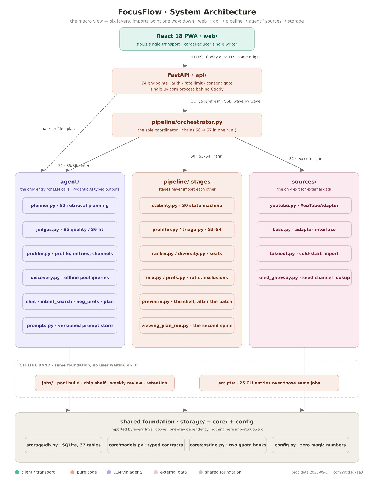

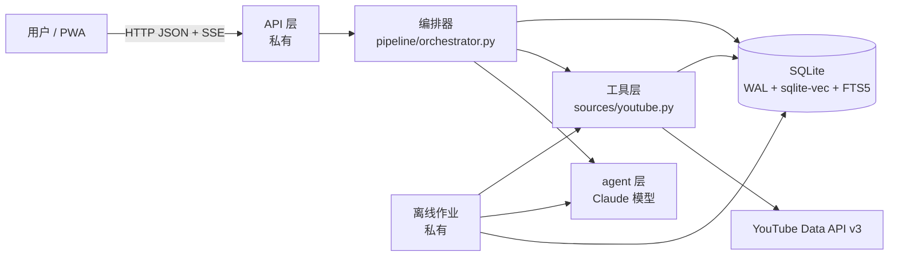

整个系统是一个进程、一个 SQLite 文件。没有消息队列,没有缓存服务器,没有第二个数据库。向量检索和全文检索都在同一个 SQLite 文件里完成。

### 3.2 分层与依赖方向

依赖只允许向下:`前端 → API → 编排器 → agent / 工具层 → 存储 → core / config`。

| 层 | 目录 | 职责与纪律 |
|---|---|---|
| 客户端 | `web/`(私有) | React PWA。只通过 HTTP JSON 和 SSE 与后端通信,和 Python 代码之间没有任何 import 关系 |
| 服务层 | `api/`(仅 `sse.py` 公开) | HTTP 与 SSE 端点、鉴权、限流、同意闸。是编排的**消费者**,不是第二个编排者 |
| 决策层 | `pipeline/` | S0~S7 与排序。各阶段互不 import,只由编排器组合;本身不调 LLM,也不调外部 API |
| agent 层 | `agent/` | 全项目**唯一**发起 LLM 调用的地方。每个 agent 都有纯代码兜底 |
| 工具层 | `sources/` | 全项目**唯一**调用 YouTube API 的地方。每次调用都记入配额账本 |
| 存储层 | `storage/` | 全项目**唯一**写 SQL 的地方 |
| 基础层 | `core/`、`config.py` | 共享模型、成本估算、脱敏。`config.py` 是阈值、权重、预算的唯一来源,业务代码里没有魔法数字 |

**import 规则**

- pipeline 里的阶段模块互不 import,只被编排器调用。这样任何一个阶段都可以单独摘掉做对照。
- `agent/` 不 import `sources/`:LLM 只出计划,不亲手调 API。
- SQL 只出现在 `storage/`;YouTube 调用只出现在 `sources/youtube.py`;LLM 调用只出现在 `agent/`。
- API 层只允许 import 编排器、预备批模块、偏好读取模块、存储、core、config、Takeout 导入,外加画像与聊天两个窄口子;禁止 import 判官、规划器、各阶段模块和 YouTube 适配器。
- 离线作业可以 import agent、sources、storage、core,但反过来不被 pipeline 和 API import。
- 有据可查的几处例外:规划器通过存储层**只读**地组装上下文,并复用 `pipeline/prefs.py` 的两个只读函数;观看计划的出卡流程复用编排器的几个纯函数;预备批模块延迟 import 了 SSE 模块里生成刷新 id 的函数。

### 3.3 一次刷新,从头到尾

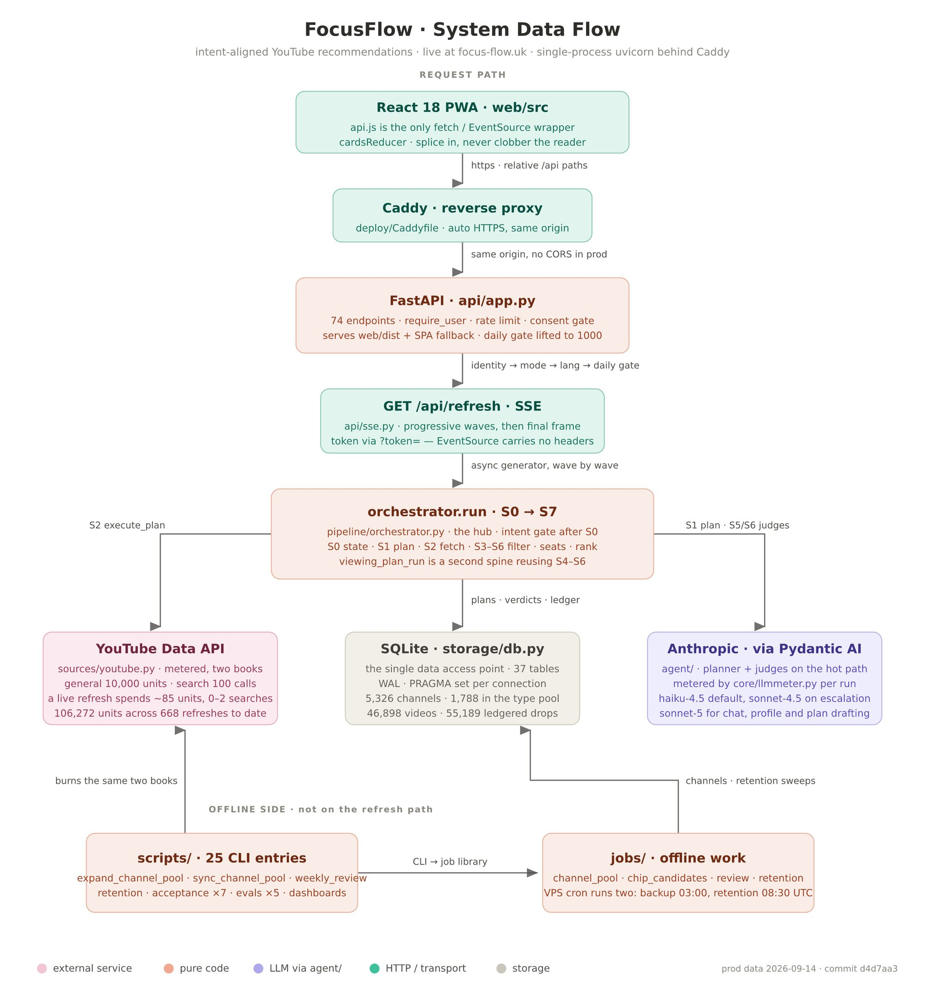

1. **秒开**。客户端进入一个模式时,API 先从按「用户 × 模式 × 语言」分开的卡片池里,把上一次的终局卡片直接吐出来(实测 21 毫秒),不花配额、不调 LLM。吐之前会用最新的拉黑、排除类型、曝光惩罚、不喜欢、已看名单再过一遍。
2. 用户点刷新,客户端打开一个 SSE 流,编排器 `run()` 开始。
3. **S0** 读这个「用户 × 模式」的状态机;同时读一次画像条目和负偏好,算出判定缓存指纹,抽出本次的画像席位计划(§5.1、§5.11)。
4. **S1** 规划。稳定态且没有意图时,可以复用上次的计划并跳过 LLM;否则由规划器产出 2~6 条策略,代码校验不过就带着原因重规划一次,再不过就用手写的兜底计划(§5.2)。如果有一次性意图,整个流程切到轻量的意图快车道(§5.10)。
5. **S1 之后的代码注入**:来源配比重分、画像搜索词轮转、种子频道、扩充频道、搜索让路、本地候选库。这些都是确定性代码,不经过 LLM。
6. **禁推名单**在取数之前一次算好:已受理申诉(豁免)、曝光惩罚、明确不喜欢、已看过。这样配额不会花在注定被丢掉的卡上。
7. **S2** 执行计划:各策略并发、去重、时长预检、补全统计、入库、时长窗过滤、按配比截断(§5.3)。
8. 已受理申诉的视频跳过 S3~S7,直接放到最前面。
9. **S3** 规则粗筛,每一条被滤掉的视频都写一行账(§5.4)。
10. **S4** 分诊:缓存命中、统计直通、待复核三桶。这是 LLM 成本的总闸门(§5.5)。
11. **S5** 质量判官审待复核桶;**同时**,直通和缓存通过的候选作为**第一波**直接进 S6。
12. **S6** 模式契合判官逐波裁定,先查 7 天缓存;每通过一批就作为 `incoming` 帧推给前端(§5.7)。
13. **S7** 去掉用户排除的内容类型(§5.8)。
14. **rank** 一次性打分、切出上屏区和折叠区,再做席位规则(§5.9);然后是来源上限、来源软保底、曝光尾席。
15. **落账**:保存计划、跑守恒校验、记录配额和 token 用量。这些都在最后一帧发出**之前**完成,客户端提前断开也不会丢账。
16. 发出终局快照帧;写入卡片池;API 标记这些卡「已上屏」并视情况启动下一批的预备(§5.14)。

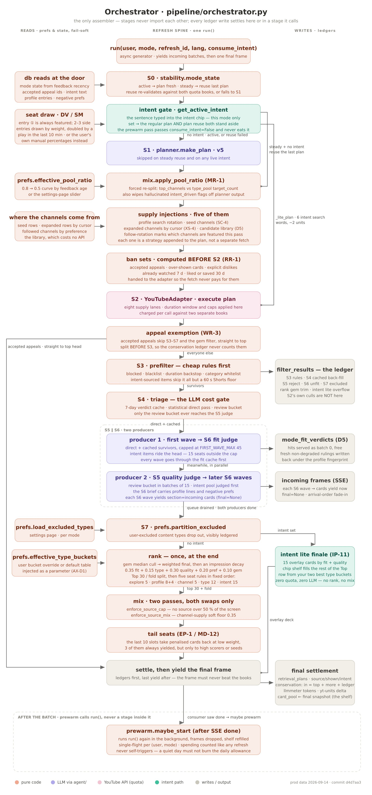

### 3.4 渐进波次与流式契约

完整刷新要几十秒,不能让用户对着转圈。做法是把 S6 拆成多个波次,谁先判完谁先上屏:

```
时间 →
生产者 1:  [第一波:直通 + 缓存通过,按统计分截取前 FIRST_WAVE_MAX 条] → S6 → 卡片帧
生产者 2:  [S5 第 1 批] → [S5 第 2 批] → ... 攒满 LLM_BATCH_SIZE 条就发一波 S6 → 卡片帧
消费者:   从队列里取帧,按到达顺序 yield 给 SSE
```

- 第一波与 S5 **并行**。两者处理的是不相交的集合,没有依赖,串行时总耗时超出预算。
- 第一波截取统计分前 `FIRST_WAVE_MAX` = 45 条(约 1.5 倍 `TOP_N`),其余**延后**到后续波次,不丢弃、不记账。如果有画像向量,截取前的排序是「统计分名次」与「与画像条目的相似度名次」的 RRF 融合,最像用户画像的先上屏。
- 第一波禁止升级到更强的模型:首屏速度比这一批的判定质量更重要。
- 后续波次只发**整批**,以便判官的批间并发真正生效;除了 S5 结束后的收尾批,只有两个例外允许半批:第一波,以及意图刷新时最早一批意图候选。
- 编排器是一个异步生成器。中间帧的 `section="incoming"`、`final=None`;**最后一帧永远是完整的终局快照**,客户端以它为准,把之前显示的卡全部按终局帧重建。这让服务端可以在终局时重排、降级甚至拿掉一张早先显示过的卡。
- 取消:生成器被关闭时,`finally` 会显式取消所有未完成的生产者任务,否则孤儿任务会继续烧 token。用户切模式或关页面,取消会一路传到判官层。

一次针对两个 LLM 阶段的、以测量为依据的并发改造,把完整刷新墙钟时间从 164.9 秒降到 **58.3 秒**(-65%):第一波与 S5 并行、判官批次并发(全局并发闸 `LLM_MAX_CONCURRENCY` = 4)、第一波按统计分截断。

### 3.5 守恒等式

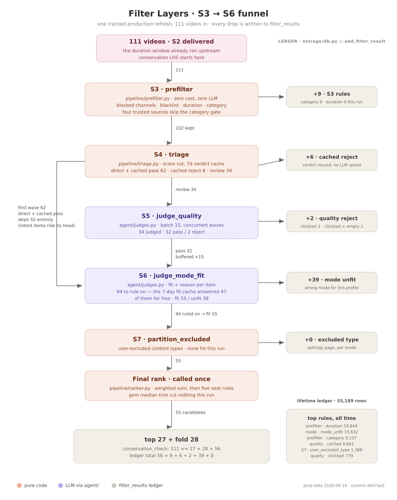

每次刷新结束都会校验:

```
S3 的输入条数 == 上屏区条数 + 折叠区条数 + 本次刷新的过滤账行数
```

进入粗筛的每一条视频,要么出现在屏幕上(上屏或折叠),要么有一行写明阶段、规则、原因的过滤记录。账本来源包括:S3 粗筛、S4 缓存里的旧拒绝、S5 拒绝、S6 拒绝、S7 排除、排序阶段的小频道中位数过滤。等式不成立时记一条 ERROR 日志,但不让刷新失败;断言放在测试里。

几个刻意的口径:

- 已受理申诉的卡在 S3 之前就分出去了,不在等式左边。
- 曝光尾席卡、意图刷新的补位卡来自卡片池或货架,从没进过 S3,也不在等式里。
- 排序阶段把卡从上屏区换到折叠区是**换位**,不是过滤,不记账。

上图那次真实刷新是 `111 == 27 + 28 + 56`。同一次刷新里,102 条粗筛幸存者中有 62 条没有进入质量判官,94 次模式契合裁定里有 47 次由 7 天缓存直接回答。出卡数量看起来不对时,第一个看的就是这个等式;它不止一次否定过错误的猜测。

### 3.6 模型档位与成本、延迟预算

| 档位 | 常量 | 当前模型 | 用在哪里 |
|---|---|---|---|
| 默认 | `LLM_MODEL` | `claude-haiku-4-5` | 规划器、两个判官、意图扩展、子方向派生、频道贴合判官、关注频道排序、频道发现 |
| 升级 | `LLM_MODEL_FALLBACK` | `claude-sonnet-4-5` | 判官某一批在重试后仍校验失败时,升级重判一次 |
| 画像 | `PROFILE_MODEL` | `claude-sonnet-5` | 画像结构化、长期信号归并、画像条目翻译、负偏好裁定 |
| 对话 | `CHAT_MODEL` | `claude-sonnet-5` | 站内聊天助手 |
| 计划 | `VIEWING_PLAN_MODEL` | `claude-sonnet-5` | 长期观看计划的起草对话 |

原则是成本优先:默认用小模型;只有测量证明有必要的地方才升级;多轮对话类的界面用大一档的模型,因为这些地方要的是多轮上下文能力。`MODE_LLM_OVERRIDES` 允许某个模式整体切到更强的模型,当前为空。模型名以 `deepseek-` 开头时会自动走另一个服务商,这个能力保留着,但一次当天试验后已经回退。

**一次普通刷新的预算(量级)**

| 项 | 数量 |
|---|---|
| 规划调用 | 0~2 次(稳定态复用或意图刷新时为 0,重规划时为 2);意图刷新另有 1 次扩词调用 |
| 质量判官 | ⌈待复核条数 / 15⌉ 批,批间并发 |
| 模式契合判官 | ⌈缓存未命中条数 / 15⌉ 批,批间并发 |
| YouTube 通用池 | 约 100 单位(计划按深翻页最坏情况预估,兜底计划约 64~72) |
| YouTube 搜索桶 | 0~2 次画像轮转搜索,另加规划器自由搜索(总量受同一闸门约束) |
| 首屏 | 21 毫秒(卡片池秒开);新卡在第一波判完后开始到达 |
| 完整刷新 | 58.3 秒(实测) |

省 LLM 的手段都写在架构里:S4 直通、质量判定缓存 7 天(跨用户共享)、契合判定缓存 7 天(按用户)、批量调用、稳定态跳过规划。

### 3.7 失败柔性的原则

1. **任何 LLM 都有纯代码兜底**,而且产品在兜底路径上必须仍然可用。
2. **兜底要可见**:兜底结果带 `degraded=True` 标记,规划来源记为 `default`,降级率是一个可以统计的指标,而不是一次事故。
3. **兜底结果不进缓存**:缓存里的每一条都意味着「LLM 真的判过」。
4. **方向有讲究**:质量和契合在大多数模式下**失败放行**(宁可让卡有机会出现,也不要白屏);睡前模式是唯一**失败拒绝**的模式,宁缺毋滥。状态机在数据不足时一律回到「活跃」,多花几个 token 比错误地复用旧计划安全。
5. **记账失败不能拖垮结果**:落账、写卡片池失败只记日志,终局帧照发。
6. **错误信息不外泄**:所有异常日志都过脱敏层(API key、会话令牌、Bearer 令牌);SSE 的错误事件只发固定文案和刷新 id。

---

## 4. 模块

### 4.1 agent 层

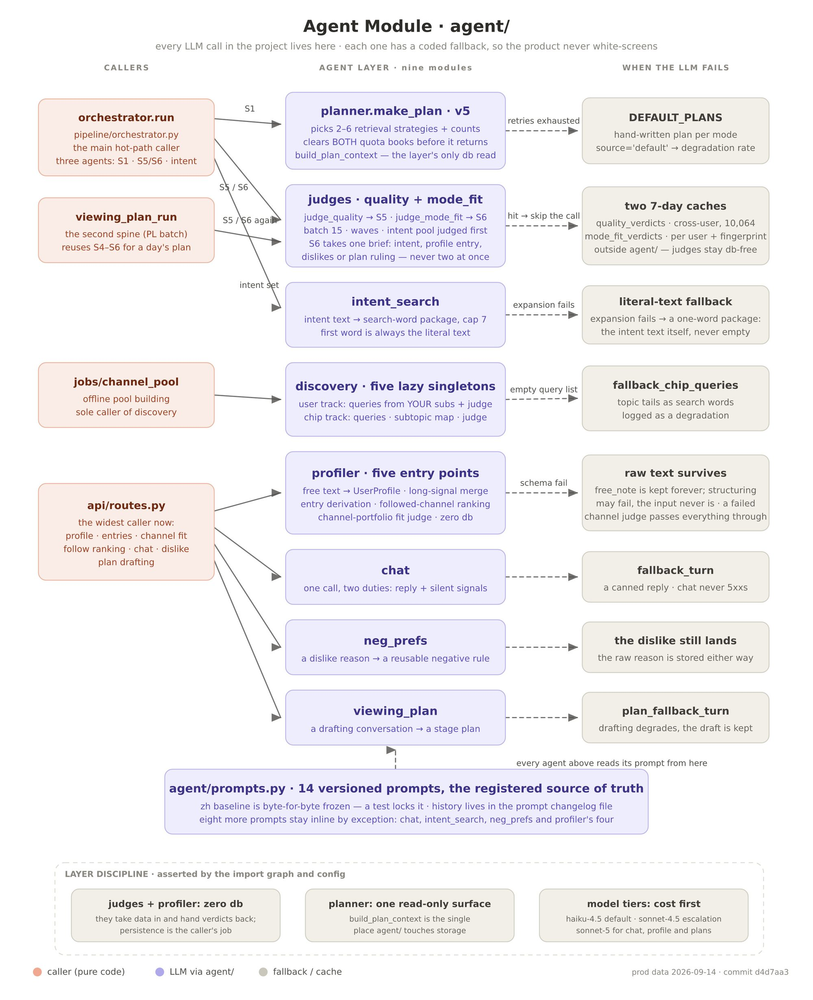

所有 agent 都用 Pydantic AI 构建,输出是带类型的 Pydantic 模型,框架负责结构校验和重试(`LLM_MAX_SCHEMA_RETRIES` = 1,单次超时 `LLM_TIMEOUT_SEC` = 60 秒)。Agent 对象都是首次使用时才构建,所以没有 API key 也能 import、能跑离线测试。

| agent | 文件 | 角色 | 输入 → 输出 | 模型档 | 失败时 |
|---|---|---|---|---|---|
| 检索规划器(S1) | `planner.py` | 为当前模式选 2~6 条检索策略 | `PlanContext` → `RetrievalPlan` | 默认 | 代码校验不过重规划一次;再失败或任何异常 → `DEFAULT_PLANS[mode]`,来源记为 `default` |
| 质量判官(S5) | `judges.py` | 0~3 四档质量分,识别三类低质 | 15 条压缩元数据 → `list[QualityVerdict]` | 默认,可升级 | 重试 → 升级 → 降级:按统计分 ≥ `DEGRADE_PASS_THRESHOLD` 放行;睡前模式全拒 |
| 模式契合判官(S6) | `judges.py` | 是否契合模式、契合分、内容类型、画像归属、推荐理由,一次调用全出 | 15 条 + 可选前缀段 → `list[ModeFitVerdict]` | 默认,可升级 | 同上;降级为 `fit=True`、`fit_score=0.5`、理由「未经模式判断」;睡前模式全拒 |
| 意图扩展 | `intent_search.py` | 把一句意图扩成多角度搜索词 | 意图原文 → `IntentQuerySet` | 默认 | 只用原文这一个词,意图检索永不归零 |
| 画像结构化 | `profiler.py` | 把自由文本拆进六个字段 | 原文 → `UserProfile` | 画像 | 异常上抛;调用方先存原文、结构化结果置空,规划器改读截断的原文 |
| 画像条目翻译 | `profiler.py` | 每条画像派生类型、搜索词、兴趣标签、英文译文 | 条目列表 → `list[EntryDerivation]` | 画像 | 异常上抛;调用方存空派生 |
| 子方向派生 | `profiler.py` | 每条画像派生 8~12 个子方向 | 条目 → 子方向列表 | 默认 | 异常上抛;只用条目主搜索词 |
| 长期信号归并 | `profiler.py` | 判断新信号与哪些已有条目同义 | 新信号 + 列表 → `LongConsolidation` | 画像 | 异常上抛;调用方按新条目追加 |
| 关注频道排序 | `profiler.py` | 按与某条画像的相关度给已关注频道排序 | 条目 + 频道 → 序号列表 | 默认 | 异常上抛;调用方退回启发式。有向量时这一步改用向量,不再调 LLM |
| 频道贴合判官 | `profiler.py` | 按近期上传标题估计频道有多少内容属于这条画像(0/1/2) | 条目 + 候选频道(每块 `EXPAND_JUDGE_BATCH` = 20 个,并发) | 默认 | 序号缺失或越界整块作废;调用方全部按 1 处理并标记未判 |
| 负偏好裁定 | `neg_prefs.py` | 把一次「不喜欢」归纳成一条题材级负偏好,或并入已有一条 | 视频 + 勾选理由 + 画像 + 已有负偏好 → `NegAdjudication` | 画像 | 异常上抛;API 层失败柔性处理,原始理由照存 |
| 聊天助手 | `chat.py` | 陪聊,同时静默提取意图候选和画像信号 | 历史 + 新消息 → `ChatTurn` | 对话 | 异常上抛;API 层回固定文案,聊天接口永不 5xx |
| 观看计划起草 | `viewing_plan.py` | 多轮对话起草多日观看计划 | 历史 + 背景 + 新消息 → `PlanDraftTurn` | 计划 | 异常上抛;API 层回固定文案 |
| 频道发现(离线) | `discovery.py` | 为离线频道池生成搜索词、判候选频道 | 频道池画像 / 兴趣标签 → 搜索词 / 入选 id | 默认 | 每个都配纯代码兜底:按主题分类出词、按硬指标排序 |

**判官的三层保护**(两个判官共用同一套实现 `_judge_batch`):

1. **结构校验**:Pydantic AI 的 `output_type`,不符合结构自动重试。
2. **批校验**:输出的 video_id 集合必须与输入一一对应(不缺、不多、不重复),质量判官还要求每条都有 `quality_grade`。不过就带着针对性的提示整批重试一次;还不过就升级到 `LLM_MODEL_FALLBACK` 重判一次;仍不过就降级。异常(超时、无 key、网络)直接降级,不升级。按平均置信度升级的触发器存在,但阈值 `ESCALATE_CONF_MEAN_MIN` = 0.0,目前不生效。
3. **差异化降级**:见上表。降级结果只由代码设置 `degraded=True`,LLM 不能自己声称降级。

**其他共同做法**

- **确定性打乱**:送进提示词之前,先按 video_id 排序抹掉检索顺序,再用批内容的哈希做种子打乱。这消除了位置偏差(检索顺序天然偏向订阅内容),同时让同一批内容的提示词顺序可复现。结果按原输入顺序还原。
- **压缩**:每条视频只给标题、简介前 `COMPRESS_DESC_CHARS` = 200 字、前 `COMPRESS_TAGS_MAX` = 8 个标签、频道名、时长、三项计数、是否隐藏点赞、官方分类名。
- **判官不碰数据库**:读写缓存、写过滤账都由调用方负责。这样判官是纯 LLM 函数,可以零成本离线测试;每批完成就 yield,调用方立刻落库,判过的批不会因后面的失败而丢。
- **英文界面**:`lang="en"` 时在用户提示词末尾追加「理由用英文写」,系统提示词不变。

**提示词注册表**:[`prompts.py`](../src/agent/prompts.py) 里有 15 个带版本的提示词(规划器、画像结构化、质量判官、四个模式的契合判官、频道发现的用户轨两个、兴趣标签轨三个、标签理由、画像子方向、观看计划)。四个契合提示词共用同一段「内容类型判定」文本,防止四份各自漂移;改这段就要同时升四个版本号。版本变更记在单独的变更记录里,有测试保证每个当前版本都有记录。聊天、意图扩展、负偏好裁定等少数提示词写在各自文件里。提示词里出现的数字(策略数、搜索上限等)只是给 LLM 的行为指引,真正的硬闸门是代码里的校验,两者不一致时以代码为准。

### 4.2 管道各阶段

| 阶段 | 文件 | 成本 | 读 | 写 |
|---|---|---|---|---|
| S0 状态 | `pipeline/stability.py` | 纯 SQL 聚合,零 token | 动作、反馈、计划历史 | — |
| S1 规划 | `agent/planner.py` | 0~1 次 LLM | 偏好频道、类型池、反馈、配额、上次计划、画像、意图 | — |
| S1 之后的注入 | `pipeline/orchestrator.py`、`mix.py`、`diversity.py`、`subtopics.py` | 纯代码 | 画像条目、种子/扩充频道、配比设置 | 搜索游标、子方向游标、扩充游标、每用户搜索计数 |
| S2 抓取 | `sources/youtube.py` | YouTube API | 频道、视频时长缓存、翻页游标 | 频道、视频、配额、翻页游标 |
| S3 粗筛 | `pipeline/prefilter.py` | 纯代码 | 拉黑、冷却、信任频道 | 过滤账 |
| S4 分诊 | `pipeline/triage.py` | 纯代码 | 质量判定缓存 | —(只读,只路由不裁决) |
| S5 质量 | `agent/judges.py` | LLM 批量 | — | 质量判定缓存、过滤账(由编排器写) |
| S6 契合 | `agent/judges.py` | LLM 批量,先查缓存 | 契合判定缓存 | 契合判定缓存、过滤账(由编排器写) |
| S7 排除 | `pipeline/prefs.py` | 纯代码 | 排除类型 | 过滤账 |
| rank | `pipeline/ranker.py`、`diversity.py`、`mix.py` | 纯代码 | 频道偏好分、曝光次数、订阅数 | 过滤账(仅小频道中位数过滤) |
| 落账 | `pipeline/orchestrator.py` | — | — | 计划日志、用量、卡片池 |

### 4.3 工具层(数据源)

**适配器契约**:[`sources/base.py`](../src/sources/base.py) 定义 `SourceAdapter` 抽象类,有五个抽象方法。前四个是规划器可选的四种工具,名字与 `StrategyCall.tool` 的四个取值一一对应;第五个是补全:

| 方法 | 产出的来源标签 | YouTube 端点 |
|---|---|---|
| `fetch_channel_videos(channel_id, n)` | `subscribed` | `playlistItems.list` |
| `search_by_keyword(query, n)` | `search` | `search.list`(搜索桶) |
| `fetch_trending_by_category(category_id, n)` | `trending` | `videos.list?chart=mostPopular` |
| `mine_hidden_gems(k)` | `hidden_gem` | 小频道池抽样后取 `playlistItems.list` |
| `enrich_stats(videos)` | —(补全,不是检索) | `videos.list`,每 50 条一次 |

检索工具只返回「裸视频」(id、频道、来源标签),标题、时长、统计数由 `enrich_stats` 批量补全。接入新平台 = 写一个新适配器,管道骨架不动。

**同一个工具,多种身份**:`fetch_channel_videos` 通过参数区分出多条供给轨道。规划器能直接用其中两种(偏好频道、类型池),其余由编排器在 S1 之后注入:

| 参数 | 轨道 | 来源标签 | 是否调 API |
|---|---|---|---|
| `use_top_channels` | 我的频道(加权轮转) | `subscribed` | 是 |
| `use_type_pool` | 共享类型频道池 | `channel_pool` | 是 |
| `use_seed_channels` | 用户在画像条目上钦点的种子频道 | `seed_channel` | 是 |
| `use_expanded_channels` | 经判官核验的扩充频道 | `expanded_channel` | 是 |
| `use_library` | 本地高质量候选库 | `seed_channel` / `subscribed` | **否**(只补全统计) |
| `use_local_intent` | 意图的本地全文召回 | `search`(带意图标记) | **否** |
| `channel_id` | 单个指定频道 | `subscribed` | 是 |

**计划执行器 `execute_plan`** 的固定顺序:

1. **预算守卫**:用 `core/costing.py` 按两个账本重算计划成本(不信 LLM 自报的 `est_quota`),减去其他正在执行的计划的预留量后比较;超了就拒绝执行。这是在规划器校验之外的最后一道防线,因为有些调用方(校准脚本、对照实验)会绕过规划器。
2. 注入模式的地区和语言偏好(`relevanceLanguage` 只加在含中文的搜索词上,它是软偏置,不是过滤)。
3. 各策略并发执行,单条策略失败不影响其他策略,单个频道失败不影响同一策略里的其他频道。
4. 按来源优先级去重(`SOURCE_PRIORITY`:种子 > 我的频道 > 扩充 > 小频道 > 类型池 > 搜索 > 热门);意图标记在撞车时取「或」,不会因来源标签被覆盖而丢失。去重在补全之前,同一个 id 不会被收两次费。
5. 补全前零成本预筛:去掉禁推名单里的视频、去掉已知时长在模式窗口外的视频(时长来自热门榜预填或视频表缓存)。意图结果豁免。
6. 补全统计并入库。窗口外的视频也入库,视频表顺带成了下次预筛用的免费时长缓存。
7. 补全后按模式时长窗过滤;每个频道最多保留 `S2_PER_CHANNEL_MAX` 条;按各策略的 `target_count` 截回配比,非搜索来源的总量封顶 `S2_DELIVER_MAX`(`S2_PER_CHANNEL_MAX` = 8,`S2_DELIVER_MAX` = 90;任一设为 0 即关闭)。

S2 侧的删除只记日志,不写过滤账:守恒等式从 S3 的输入开始算。

**配额**:每个真实调用在**成功之后**立即记账,按 `quota_bucket(tool)` 路由到通用池或搜索桶。规划阶段的成本估算按深翻页的最坏情况(`CHANNEL_DEEP_PAGES_MAX` = 3 页)和超采后的补全批数计算,宁高勿低。

### 4.4 存储与检索

**表的概念划分**(全部 SQL 都在 `storage/` 里,本仓库只公开检索部分)

| 共享(与用户无关的客观属性) | 按用户隔离 |
|---|---|
| 频道(订阅数、上传列表 id、是否小频道、兴趣标签) | 频道偏好分、关注标志、拉黑、信任 |
| 视频(元数据与统计) | 动作与反馈、申诉 |
| 质量判定缓存(内容属性,跨用户共享) | 过滤账(按刷新 id) |
| 冷启动货架(按兴趣标签备好的卡) | 检索计划日志 |
| 视频与文本的向量映射表、全文索引 | 卡片池、模式契合判定缓存 |
| 配额账本(全站) | 画像条目、子方向、种子频道、扩充频道、负偏好、会话意图、模式设置、观看计划、每日用量 |

**混合检索**([`storage/retrieval.py`](../src/storage/retrieval.py))

- **向量**:`sqlite-vec` 的 vec0 虚拟表,512 维(`EMBED_DIM`),余弦距离;嵌入模型 `EMBED_MODEL` = `BAAI/bge-small-zh-v1.5`。vec0 表只存向量,「这个向量属于哪个视频/频道/条目、用的哪个模型、原文哈希是多少」放在普通的映射表里,用同一个 rowid 关联。视频一张向量表;频道、画像条目、兴趣标签、负偏好、子方向共用另一张,用 `(kind, key)` 区分。
- **全文**:FTS5,用 jieba 预先分词再交给 `unicode61` 分词器,因为默认分词器会把一整串汉字当成一个词。索引是自有内容表,不挂在视频表上(视频表主键是文本,没有稳定 rowid,而且索引列存的是分词后的派生文本)。
- **融合**:两路各取前 3k,用 RRF(`RRF_K` = 60)按名次融合;两路分数量纲不同(bm25 无上界,余弦在 0~1),只用名次就不用调权重。纯英文查询时全文这一路用 K/2,提高字面命中的权重,因为这个嵌入模型英文较弱。
- **范围查询**:vec0 只能按 rowid 限定范围,所以「只在这些视频里找」先翻译成 rowid 集合;范围不为空时直接算余弦距离,而不是用 `MATCH ... k = ?`(带 rowid 范围时 `k = 1` 会返回空,而范围通常只有几十到几百行,直接算既正确又便宜)。
- **优雅退化**:没装 sqlite-vec 或开关关闭时,`vector_available()` 为假,向量写入静默跳过、读取返回空,混合检索自动退成纯全文。调用方只看这一个函数,不去猜表在不在。向量的计算在一个独立的离线作业里完成(模型常驻约 900 MB,不能放进 Web 进程);新保存的画像条目次日才有向量,所有读取方都容忍向量缺失。

**向量用在哪**

| 位置 | 作用 | 开关 |
|---|---|---|
| 候选库重排 | 超采 `E1_LIBRARY_OVERSAMPLE` = 4 倍,按画像条目分段贪心认领:档 1 → 本次抽中的副档 → 其余条目 → 未命中按原顺序 | `E1_VECTOR`、`E1_ENTRY_ISOLATION` |
| 意图本地召回 | 意图原文在本地全文索引里找,命中够多就少搜几次 | `INTENT_LOCAL_RECALL` |
| S6 第一波排序 | 统计分名次与画像相似度名次做 RRF | `E7_VECTOR` |
| 子方向并入 | 每条画像的相似度 = max(条目相似度, `VEC_SUBTOPIC_WEIGHT` × 子方向相似度) | `ES_VECTOR` |
| 关注频道排序、扩充候选预排、类型池补位(私有 API 层) | 条目向量 × 频道向量 | — |

向量只回答「先看哪个、先送哪个」,不回答「该不该要」。质量判官、契合判官、粗筛规则、排序公式都不受它影响。命中门槛 `VECTOR_SIM_MIN` = 0.55。

**缓存**

| 缓存 | 键 | 有效期 | 说明 |
|---|---|---|---|
| 质量判定 | video_id | `QUALITY_CACHE_TTL_DAYS` = 7 天 | 跨用户共享(质量是内容属性);只由 S5 写,S4 只读,单一写者 |
| 模式契合判定 | 用户 × 模式 × video_id × 指纹 | `FIT_CACHE_TTL_DAYS` = 7 天 | 指纹 = sha1(提示词版本、模型、语言、本模式画像条目全文、负偏好全文);任何一项变了,旧判定全部失效 |
| 卡片池 | 用户 × 模式 × 语言 | 超过 `POOL_STALE_HOURS` = 6 小时只改提示文案 | 秒开和预备批的载体 |
| 冷启动货架 | 兴趣标签 × 语言 | `CHIP_CANDIDATE_TTL_DAYS` = 90 天 | 零配额、零 LLM 的兜底供给 |

**本地候选库**(`library_candidates`):从「本模式全部种子频道 ∪ 偏好分最高的 `LIBRARY_TOP_K` = 10 个频道」里,取本地视频表中尚未上过屏、未被判为不契合、不在禁推名单里的视频,每次最多 `LIBRARY_PER_REFRESH` = 30 条,零 API。上过屏的旧卡在最近一次上屏超过 72 小时后可以回流。排序:从没进过卡片池的在前,回流的在后;各自里未判过的在前,然后按发布时间倒序。

### 4.5 API 与 SSE 桥

[`api/sse.py`](../src/api/sse.py) 是编排器的唯一消费者,只做一对一翻译,不做第二次编排:不去重、不重排、不重新分组。

- **事件**:`card` × N → `done` 或 `error`。每张卡通过 `CardOut.from_item` 投影成展示层结构,`final` 字段区分预览帧和终局帧。
- **同一用户只保留最新的流**:新流开始时主动取消该用户的旧流。用取消而不是锁,因为生成器停在 `yield` 时被取消,`finally` 的执行时机取决于垃圾回收,锁可能永远不释放。
- **断开**:客户端断开时,取消异常**不被吞掉**,一路传进编排器,停掉还在烧配额的管道。
- **中途异常**:响应头已经发出,状态码不能再改成 500,于是发一个 `error` 事件(固定文案 `PIPELINE_ERROR_TEXT` + 刷新 id)后正常结束,不发 `done`。编排器在这条路径上到不了写卡片池那一步,残缺的结果不会覆盖上一次好的结果。
- **心跳**:沉默 15 秒发一行 SSE 注释,防止反向代理把连接当空闲掐掉。心跳包装层用同一个复制好的上下文驱动每一次 `__anext__`,保证编排器开头安装的 token 计量器对后来创建的生产者任务可见。
- **`done` 之后**:标记终局卡「已上屏」,再尝试启动下一批预备(§5.14)。

### 4.6 前端(概览,私有)

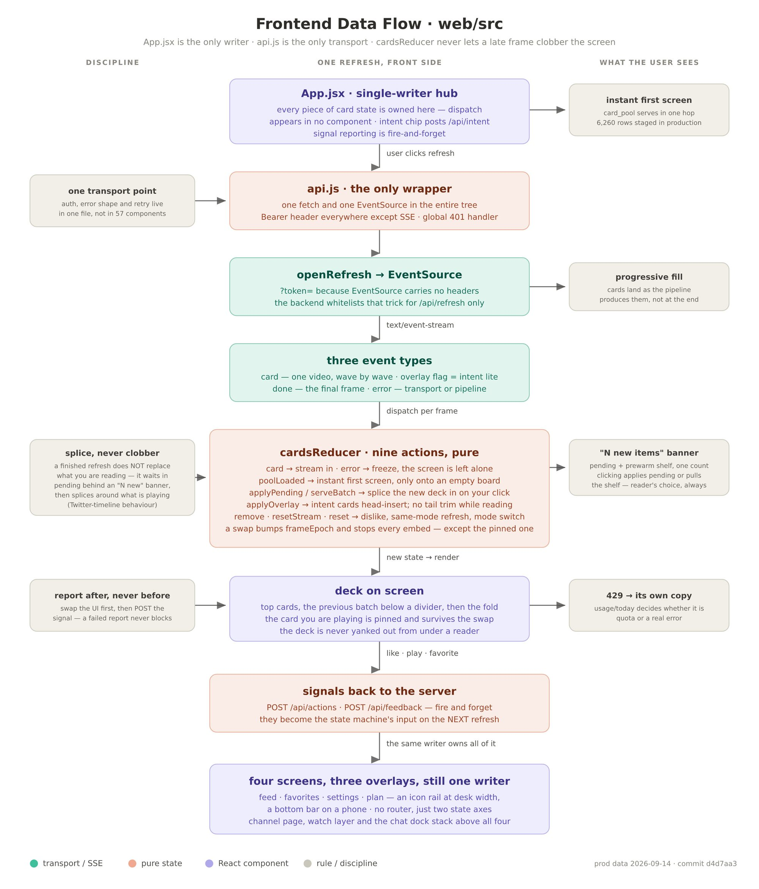

- React 18 + Vite + Tailwind CSS v4,PWA,可安装到手机主屏。
- 不用路由库,不用全局状态库;每个「页面」是根组件里的一个状态切换。
- 一个传输模块封装全部 fetch 和 EventSource;一个 reducer 是卡片状态的唯一写者。
- **帧模型**:预览帧半透明淡入,终局帧到达后按终局帧重建列表。进度条显示当前在哪个阶段。
- 信号上报「发出即忘」:界面先更新,上报失败不阻塞、不回滚。
- 站内播放不带侧栏推荐、不自动连播;「在 YouTube 打开」是一个显式的出口。
- 中英双语,模式即主题色。

### 4.7 离线作业(概览,私有)

| 作业 | 目的 |
|---|---|
| 周度复审 | 只读地汇总一周的申诉队列、过滤规则分布、主动动作、频道池健康、黑名单词命中、负偏好;由人通过命令行裁定申诉(受理即成为长期豁免)或撤销被过度应用的负偏好 |
| 嵌入作业 | 每晚增量计算视频、频道、画像条目、子方向、兴趣标签、负偏好的向量,同时写全文索引;按原文哈希跳过没变的行 |
| 频道池 | 用 `agent/discovery.py` 的 LLM 出词和判官,按 44 个兴趣标签建一个共享的、经过筛选的类型频道池(订阅数硬下限 `TYPE_POOL_SUBS_MIN` = 20 万),以及一个小频道池;另有用户轨从用户已有偏好频道出发找同类 |

这些作业都不在刷新链路上,没有用户会等它们。

---

## 5. 细节

### 5.1 S0 · 状态机

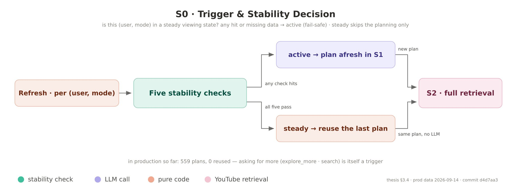

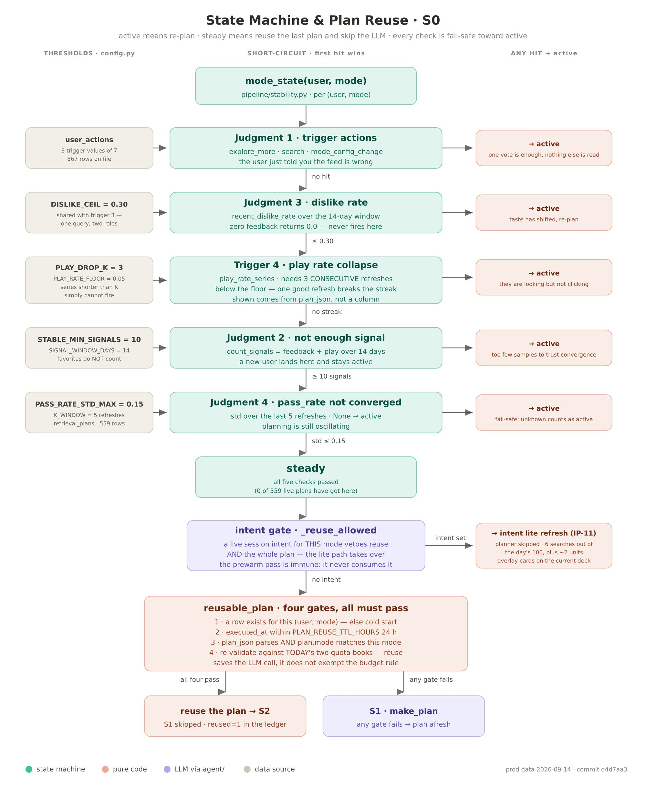

每个「用户 × 模式」独立维护两个状态:**活跃**(active)和**稳定**(steady)。`stability.mode_state` 按顺序检查,任一命中即为活跃:

| 检查 | 规则 |
|---|---|
| 0 总开关 | `ENABLE_ACTION_SIGNALS` 关闭 → 永远活跃 |
| 1a 触发动作 | 近 `SIGNAL_WINDOW_DAYS` = 14 天内有「换一批 / 主动搜索 / 修改模式设置」任一动作 |
| 1b 点踩率 | 近 14 天点踩率 > `DISLIKE_CEIL` = 0.30 |
| 1c 播放率骤降 | 最近 `PLAY_DROP_K` = 3 次刷新的播放率(播放数/展示数)**全部**低于 `PLAY_RATE_FLOOR` = 0.05 |
| 2 信号不足 | 近 14 天反馈 + 播放少于 `STABLE_MIN_SIGNALS` = 10 条 |
| 4 未收敛 | 最近 `K_WINDOW` = 5 次刷新的质量通过率标准差 > `PASS_RATE_STD_MAX` = 0.15,或数据不足 |

方向是**数据不足即活跃**:多花几个 token 总比错误地宣布收敛、拿旧内容糊弄人要安全。全部是 SQL 聚合,零 token。

**稳定态只跳过规划**。复用计划需要再过四关(`stability.reusable_plan`):存在上一份计划;它在 `PLAN_REUSE_TTL_HOURS` = 24 小时内;能反序列化为本模式的合法计划;用**今天的**两个配额账本重新校验通过(校验函数由编排器注入,`stability` 不依赖 agent 层)。任一关不过就照常走 S1。复用不是复刻:S2 照样全量执行,频道上传列表按时间倒序,新视频照样进来。防止内容停滞的另外两道保险是探索位下限(§5.9)和播放率骤降触发器。

有意图时永远不复用:意图是一次性的输入,必须走新的检索。

### 5.2 S1 · 规划

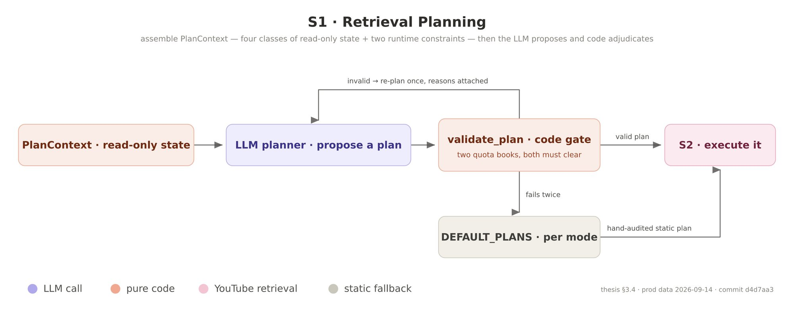

**上下文** `PlanContext`(由 `build_plan_context` 只读组装,所有数据库行都转成普通类型,保证能整体序列化进提示词):

| 字段 | 内容 |
|---|---|
| `mode_config` | 模式摘要:关键词池、分类白名单、时长窗口、是否允许小频道挖掘、是否严格模式(黑名单词刻意不给,那是 S3 的事) |
| `channels` | 15 个频道:用户偏好分最高的频道与类型池频道按来源配比切分,一侧不够另一侧补;类型池频道只取本模式前两档内容类型、排除用户已有偏好分的频道,在内存里给中性分 0.5,**从不写回用户偏好** |
| `feedback` | 最近的显式反馈按频道聚合 `[赞数, 踩数]` |
| `quota_left` / `search_left` | 两个账本的今日余量 |
| `last_plan` | 上次计划、各策略实际取回条数、通过率、是否复用;让规划器自我调整 |
| `time_stats` | 时段行为分布 |
| `user_profile` | 持久画像六字段;结构化失败时退成截断原文 `free_note` |
| `session_intent` | 当前意图原文 |

**提示词里的指引**(软约束):总目标数 240~300 条,用来对冲时长规则造成的折损(订阅生态里 Shorts 很多,实测折损 56%~92%);预算不够时预算优先;允许小频道挖掘的模式应当包含挖掘策略,不允许的模式禁止使用;优先级链为「模式硬约束 > 意图 > 当前目标 > 兴趣 > 行为偏好」;有意图时产出一句不超过 60 字的确认语 `ack`。

**代码校验** `validate_plan`(硬约束,不信任 LLM 自律):

1. 规划器自由选择的搜索策略不超过 `MAX_SEARCH_PER_REFRESH` = 2 个;搜索桶剩余低于 `SEARCH_FLOOR_PROFILE` = 20 时为 0 个。
2. 通用池成本 ≤ 今日剩余 × `PLAN_QUOTA_BUDGET_RATIO` = 0.5;搜索次数 ≤ 搜索桶剩余。成本由代码重算。
3. 策略数在 `PLAN_MIN_STRATEGIES` = 2 到 `PLAN_MAX_STRATEGIES` = 6 之间;上限只数 LLM 自己写的策略,编排器注入的种子、扩充、候选库、本地意图不计。
4. 每个工具的必需参数都在(否则执行时会因缺键作废)。
5. 计划的模式必须是请求的模式。

不过就把失败原因放进下一轮用户提示词的开头,重规划 `PLANNER_REPLAN_MAX` = 1 次;仍不过,或出现任何 LLM 异常(无 key、超时、结构重试耗尽),返回 `DEFAULT_PLANS[mode]` 的深拷贝。返回值的来源字段是 `agent`、`agent_replan` 或 `default`,降级率可以统计。

**兜底计划**(`DEFAULT_PLANS`,手写、手审):

| 模式 | 策略 |
|---|---|
| 专注 | 我的频道 120 · 类型池 40 · 搜索「白噪音 纯音乐」40 · 搜索「AI tools productivity」40 · 音乐分类热门 30 |
| 娱乐 | 我的频道 150 · 类型池 40 · 喜剧分类热门 40 · 小频道挖掘 40 |
| 探索 | 我的频道 150 · 类型池 40 · 搜索「科普 原理」50 · 小频道挖掘 40 |
| 睡前 | 我的频道 100 · 类型池 40 · Howto&Style 分类热门 40 · 搜索「治愈 慢生活」40 |

**规划之后的代码注入**(非意图刷新,对规划器产出、复用计划、兜底计划一视同仁):

1. **清除幻觉标记**:规划器输出里若有 `intent_driven=True`,一律清零。只有编排器能发这张「意图通行证」。
2. **来源配比**(`apply_pool_ratio`):把「我的频道」和「类型池」两条策略的目标数加总,按类型池占比重新切分。占比优先取用户在设置页的滑块;否则随信号成熟度从 `POOL_RATIO_NEW` = 0.8 线性滑到 `POOL_RATIO_MATURE` = 0.5(成熟度 = 近 14 天信号数 / 10,封顶 1)。用户还没有任何偏好频道时,全部给类型池,避免新用户那一份取回空。
3. **画像搜索轮转**(§5.11)。
4. **种子频道**和**扩充频道**的定向抓取(§5.11)。
5. **搜索让路**:无论计划从哪来,剩余的非意图搜索都要再过一次闸:搜索桶低于 20 或该用户今日画像搜索将超过 `PROFILE_SEARCH_DAILY_MAX` = 40,就整体剔除;否则记入该用户的今日用量。
6. **本地候选库**(§4.4),放在最后,在配比截断下只填订阅和种子目标剩下的空。

### 5.3 S2 · 抓取

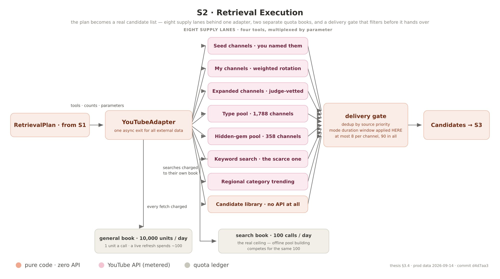

执行顺序见 §4.3。几条轨道的细节:

- **我的频道轮转**:候选集是用户未拉黑、偏好分 ≥ `FOLLOW_POOL_MIN_PREF` = 0.5,且「已关注」或「偏好分 ≥ `FOLLOW_POOL_LOVED_PREF` = 0.75」的频道。按权重无放回抽样:`exp(FOLLOW_PREF_BETA × (偏好分 − 0.5)) × FOLLOW_PICK_DECAY ^ 今日已被抽中次数 × (若该频道近期被归属到本次主推的画像条目则 × FOLLOW_ENTRY_AFFINITY)`,参数分别是 8.0、0.85、2.0。偏好分 0.6 的权重约 2.2,0.9 约 25。这样一天之内整个关注列表都会轮到,而不是每次都是同几个频道的最新视频。
- **深翻页**:每个频道先取第一页(最新上传,每页 `CHANNEL_PAGE_SIZE` = 50 条)。有效条目(不在禁推名单、未收集过、已知时长不在窗口外)不够时,从「用户 × 频道」的游标处继续往深翻,每次刷新每个频道最多 `CHANNEL_DEEP_PAGES_MAX` = 3 页。翻到底就标记为耗尽,`CHANNEL_DEEP_RESET_DAYS` = 30 天后再从头开始。游标读写失败退回只取第一页。
- **超采**:非意图策略按 ⌈目标数 × `S2_OVERFETCH_FACTOR`⌉ = 2 倍取,给补全后的时长过滤留余量;在 50 条一页之内不多花检索配额。意图策略不超采,每个搜索词恰好取自己那一份。
- **小频道挖掘**:从小频道池(订阅数低于 `SMALL_CHANNEL_SUBS_MAX` = 20 万)随机抽 `SMALL_POOL_SAMPLE_K` = 6 个频道,有 24 小时冷却;没有缓存上传列表 id 的当场解析并缓存,死频道也进冷却,浪费上限是每频道每天 1 单位。
- **类型池**:按用户勾选的兴趣标签从共享池取 8 个频道,先排除用户拉黑的频道(否则这一单位和这一个名额就白花了)。这条路径**永远不写**用户偏好表。
- **热门榜**:是唯一在截断前就知道真实时长的路径,所以窗口外的条目可以在补全前免费丢掉。

### 5.4 S3 · 规则粗筛

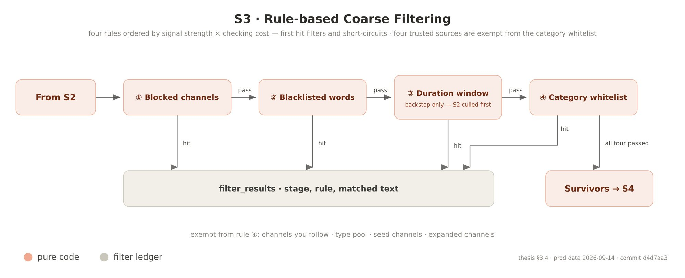

规则按「信号强度 × 检查成本」排序,命中第一条即过滤并短路,每条视频只记一个原因:

| 顺序 | 规则 | 记账规则名 | 说明 |
|---|---|---|---|
| 1 | 拉黑频道 | `channel_blacklisted` | 搜索和热门不经过频道级排除,必须在这里拦 |
| 1 | 冷却中的频道 | `channel_cooldown` | 用户说过「这个频道推太多了」,见 §5.13 |
| — | **意图来源** | `intent_shorts_floor` | 只保留拉黑检查和 `INTENT_MIN_DURATION_SEC` = 60 秒的反 Shorts 下限,其余规则全部豁免 |
| 2 | 黑名单词 | `blacklist:<词>` | 匹配标题 + 简介前 200 字 + 标签;ASCII 词整词匹配(前后不能是字母数字),中文词子串匹配;多个命中时报最长的那个 |
| 3 | 时长窗口 | `duration` | 与 S2 共用 `Mode.fits_duration`,这里只是兜底;时长为 0(补全失败)自然被滤 |
| 4 | 分类白名单 | `category` | 我的频道、类型池、种子、扩充四种频道来源以及用户信任的频道**豁免**:用户或池子的筛选已经为主题担保,而 YouTube 的分类与模式并不对齐 |

豁免只免这一条规则,后面的质量和契合判断照旧。

### 5.5 S4 · 分诊(LLM 成本总闸门)

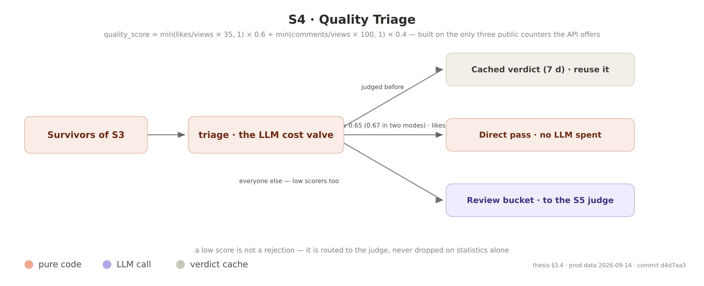

统计质量分只能用 API 给的三个数:

```
like_term    = min(点赞数 / max(播放数, 1) × QUALITY_LIKE_RATE_SCALE, 1)        # 35
comment_term = min(评论数 / max(播放数, 1) × QUALITY_COMMENT_RATE_SCALE, 1)     # 100
质量分 = like_term × QUALITY_W_LIKE + comment_term × QUALITY_W_COMMENT           # 0.6 / 0.4
隐藏点赞时:质量分 = comment_term
```

三个桶,顺序固定:

| 桶 | 条件 | 去向 |
|---|---|---|
| 缓存 | 7 天内有质量判定(无论通过与否) | 通过的进第一波;拒绝的由编排器记账(规则 `cached`) |
| 直通 | 质量分 ≥ 阈值(`QUALITY_PASS_THRESHOLD` = 0.65;娱乐和探索为 `MODE_DIRECT_THRESHOLDS` 里的 0.67),且点赞项 ≥ `DIRECT_LIKE_TERM_FLOOR` = 0.4;隐藏点赞的不直通(`ALLOW_LIKE_HIDDEN_DIRECT` = False) | 第一波,质量归一值记为常数 `DIRECT_PASS_QUALITY_NORM` = 0.6 |
| 待复核 | 其他全部,**包括分数很低的** | S5 |

低分不等于拒绝:新视频和小频道的统计数据不可靠,所以没有「统计一票否决」,也没有绝对播放量门槛。S4 不写任何东西,也不需要 user_id:统计分每次都免费重算,缓存它只会把一个免费信号冻结好几天。

### 5.6 S5 · 质量判官

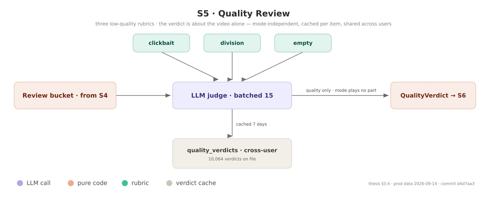

- 判的是**内容本身**,与模式无关、与语言无关,所以判定结果跨用户共享缓存。
- 四档 `quality_grade`:3 优质、2 合格(信号不明确时的默认档)、1 偏低、0 低质。`passed` 由代码按 `grade ≥ QUALITY_GRADE_PASS_MIN` = 2 推导,LLM 给的分级是唯一真相。
- 三类低质:**clickbait**(震惊体、标题与内容错位)、**division**(以对立为核心叙事、以个例污名化群体)、**empty**(标题党、AI 口水文、无原创信息的剪辑合集)。
- 判断原则:只看到元数据,不要脑补内容;拿不准偏向通过;「煽动对立」必须高置信才定 0,严肃讨论争议议题不算;隐藏点赞是「未知」不是证据。
- 每批 `LLM_BATCH_SIZE` = 15 条,所有批次一开始就全部调度,按输入顺序 yield,调用方每拿到一批就落库。
- 意图刷新时,待复核队列里的意图候选排在最前,让它们先判完、先进 S6。
- 被拒视频的规则名是 LLM 给的低质类别(如 `clickbait,empty`);降级拒绝记 `degraded_reject`。
- 质量归一值:LLM 判定为 `grade / 3`;降级通过的用统计分。由此保证顺序 0 < 1/3 < 0.6(直通) < 2/3 < 1。

### 5.7 S6 · 模式契合判官

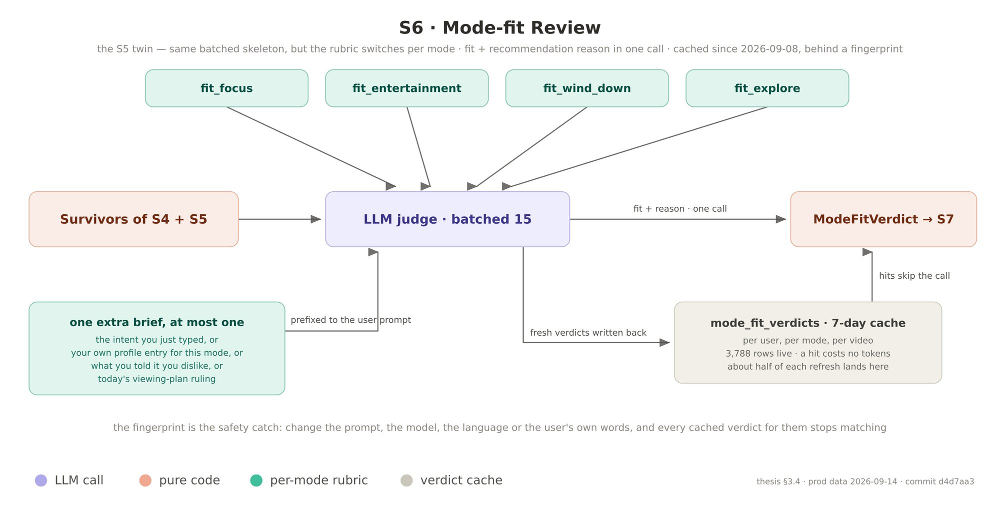

一次调用同时产出五样东西:是否契合、契合分(0~1,进排序)、内容类型(17 类之一或 `other`)、画像归属(属于本模式第几条画像,或 null)、推荐理由(`fit=True` 时就是卡片上展示给用户的那句话)。

**四个模式各有一份评分标准**(`fit_focus`、`fit_entertainment`、`fit_explore`、`fit_wind_down`),都带边界判例。系统提示词固定不变;本批的特殊情境用**用户提示词前缀**表达,按优先级只取一种:

| 前缀 | 何时 | 效果 |
|---|---|---|
| 意图裁定 | 意图池 | 改判「是否贴合这句意图」,模式的排除条款对本批不适用;质量底线照旧;理由用「应你的要求」口吻 |
| 计划裁定 | 观看计划出卡 | 改判「是否贴合计划当前阶段」,渐进式计划还要难度匹配 |
| 画像条目 | 常规池且用户写了画像 | 列出本模式画像条目,命中的给更高分并在理由里点明;同时要求输出画像归属,按内容主题从严判 |
| 负偏好 | 仅常规池,可与画像段并存 | 明确命中判 `fit=false`,理由以「不喜欢命中:」开头(`NEG_PREF_HIT_PREFIX`);疑似命中但另有价值的压低分数;不得扩大解释 |

意图与计划两种前缀互斥,同时传入会直接报错。

**契合缓存**(`_fit_with_cache`):常规池先查缓存,命中的作为一批立刻 yield(不调 LLM,账本备注加「[缓存]」前缀);未命中的送判官,非降级的判定写回。意图池不走缓存。缓存读失败视为全部未命中,写失败只告警。

**判定的统一消费点** `fit_effective`:`fit=False` → 记 `mode_unfit`(真判定)或 `mode_degraded_reject`(降级);`fit=True` 的降级判定绕过分数阈值(保留失败放行);可选的分数阈值 `FIT_SCORE_THRESHOLD` 当前为 None,即不启用。

**画像归属**是席位分配的依据(§5.9)。LLM 输出不可信,编排器把它钳到 1..条目数之间,越界或布尔值一律置空。归属按内容主题判,而不是按宽泛的基础类型,防止「沾边」的卡冒充某条具体的画像。

**内容类型**是内容的全局属性,与模式无关。17 类词表是 `CONTENT_TYPES`;提示词里有一张 11 步的裁定阶梯处理边界(时事新闻优先、纯环境声、影视解说归影视、美妆教程归时尚美妆……命中即止)。词表外的值不会弄坏排序(按未知类型给 0.6),但会汇总成每次刷新一条告警日志。

### 5.8 S7 · 排除类型

用户可以在每个模式下永久排除某些内容类型。语义是「永远不出现」,而不是「沉底」,所以在排序**之前**整条拿掉,并以阶段 `S7`、规则 `user_excluded_type` 记账,用户在侧栏能看到、能申诉。

例外:**豁免档**。画像条目是用户认真写下的,排除类型往往是随手勾的;两者冲突时画像优先,但只限最重要的几条。自动模式下是第 1~`EXCLUDE_EXEMPT_TOP_N` 条(当前 2),手动占比模式下是占比最高的 2 条。归属于豁免档的卡会通过,并记一行 `exempt_top_entry` 说明原因。用户若在冲突提示里明确选择「保持排除」,豁免取消。席位侧(抽签、手动席位、搜索词顺序)和 S7 用的是同一个有效排除集,两边保持同步,否则会出现「席位留了、卡却被拦」的空席。类型为 null(判官降级)的卡永远不被排除:未知即无罪。

### 5.9 rank · 排序与席位

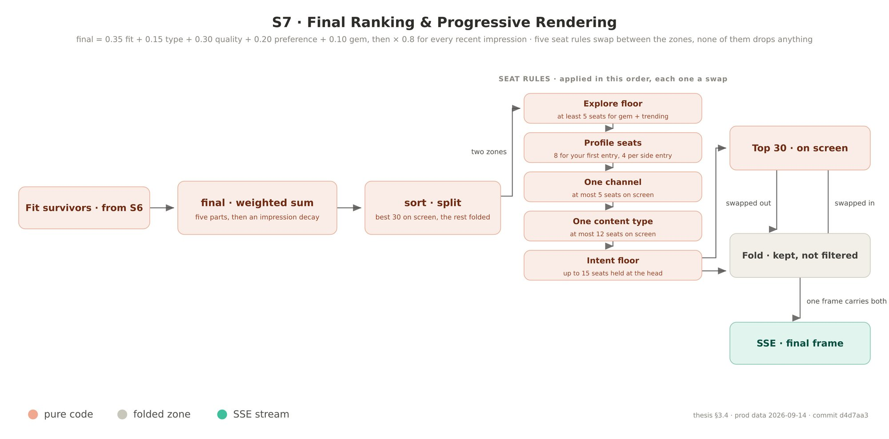

**打分**

```
final = W_FIT × 契合分 + W_TYPE × 类型权重 + W_QUALITY × 质量归一值 + W_PREF × 频道偏好分 + GEM_BONUS × 是否小频道挖掘
      = 0.35 × fit + 0.15 × type + 0.30 × quality + 0.20 × pref + 0.10 × gem
final ×= IMPRESSION_RANK_DECAY ^ (72 小时窗口内的上屏次数)      # 0.8;意图卡豁免
```

- **类型权重**:每个模式把 17 种类型分到四档(`MODE_TYPE_BUCKETS`,用户可覆盖),四档权重 `TYPE_BUCKET_WEIGHTS` = [1.0, 0.7333, 0.4667, 0.2];未知类型 0.6,明确判为 `other` 的 0.2。
- **频道偏好分**:从数据库读,这里不重算;没有记录的中性 0.5。它已经包含了冷却期的软降权。
- 模式匹配(契合 + 类型)是最大的一轴,质量第二,偏好有上限(避免过拟合旧口味),小频道是一个小常数推力。

**排序前后的处理**,按执行顺序,后做的可以覆盖先做的:

| 序 | 处理 | 规则 | 是否删除 |
|---|---|---|---|
| 1 | 小频道中位数过滤 | 小频道挖掘来的候选 ≥ `GEM_MEDIAN_MIN_N` = 4 条时,小频道分严格低于中位数的丢弃并记账(`gem_below_median`)。小频道分 = 互动率 × 播放量系数(2,000~30,000 为 1.0,更低 0.7,更高 0.5)× 订阅数系数(低于 20 万 × 1.2) | **是**(唯一删除的一步) |
| 2 | 同频道新上传优先 | 同一频道两张卡分差 ≤ `RANK_RECENCY_TIE_DELTA` = 0.02 视为平手,新上传的在前;顺序编码进 `final` 的 1e-6 级差值,后面每一步重排都保得住 | 否 |
| 3 | 切分 | 按 `(-final, video_id)` 排序,前 `TOP_N` = 30 进上屏区,其余进折叠区 | 否 |
| 4 | 探索位下限 | 上屏区里「小频道 + 热门」至少 ⌈30 × `EXPLORE_SLOT_FLOOR`⌉ = 5 张;不够从折叠区提升最好的,降下上屏区最弱的非探索卡;没货不强求 | 否,换位 |
| 5 | 画像席位 | 见下 | 否,换位 |
| 6 | 单频道上限 | 每个频道最多 `RANK_CHANNEL_CAP` = 5 张;钦点席优先保留;意图卡不计 | 否,换位 |
| 7 | 单类型上限 | 每种类型最多 `RANK_TYPE_CAP` = 12 张;补位时也遵守单频道上限 | 否,换位 |
| 8 | 意图保底 | 意图来源的卡按 `W_FIT×fit + W_QUALITY×quality` 取前 `INTENT_RESERVED_SLOTS` = 15 张置顶(当前的意图刷新走轻量快照,不经过排序,这一步对常规刷新是空操作) | 否,换位 |
| 9 | 单来源上限 | 任一来源在上屏区不超过 ⌈`SOURCE_MAX_SHARE` × 上屏数⌉(0.5 → 15 张);意图卡不计;已入席的卡不换出 | 否,换位 |
| 10 | 两侧软保底 | 「我的频道」与「类型池」在频道类卡中任一侧低于 `SOURCE_MIX_FLOOR` = 0.35 且折叠区有货,就换位;分母太小时不动 | 否,换位 |
| 11 | 曝光尾席 | 见 §5.13 | 从卡片池取,不在守恒等式内 |

所有换位都是纯换位:上屏区 + 折叠区的总集合不变,不写账。每一步换入一张卡之前都先检查该频道在上屏区是否已满 5 张,单频道上限是硬约束。

**画像席位**(`_apply_profile_diversity`)

自动模式下,席位计划由 `diversity.draw_featured_subs` 在 S0 抽出:

- 第 1 条画像(档 1)恒定拿 `DIVERSITY_TIER1_SEATS` = 8 席。
- 第 2 条起每条独立抽签,概率按位次递减 `DIVERSITY_SUB_BASE_WEIGHTS` = [0.6, 0.45, 0.3, 0.2](更靠后的沿用最后一个值);中签的每条 `DIVERSITY_SUB_SEATS` = 4 席,最多 `DIVERSITY_MAX_SUBS` = 3 条。
- 近 `DIVERSITY_PLAY_WINDOW_SEC` = 600 秒内播放过的条目,抽签权重 × 2(封顶 `DIVERSITY_WEIGHT_CAP` = 0.9,所以从不是必中),席位也翻倍。
- 连续 `DIVERSITY_MISS_FORCE` = 3 次没抽中的条目强制入选;一次也没抽中时,补上连续落空最久的那条。
- 随机数以刷新 id 为种子,可复现。
- 每条画像在上屏区最多 `DIVERSITY_ENTRY_CAP` = 12 张。

手动占比模式下(用户在设置里给每条画像分了百分比,合计 100):每条的席位 = round(占比 × `SEAT_PROFILE_SHARE_PCT`% × 30),即画像整体只拿 85%,剩下 15% 默默留给探索;不抽签、不加权、不强制,单条上限关闭。

执行时,每条画像按位次认领自己的席位,条内顺序是:

1. **钦点席**:该条画像的种子频道的卡,档 1 最多 `SEED_TIER1_SEATS` = 3 张,其余条目最多 `SEED_ENTRY_SEATS` = 2 张。按频道 id 认领,不看来源标签,所以同一个频道从「我的频道」轨来的卡也算。认领时把归属改写为本条。
2. **关注席**:归属于本条、且来自已关注频道、偏好分 > `FOLLOW_SEAT_MIN_PREF` = 0.6 的卡(`FOLLOW_ENTRY_SEATS_ON`)。阈值让「关注了但从没点过赞」的频道按分数竞争,而不是插队。
3. 其余归属于本条的卡,按 `final` 降序。

席位绝不用占位卡填。如果判官整批都没给出画像归属(降级),退回用「内容类型是否属于该条画像的基础类型」来判断。被认领的卡标记为 `seated`,之后的来源上限和软保底不会把它换出去。

### 5.10 意图快车道

用户在某个模式下输入一句话(例如「想看神经网络底层原理讲解」),它在一段时间内(私有配置,约半小时)是这个模式的**会话意图**。意图只在声明它的模式里生效,不串到其他模式。

有意图时走**轻量意图刷新**,整个常规流程让路:

1. **跳过**规划器、来源配比、常规检索、画像席位抽签和排序。
2. **扩词**:原文永远是第一个词,LLM 再给出至多 `INTENT_SEARCH_MAX` − 1 个变体(中英双语、子角度、同义说法,必须仍然精确指向用户点名的主题,不能泛化成上位类目)。扩词失败就只搜原文。
3. **本地先找**:用 jieba 分词后的原文查本地全文索引,应用模式时长窗口,排除明确不喜欢和已看过的视频,最多 `INTENT_LOCAL_K` = 45 条,零 API。
4. **搜索次数**:默认 `INTENT_LITE_QUERIES` = 6 个词;本地命中已经 ≥ `INTENT_LITE_TOP` = 15 条时减到 `INTENT_LITE_QUERIES_MIN` = 1 个(原文照搜,以接住库里还没有的新内容)。再受搜索桶余量和该用户今日意图搜索余额(`INTENT_SEARCH_DAILY_MAX` = 40)约束。每个词保留相关度前 `INTENT_PER_QUERY_KEEP` = 10 条。
5. **意图通行证**:本地召回和搜索包里的视频都标记 `intent_sourced`。这个标记只有编排器能发,规划器输出里的同名字段会被清零。
6. S3 只做拉黑和 60 秒下限检查;S5 队列意图优先;第一波里前 `INTENT_FIRST_WAVE_MAX` = 15 条意图候选排在最前,不和常规候选抢截断名额;S5 第一批里通过的意图候选不等攒满整批,立刻发一波 S6。
7. S6 用意图裁定前缀,不查缓存。S7 照常应用排除类型(这是用户明说的,意图不豁免)。
8. **轻量快照**:按 `W_FIT×fit + W_QUALITY×quality` 取前 15 张,`overlay=True`,前端把它们插到当前屏幕的最前面,原有的卡往下挪,而不是整屏替换。没被选中的候选记一行 `intent_lite_overflow`,保持守恒。频道偏好分不参与,因为意图召回的多半是用户没见过的频道。
9. **补位**:上屏区剩下的位置从冷启动货架补,只取用户前 `INTENT_FILL_BUCKET_TIERS` = 2 档的内容类型,按类型轮流取,零配额、零 LLM,不在守恒等式内。

**已看过视频的一次性通行**:看过的视频通常在禁推期内不出现,但意图搜索命中的已看视频可以出现**一次**;出现之后通行证就用掉了。

后台的预备批永远不消费意图(`consume_intent=False`),否则意图卡会在后台被提前跑掉、失去置顶位置,还白白花掉意图搜索额度。

### 5.11 画像条目与子方向轮转

用户在每个模式下可以写若干条画像(私有配置,每模式最多 6 条),用自己的话,可以重排、编辑、删除。**第一条就是档 1**,是这个模式下最重要的兴趣。产品红线:用户写的东西可见可改;系统推断出的状态从不以「这就是你」的形式展示。

保存时,画像条目翻译器为每条派生:基础类型(最多 2 个)、一条代表性搜索词(原文语言)、英文搜索词、细分兴趣标签(最多 `ENTRY_CHIPS_MAX` = 3 个)、英文译文。子方向派生器再为每条给出 `ENTRY_SUBTOPICS_MIN`~`ENTRY_SUBTOPICS_MAX` = 8~12 个子方向,每个带中英两个搜索词。

一份画像有五个用处:

| 用处 | 机制 |
|---|---|
| 搜索 | 每次刷新最多 `MAX_SEARCH_PER_REFRESH` = 2 个画像搜索词(见下) |
| 种子频道 | 主推条目上用户钦点的频道,每次刷新最多 `SEED_FETCH_CHANNELS_MAX` = 10 个,每个取最新 `SEED_FETCH_PER_CHANNEL` = 3 条;档 1 的种子频道每次全部先取(`SEED_TIER1_FETCH_ALL`),其余条目轮询 |
| 扩充频道 | 由频道贴合判官核验过的同类频道,每条主推条目按游标轮取 `EXPAND_FETCH_PER_ENTRY` = 3 个,每次最多 `EXPAND_FETCH_CHANNELS_MAX` = 6 个,每个取 `EXPAND_FETCH_PER_CHANNEL` = 3 条;跳过已关注和本次的种子频道;游标只在真正注入后前进,被预算挡下的下次重试 |
| 判官方向 | 本模式画像全文进 S6 用户提示词,判官同时输出画像归属 |
| 席位 | §5.9 |

**搜索词顺序**(`order_profile_queries`):档 1 → 本次抽中的副档(按游标轮转,避免只剩一个名额时总是档 2)→ 其余条目(按游标轮转);全部被排除类型覆盖的条目不花搜索。`PROFILE_SEARCH_TIER1_RESERVED` = 1 保证档 1 排在最前。手动占比模式下改为按占比加权无放回抽取顺序。

**子方向轮转**(`subtopics.entry_rotation`):每条画像维护自己的游标,轮转序列是 `[代表性搜索词] + [每个子方向的搜索词]`。游标 0 永远是代表性搜索词,所以刚保存的条目第一次刷新和没有子方向时完全一样。英文界面优先用英文词。三个开关可以退回只用代表性搜索词:`PROFILE_SUBTOPICS`、`PROFILE_SUBTOPIC_SEARCH`,以及用户自己的「发散搜索」设置。子方向的向量同时并入候选库重排和第一波排序(§4.4)。

**闸门**:搜索桶低于 `SEARCH_FLOOR_PROFILE` = 20 时,画像搜索和规划器的自由搜索全部让路,刷新照样出卡;每个用户每天画像搜索加自由搜索合计不超过 `PROFILE_SEARCH_DAILY_MAX` = 40。试用账号在全站搜索余量低于 `TRIAL_SEARCH_FLOOR` = 40 时,所有搜索路径读到的余量都是 0。

**另一份画像**:聊天助手静默提取的信号写入画像原文里两个系统维护区:短期区(先进先出最多 `CHAT_SHORT_MAX` = 8 条,`CHAT_SHORT_TTL_DAYS` = 30 天过期)和长期区(按模式分桶,每桶最多 `CHAT_LONG_MAX` = 12 条,`[日期|xN|模式] 文本` 的频次账,同义的由 LLM 判定后合并,满员时先淘汰次数最少的)。画像结构化器把用户手写区和这两个区一起拆成六字段,只装用户明说的内容,禁止推断年龄、性别、职业等未声明属性。这份结构化画像只给 S1 规划器用。

### 5.12 长期观看计划

用户可以和计划助手对话,起草一份多日观看计划。计划有两种:**渐进式**(由浅入深的课程)和**主题轮换式**(同一主题下不重复的子话题)。每份计划最多 `VIEWING_PLAN_STAGES_MAX` = 8 个阶段、总长 `VIEWING_PLAN_DAYS_MAX` = 30 天,每天默认 `VIEWING_PLAN_DAILY_DEFAULT` = 5 张、最多 `VIEWING_PLAN_DAILY_MAX` = 10 张;每阶段最多 `VIEWING_PLAN_KEYWORDS_PER_STAGE` = 5 个搜索词。LLM 产出的草案由纯函数 `sanitize_draft` 清洗。

每天的出卡由 [`pipeline/viewing_plan_run.py`](../src/pipeline/viewing_plan_run.py) 完成,这是与 `orchestrator.run` 平行的第二个、非流式的编排入口。计划被当作「定时的意图包」:

```
当前阶段的搜索词作为意图包注入(不扩词,最多 VIEWING_PLAN_SEARCH_MAX = 5 个)
→ S2 → 显式减去禁推名单和本计划已出过的视频(计划没有一次性通行证)
→ S3(意图分支)→ S4 → S5 → S6(计划裁定前缀,不注入画像和负偏好)→ S7
→ 按 fit + quality 取前 daily_count 张
```

不排序、不写卡片池、不触发预备批。搜索桶余量不足 `VIEWING_PLAN_MIN_QUERIES` = 2 次时当天放弃,不跑残缺的包。S2 零召回时报「配额」错误而不是缓存一个空结果,否则用户当天剩下的时间都不会有卡。

### 5.13 反馈信号

**频道偏好分**(存储层,私有):0~1,拉普拉斯平滑:`(赞 + 2×收藏 + 1) / (赞 + 2×收藏 + 踩 + 2)`。一次赞 0.667,一次踩 0.333;收藏按两个赞计。没有反馈过的:Takeout 导入、关注按钮、手动种子初始 0.6,离线发现 0.5。关注按钮只设标志位,不改已学到的分数。偏好分用在四处:进不进「我的频道」轮转池、轮转权重、能不能先认关注席、排序公式的 0.2 权重。

**「不喜欢」的分流**:用户点「不喜欢」时选一个理由(`DISLIKE_CHIP_LABELS`,六选一)。

| 理由 | 处理 | 是否调 LLM |
|---|---|---|
| 这个频道推太多了 | 第一次:该频道权重减半一段时间;短期内再点:频道进入冷却,时长逐次加倍(私有配置) | 否,API 层直接处理 |
| 不喜欢这个频道的内容 | 按多倍点踩当量压低偏好分;累计到阈值时提示用户拉黑或取消关注 | 否 |
| 对这个题材不感兴趣 / 内容质量差 / 不想在此模式看这类 / 其他 | 负偏好裁定官结合本模式画像,把它归纳成一条题材级负偏好,或并入已有的一条(每模式条数有上限),进 S6 提示词 | 是 |

无论哪种理由,这一条视频在这个模式下都永远不再推荐。

**各种「不推」与「少推」**

| 机制 | 触发 | 效果 | 时效 |
|---|---|---|---|
| 拉黑频道 | 用户操作 | 轮转池、S3、秒开路径全部剔除 | 永久 |
| 频道冷却 | 「推太多了」反复点 | S3 按 `channel_cooldown` 拦截 | 到期解除 |
| 排除内容类型 | 设置页 | S7 拦截(豁免档除外) | 永久 |
| 明确不喜欢(视频级) | 不喜欢弹框 | S2 之前就排除 | 永久 |
| 已看过 | 播放过,或点赞/收藏过 | S2 之前就排除;播放的禁推 7 天,点赞/收藏的 30 天(私有配置);意图命中可一次性放行 | 到期解除 |
| 曝光惩罚 | `IMPRESSION_SUPPRESS_TTL_HOURS` = 72 小时内上屏 ≥ 2 次但没点开 | 72 小时内不进新鲜管道;进了排序也要 × 0.8^次数 | 72 小时 |
| 曝光尾席 | 惩罚期内的卡 | 只能出现在上屏区末尾,见下 | — |

原则:**「明确说了不要」永远压过「只是没点开」。**

**曝光尾席**(`_impression_tail_cards`):被惩罚的卡不是被封禁,而是只能坐在上屏区最后 `IMPRESSION_TAIL_SEATS` = 10 个位置里;即使新鲜卡已经填满 30 张,也固定让出 `IMPRESSION_TAIL_FIXED_SEATS` = 3 席。候选必须是质量 ≥ `TAIL_HIGH_QUALITY_MIN` = 0.8 或来自本模式种子频道的卡,按曝光次数升序轮转。它们直接从卡片池取:当初上屏时已经过 S3~S7,质量、理由、类型都在池子里,不重判、不调 LLM(送回管道会让 S6 的调用量翻五到八倍)。拉黑、排除类型、明确不喜欢、已看过都压过尾席。尾席同样遵守单频道上限。挤出的上屏卡顺延到折叠区。后台预备批不加尾席,尾席在出卡时才补。

**申诉**:用户可以对任意一条被滤掉的视频申诉。申诉在周度复审中由人裁定;受理后成为长期豁免:以后再取到这条视频时,它跳过 S3~S7,直接放在最前面,理由是 `APPEAL_EXEMPT_REASON`。显式申诉压过隐式的曝光惩罚。

### 5.14 冷启动与预备货架

**冷启动**:新用户的第一份种子偏好有三个来源,都是显式的:

1. 向导里勾选兴趣标签(44 个 `INTEREST_CHIPS`,每个挂在 17 种类型之一下面),并为每个模式写下画像条目;
2. 可选地上传 Google Takeout 导出的订阅列表(`sources/takeout.py`:按列位置而不是表头解析,校验频道 id 格式,只在该用户对该频道还没有偏好记录时写入 0.6 的种子分,重复导入不会覆盖已学到的分数);
3. 在画像条目上钦点种子频道。

还没有偏好频道时,来源配比自动把频道类供给全部给类型池(§5.2),类型池按勾选的兴趣标签取频道。秒开路径没有存货时,从**冷启动货架**(按兴趣标签预先备好的卡)轮流取卡。

**卡片池与预备批**(`pipeline/prewarm.py`):每次刷新的终局快照都写进「用户 × 模式 × 语言」的卡片池(失败柔性:池是加速器,不是主路径)。每交付一批,API 就尝试在后台为同一个键再跑一次完整的 `orchestrator.run`,丢弃中间帧,只要它写进卡片池的终局结果;用户点「N 条新内容」时秒换。启动条件:

1. 事件循环可用(测试和离线脚本里永远不启动);
2. 这个键上没有正在跑的预备;
3. 不是试用账号;
4. 货架上没有一批新鲜的、未上屏的存货(最多领先一批);
5. 今天剩余刷新次数 ≥ `PREWARM_MIN_CREDITS_LEFT` = 2,最后几次留给用户。

预备批计入每日刷新次数。唯一的触发点是「一批交付了」;预备完成**不会**触发下一次预备,否则在复用旧计划只能取回旧视频的安静时段,会链式烧光额度。

### 5.15 四个模式

| | 专注 | 娱乐 | 探索 | 睡前 |
|---|---|---|---|---|
| 意图 | 工作学习时的陪伴:同域的技能内容,或不抢注意力的背景声 | 放松、开心、满足好奇,不是变得更好 | 有信息量的新东西:科普、原理、严肃纪实 | 只许安抚,不许唤醒 |
| 时长窗口 | ≥ 180 秒 | 10~1,800 秒 | 180~10,800 秒 | ≥ 300 秒 |
| YouTube 分类白名单 | 10 音乐、24 娱乐、27 教育、28 科技 | 23 喜剧、24 娱乐、1 影视动画、19 旅行、15 宠物 | 28 科技、22 人物博客 | 22 人物博客、15 宠物、26 生活技巧 |
| 黑名单词举例 | reaction、drama、shocking、震惊、吐槽 | tutorial、course、productivity、教程、职场、考研 | career、layoff、get rich、副业、内卷、塌房 | horror、debate、vs、恐怖、干货、考试 |
| 小频道挖掘 | 关 | 开 | 开 | 关 |
| 直通阈值 | 0.65 | 0.67 | 0.67 | 0.65 |
| 判官失败时 | 放行 | 放行 | 放行 | **拒绝**(唯一的严格模式) |
| 类型第一档 | 职业实操、科技、专业知识 | 喜剧、体育游戏、音乐、影视动漫 | 专业知识、纪录片、科技 | 治愈生活、环境声、音乐 |
| 判官要点 | 工作同域内容是正例;历史政治等敏感题材一律拒;纯环境音即使标题带「助眠」也合格,有人声引导入睡的拒 | 一切学习、技能、自我提升导向的内容都拒,哪怕质量很高;企业宣传拒;沉重严肃叙事拒 | 体系化教程也合格;收入承诺标题不构成拒因,交给排序压低;严肃历史政治纪实看创作者信誉和叙述克制;小频道拿敏感话题博眼球的拒 | 任何引发思考、强情绪、高信息密度的都拒;拿不准就拒 |

每个模式的搜索地区是 `US`(YouTube 不支持 CN 地区),搜索语言偏置 `zh-Hans` 只加在含中文的搜索词上。模式定义在 `config.py` 的 `FOCUS`、`ENTERTAINMENT`、`EXPLORE`、`WIND_DOWN` 四个实例里,`Mode.llm_system_prompt` 刻意留空,判官总是按 `fit_{模式名}` 去注册表里取提示词,避免同一份文本存两处而漂移。

---

## 6. 可靠性与降级矩阵

| 阶段 / 部件 | 故障 | 行为 |
|---|---|---|
| S0 状态机 | 数据不足、通过率为空 | 判为活跃,走 S1 |
| S0 计划复用 | 过期、反序列化失败、今日预算重校验不过 | 不复用,走 S1 |
| S1 规划器 | 校验不过 | 带原因重规划一次 |
| S1 规划器 | 再不过,或任何 LLM 异常 | 用 `DEFAULT_PLANS`,来源记 `default` |
| 意图扩展 | LLM 失败 | 只搜原文 |
| 搜索桶 | 剩余 < 20 | 画像搜索与规划器自由搜索全部让路;频道、类型池、热门、候选库照常出卡 |
| 搜索桶 | 意图搜索时余量为 0 | 不注入搜索包,只用本地全文召回 |
| S2 预算守卫 | 估算成本超过今日余量 | 拒绝执行,刷新以 `error` 事件结束,卡片池保留上一次的结果 |
| S2 某条策略 / 某个频道 | 异常 | 记日志后跳过,其他策略和频道继续 |
| S2 深翻页 | 游标读取失败 / 翻页失败 | 只取第一页 / 保留已收集的、游标清零 |
| S2 补全 | 某些 id 没返回(删除、私有、地区屏蔽) | 丢弃这些 id |
| 向量 | sqlite-vec 不可用、开关关闭、条目还没有向量 | 混合检索退成纯全文;重排保持原顺序;第一波只按统计分 |
| S5 质量判官 | 批校验不过 | 整批重试一次 → 升级到更强模型一次 → 降级 |
| S5 质量判官 | 降级 | 非严格模式统计分 ≥ 0.4 放行,睡前全拒;降级结果不缓存 |
| S6 契合判官 | 批校验不过 / 异常 | 同上;降级为中性分 0.5 放行(第一波不升级),睡前全拒;不缓存 |
| S6 缓存 | 读失败 / 写失败 | 视为全部未命中 / 只告警 |
| 偏好读取(类型分档、排除类型、配比) | 存储的数据损坏 | 回退默认值并告警;排除清单里个别词表外的值只丢这一个 |
| 画像归属 | 越界、非整数、判官降级 | 置空;席位退回按基础类型匹配 |
| 落账与守恒校验 | 任何异常 | 记脱敏后的 ERROR 日志,终局帧照发 |
| 守恒不成立 | — | 记 ERROR 日志,不让刷新失败 |
| 卡片池写入 | 异常 | 记日志,不影响本次刷新 |
| SSE | 管道中途异常 | 发固定文案的 `error` 事件(带刷新 id),不发 `done`;异常原文只进脱敏日志 |
| SSE | 客户端断开 / 切模式 | 取消一路传到编排器和判官,未完成的生产者和批任务全部取消 |
| 预备批 | 异常 | 记日志;已扣的刷新次数不退 |
| 画像结构化 | LLM 失败 | 原文已保存,结构化结果为空,规划器读截断原文 |
| 画像条目派生 / 子方向 | LLM 失败 | 存空派生;搜索只用代表性搜索词 |
| 聊天 / 观看计划起草 | LLM 失败 | 固定文案回复,不产出信号或草案,接口永不 5xx |
| 负偏好裁定 | LLM 失败 | 原始理由照存,这条视频照样永不再推 |
| 观看计划出卡 | S2 零召回 / 判官整体失败 | 报「配额」/「LLM」错误,不缓存空结果 |
| 离线频道发现 | LLM 失败 | 按主题分类出词、按硬指标排序 |
| 日志 | 异常文本里有 API key、会话令牌、Bearer 令牌、Anthropic key | 统一经 `core/logsafe.py` 脱敏,其余内容逐字保留 |

---

## 7. 代码地图

| 章节 | 文件 |
|---|---|
| §2.5 先规划后执行 | [`agent/planner.py`](../src/agent/planner.py)、[`sources/youtube.py`](../src/sources/youtube.py)(`execute_plan`) |
| §3.2 分层 | [`agent/__init__.py`](../src/agent/__init__.py)(各 agent 的共同约定)、[`storage/db.py`](../src/storage/db.py)(门面) |
| §3.3 一次刷新 | [`pipeline/orchestrator.py`](../src/pipeline/orchestrator.py)(`run`) |
| §3.4 渐进波次 | `orchestrator.py`(`_truncate_first_wave`、`_pump_first_wave`、`_pump_s5`、`_drain_whole_batches`) |
| §3.5 守恒等式 | `orchestrator.py`(`conservation_check`) |
| §3.6 模型与成本 | [`config.py`](../src/config.py)、[`core/costing.py`](../src/core/costing.py)、[`core/llmmeter.py`](../src/core/llmmeter.py) |
| §3.7 脱敏 | [`core/logsafe.py`](../src/core/logsafe.py) |
| §4.1 agent 层 | [`agent/`](../src/agent/) 全部;提示词 [`agent/prompts.py`](../src/agent/prompts.py) |
| §4.2 管道阶段 | [`pipeline/`](../src/pipeline/) |
| §4.3 工具层 | [`sources/base.py`](../src/sources/base.py)、[`sources/youtube.py`](../src/sources/youtube.py) |
| §4.4 存储与检索 | [`storage/retrieval.py`](../src/storage/retrieval.py)、[`sources/embeddings.py`](../src/sources/embeddings.py)、[`core/embed_text.py`](../src/core/embed_text.py)、[`core/fit_cache.py`](../src/core/fit_cache.py) |
| §4.5 SSE | [`api/sse.py`](../src/api/sse.py)、[`api/schemas.py`](../src/api/schemas.py) |
| §5.1 S0 | [`pipeline/stability.py`](../src/pipeline/stability.py) |
| §5.2 S1 | [`agent/planner.py`](../src/agent/planner.py)、[`pipeline/mix.py`](../src/pipeline/mix.py)(`apply_pool_ratio`)、[`pipeline/prefs.py`](../src/pipeline/prefs.py)、`config.py`(`DEFAULT_PLANS`) |
| §5.3 S2 | [`sources/youtube.py`](../src/sources/youtube.py)(`_run_strategy`、`fetch_channel_videos_deep`、`_weighted_sample_channels`、`dedup`、`_truncate_by_target`) |
| §5.4 S3 | [`pipeline/prefilter.py`](../src/pipeline/prefilter.py) |
| §5.5 S4 | [`pipeline/triage.py`](../src/pipeline/triage.py) |
| §5.6 S5 / §5.7 S6 | [`agent/judges.py`](../src/agent/judges.py)、`orchestrator.py`(`_fit_with_cache`、`fit_effective`、`quality_norm_of`) |
| §5.8 S7 | [`pipeline/prefs.py`](../src/pipeline/prefs.py)(`partition_excluded`)、[`pipeline/diversity.py`](../src/pipeline/diversity.py)(`exempt_positions`、`effective_excluded`) |
| §5.9 排序与席位 | [`pipeline/ranker.py`](../src/pipeline/ranker.py)、[`pipeline/diversity.py`](../src/pipeline/diversity.py)、[`pipeline/mix.py`](../src/pipeline/mix.py) |
| §5.10 意图快车道 | [`agent/intent_search.py`](../src/agent/intent_search.py)、`orchestrator.py`(`_lite_plan`、`_lite_snapshot`、`_intent_fill_cards`、`_inject_intent_package`)、`retrieval.py`(`intent_local_candidates`) |
| §5.11 画像条目 | [`agent/profiler.py`](../src/agent/profiler.py)、[`pipeline/subtopics.py`](../src/pipeline/subtopics.py)、`diversity.py`(`order_profile_queries`、`weighted_profile_queries`)、[`core/profile_sections.py`](../src/core/profile_sections.py)、[`agent/chat.py`](../src/agent/chat.py) |
| §5.12 观看计划 | [`agent/viewing_plan.py`](../src/agent/viewing_plan.py)、[`core/viewing_plan.py`](../src/core/viewing_plan.py)、[`pipeline/viewing_plan_run.py`](../src/pipeline/viewing_plan_run.py) |
| §5.13 反馈信号 | [`agent/neg_prefs.py`](../src/agent/neg_prefs.py)、`orchestrator.py`(`_impression_tail_cards`、`_apply_consumed_filter`) |
| §5.14 冷启动与预备 | [`pipeline/prewarm.py`](../src/pipeline/prewarm.py)、[`sources/takeout.py`](../src/sources/takeout.py)、`orchestrator.py`(`_write_pool_safe`) |
| §5.15 四个模式 | `config.py`(`FOCUS`、`ENTERTAINMENT`、`EXPLORE`、`WIND_DOWN`、`MODE_TYPE_BUCKETS`)、`prompts.py`(`fit_*`) |
| 离线频道发现 | [`agent/discovery.py`](../src/agent/discovery.py) |
| 测试 | [`tests/`](../tests/)(不连数据库、不联网、不需要 API key) |
